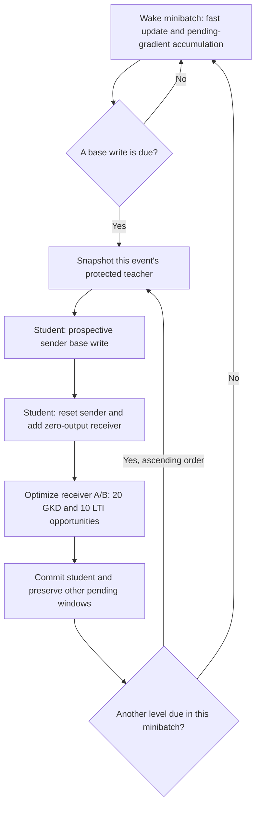

# Sleep alignment: implemented mechanisms and local assumptions

This is an implementation comparison, not a claim of numerical reproduction. Banking V10 training and V11 ablations have separate frozen artifacts and result reports. The primary source is [Sleep v2](https://arxiv.org/html/2606.03979v2); the distinctions below use Sections 3.2-3.3, 4.1 and Appendix B.

| Area | Explicit paper design | Current local implementation |
|---|---|---|
| Boundary lifecycle | Pre-update teacher; prospective/reset student; optimize expanded parameters; then commit. | Implemented with separate contexts, protected-state checks, pending gradient windows and checkpoint replay checks. |
| Expansion | New low-rank experts in slower sparse memory modules. | Five last-MLP memory levels on a frozen Llama-3.2-3B base backbone; rank 64 and eight stored slots per bank. Additive receiver routing is our intervention. |
| Distillation | Teacher/student-policy samples and a generic divergence; sampling has no gradient. | Alternating teacher/student GKD rollouts, teacher-to-student token KL, and separate LTI updates. This is a local objective assembly. |
| Imitation | Frozen semantic reward model plus thresholded, length-normalized edit reward. | Canonical-label equality replaces the learned semantic model. The formal CLINC V8 runner and Banking V10 use the length-normalized edit formula. |
| Classification | Llama 3B/8B, CLINC/Banking/DBpedia, accuracy, consolidation without Dreaming. | The present controlled grid uses a 3B base model and Banking77. It does not establish an 8B or DBpedia result. |
| Optimization table | Appendix B.4 Table 5 separately gives Sleep learning rate 5e-6, effective batch 32, 100 steps, LoRA rank 64 and alpha 128. | Wake fast/base rates are 0.1/0.001 with wake minibatch 8. Receiver AdamW uses 0.001, one replay request per update without gradient accumulation, and 30 receiver opportunities per event. These are different parameterizations and budgets. |

The accessed manuscript does not identify a complete classification recipe: exact checkpoint revision, prompt/tokenization, class orders, split IDs, decoder, clock units, or all optimization settings. Its long-context frequency ablation does not establish a classification-optimal minibatch schedule.

Table 5 is explicit numerical evidence, not a missing table. Its connection to the individual class-incremental wake/base/receiver optimizers and per-boundary work is not specified, and its LoRA alpha does not have a direct configured counterpart in our CMS matrices. We therefore list these differences rather than silently applying the table to one local optimizer and calling that a faithful classification replication. The V11 contrast keeps the local optimizer/budget fixed to isolate its reward intervention; it does not close this optimization gap. Likewise, Appendix B's five added dimension-64 MLP blocks must not be equated automatically with our five rank-64 memory levels.

The effective consolidation batch is one request, not eight: `run_sleep_event` loops over individual selected requests, and `AdditiveSleepTransaction.optimize` clears gradients and performs an AdamW step for each non-skipped scalar objective. The gold control likewise uses one selected request per receiver step. Wake batching, candidate-scoring batching and consolidation batching are separate quantities. This is a concrete optimization mismatch with Table 5; it is not evidence that batching alone caused the observed accuracy gap.

Appendix B.1 specifies a 70-class, level-2 DBpedia setting with 10,000 training and 1,000 test examples. A future DBpedia extension would need to establish that source and sampling protocol; the common 14-class corpus would not automatically match it. This release makes no DBpedia result claim.

Our explicit assumptions include a shared CMS-only task-0 foundation, two fixed epochs per task, seven tasks of eleven classes, class-order seeds 17/29/43, shared initialization seed 1907008, batch 8, periods 16/64/256/1024/held-fixed measured in minibatches, and 30 consolidation opportunities per event. The first task has no Sleep in this controlled design. Pending windows continue across task boundaries.

Here pre-update means before the due sender **base-matrix** write. The fast expert has already received its current minibatch update in `record_tick` before the boundary teacher is constructed. The teacher is therefore not a snapshot from before that minibatch or before the task switch. Simultaneously due levels are processed in ascending order. These are local wake/lifecycle choices, not details established by the manuscript.

Only the shared task-0 foundations have an acquisition gate. Subsequent event teachers are protected during their own transaction but are not each requalified for old-task accuracy. This leaves teacher drift under preceding new-task wake updates as a possible cause alongside receiver fit, routing and the local reward. The V11 controls vary the reward term and do not remove those other mechanisms.

This is the local Sleep path. Each simultaneous event receives its own teacher; a later event sees the earlier committed event. The diagram does not imply a teacher captured before the fast update or a joint all-level transaction.

Prompts retain the historical segmented, no-BOS encoding in both training and evaluation. All 77 labels round-trip through the tokenizer; ten tokens cover the longest label plus EOS. The primary readout scores every canonical label, including EOS, with no task mask. It supplies the complete label dictionary and substantial inference work. Free generation and token-mean scoring are separately named diagnostics, rather than interchangeable accuracy measures.

The publisher training split is deduplicated before a deterministic ten-per-class development carveout. The official test is reserved until all nine main runs are sealed. The shared foundation must satisfy the fixed old-task development gates for all three seeds. These are our safeguards and assumptions, not a claim that the paper specified these sample IDs or gates.

The additive path can execute several experts for one token, unlike natural top-one routing. Its extra branch computation must be counted. Historical `clinc_tail_runtime_v8.parameter_counts` describes natural routing and cannot provide a valid additive execution bound; the additive accounting helper supplies corrected counts while raw receipts retain their original fields. Allocated storage, activated resident weights, unique executed weights and repeated branch work are distinct quantities.

Sleep also retains access to earlier training requests. Its deterministic selector uses task/class metadata to balance old and current inputs; sampled targets, rather than row gold targets, drive its loss. This is extra data access and metadata even though it is not gold-target replay. The archive of 9,229 training requests and the full class dictionary must be reported separately from model checkpoint storage. No future-task requests enter an event before that task becomes current.

The CMS-only reference has neither the expansion nor the extra old-input consolidation passes. A Sleep-versus-CMS difference therefore compares the combined intervention, including data access, parameters and computation. The V11 pair preserves these factors and changes only the stated local reward contribution; it gives a narrower mechanism comparison. The three runs vary class-order and data/sampling seeds while sharing the model initialization, so their sample standard deviation describes these three orders, not independent backbone initializations.

Reserve slots are preallocated in every arm. Stored matrix counts therefore include inactive slots; logical expansion need not increase that stored count. The legacy phrase `activated_resident_mutable_parameters` means the dense-plus-active-slot footprint, not measured physical GPU residency. Peak GPU allocation and checkpoint bytes are separate observed costs. Likewise, backward target-token counts describe loss support, not all executed padded backward positions.

Gold replay is a supervised positive control. It uses additional known target exposures and has different generation/optimization costs. Matching starting states, wake data, receiver allocation and call opportunities does not make it information- or FLOP-matched.

Archived R2 used a different edit denominator. That historical code must not be confused with the formal six-run CLINC V8 result, whose reward was already corrected. Banking's initial draft accidentally selected the archived callback; review caught and corrected that regression before any Banking GPU run.

The V11 controls change only the local reward contribution: one removes it while retaining KL; the other retains it only when the teacher answer matches a canonical label under the frozen runtime normalizer. The gate uses the same global 77-label dictionary already available to the system; it never checks the example's gold label, and a wrong but canonical teacher label remains eligible. Both preserve the same task-1 training schedule and start from the task-0 foundation. A V10 task-1 checkpoint is a comparison reference, never an initialization. These controls investigate a local proxy and are not equivalent to claiming the manuscript's full learned-reward objective. They use train/development data; a previously scored official test cannot provide fresh confirmation for them.

In the transfer probe, a fresh receiver bank has no older active expert. The natural router still has a null bucket, so a singleton expert contributes `gE` with `0 < g < 1`. Fixed mix contributes `(0.5g + 0.5)E`; additive routing excludes that expert from the natural pool and then contributes `E`. These policies already differ in amplitude and gate gradients at the first boundary. The one-boundary result cannot establish how either policy retains a long history.

Recovery scope amendment: the accepted transfer probe compared an in-memory snapshot reconstruction with a disk snapshot reconstruction. Both branches called `from_snapshot`; it did not compare against the original uninterrupted transaction. The separate nine-update qualification subsequently continued the original object through calls 4-6 and compared it with disk restoration: reports and full transaction/Adam/RNG hashes matched exactly. It used 57 full-backbone forwards and 11.188 seconds of activity, with no readout or test access. The qualification amendment was completed after the first two main runs and before official-test acquisition; it changed no main-run arithmetic and does not establish whole-job resumability. The previous evidence and its narrower scope remain preserved.

Development-only plan amendment before official-test access: the completed seed-17 training trace contains 1,640 LTI teacher samples, including 103 canonical answers and 79 matches to the training label. Of 1,294 positive-reward cases, 1,196 had a noncanonical teacher. Only 12 began with EOS, none received positive reward, and task 1 had no such EOS case. An EOS-only reward gate would therefore be a no-op for this seed's task-1 comparison. That unexecuted draft was archived and replaced with the canonical-teacher gate before any V11 configuration or contract was frozen. The row-label agreement is diagnostic evidence only; it is not a new loss target. All 164 seed-17 Sleep/Gold request cohorts matched exactly. This evidence motivates the local reward ablation without establishing that reward quality is the only cause of the poor final accuracy.
