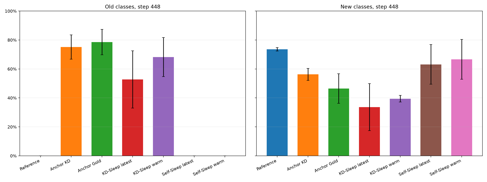
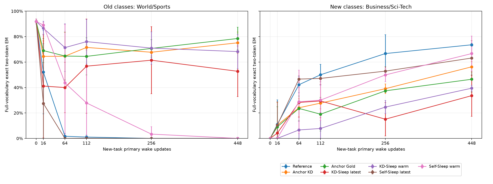

# Anchored wake, routing and Sleep: completed v5 development comparison

**None of the 21 runs satisfies the frozen joint old/new learning gate.** The frozen-teacher wake-KD arm has higher old-task EM and lower new-task EM than the CMS reference (75.13%/56.25% versus 0%/73.57%). This observed contrast bundles additional replay supervision, saved teacher context and computation. The tested Sleep additions do not establish a joint retention-and-acquisition benefit. These are exploratory results on already-used AG News development roles, not independent confirmation, a full Sleep/HOPE reproduction, or a claim that Sleep cannot work.

All seven arms × three seeds completed 448 primary updates. We report all 21 endpoints and all 126 fixed validation states (512 articles per state: 256 old and 256 new), including collapsed seeds. The table is endpoint validation full-vocabulary two-token greedy exact match, mean ± sample SD in percentage points across seeds 17/29/43; no checkpoint/seed selection or p-values.

| Fixed condition | Old EM % | New EM % | Joint gate |
|---|---:|---:|---:|
| CMS reference | 0.00 ± 0.00 | 73.57 ± 1.13 | 0/3 |
| Frozen-teacher wake KD | 75.13 ± 8.40 | 56.25 ± 4.13 | 0/3 |
| Gold old-answer wake replay | 78.52 ± 8.80 | 46.48 ± 10.24 | 0/3 |
| KD + Sleep, latest mixture | 52.73 ± 19.81 | 33.59 ± 16.25 | 0/3 |
| KD + Sleep, warm mixture | 68.23 ± 13.51 | 39.45 ± 2.34 | 0/3 |
| Self Sleep, latest mixture | 0.00 ± 0.00 | 63.15 ± 13.70 | 0/3 |
| Self Sleep, warm mixture | 0.00 ± 0.00 | 66.67 ± 13.76 | 0/3 |

Each task must reach training EM ≥80%, validation EM ≥75%, and validation EM ≥70% in each of its two classes. The joint gate requires both tasks within a run; a high old average alone is insufficient. [Per-seed endpoints and every gate](../results/agnews-anchored-v5/per-seed-endpoints.md), [all fixed trajectories](../results/agnews-anchored-v5/trajectory-table.md), and [11 paired contrasts plus two signed interactions](../results/agnews-anchored-v5/paired-endpoints.md) retain the full comparison.





## Why these interventions

The [completed mechanism diagnosis](agnews-mechanism-v5.md) found heterogeneous base/route effects and local old/new gradient opposition. Frozen receiver parameters alone did not protect the old-task function. Restoring archived base weights and the warm execution state recovers the warm function, but explicitly reintroduces saved information; it does not prove that all knowledge remained in the receiver or that routing alone caused forgetting. Initial failed controls, their executed sources and their costs remain in that report.

The matched 2×3 comparison crosses frozen old-teacher wake KD off/on with no Sleep, P16 latest-receiver mixture and P16 original warm-slot mixture. A seventh gold old-answer replay control uses the same deterministic old sampling schedule. Every arm has the same 448 new-task primary updates, rank16/capacity32, base/expert learning rates 0.02/0.04, CMS periods4/16, clipping1 and qualified warm initialization. All three no-Sleep references reproduce the prior v4 model/controller/execution-policy/RNG states and full validation metrics exactly at steps16 and112 (six checks).

The immutable teacher is the qualified pre-switch warm model, retained separately and sharing only frozen backbone parameters. Soft KD uses old article prefixes and its full output distributions at two answer positions, with the second position conditioned on the teacher's first token; old gold answer fields do not enter this loss. Existing class metadata still balances the four-row old minibatch, so this is not wholly label-free. New CE and old auxiliary backward passes precede one clipping/CMS collection; auxiliary work does not advance the primary update clock twice. The fixed coefficient is1, temperature1, without a search. Gold directly uses old-answer targets and has different compute from KD.

P16 Sleep performs 28 events/run ×24 Adam updates/event: 16 GKD (eight teacher-context and eight on-policy) plus eight LTI, learning rate0.003, two answer tokens, no Dream. Each event uses a fixed balanced train-only prefix pool. Its teacher remains the current self candidate with due slow proposals; the archived teacher is used only by wake KD. Warm-mixture arms change post-Sleep wake policy to slot0 mixture0.5; Sleep still trains the new receiver at mixture0.5. This deliberately changes train-to-wake policy and coefficient and may hinder adaptation; it is not a silent bug fix or an isolated test of retrieval starvation. Final Sleep active slots are [0,29], within capacity32.

## Separate retained-context routing control

After the frozen seven-arm study finished, a separate fixed capacity/routing diagnostic retained the complete qualified warm and new-CMS-reference endpoint adapter states. It did not consolidate them into one model. A hook extracts the original final-MLP output before memory adapters at the last article-prefix position, piggybacked on the warm branch's scoring forwards. It fits one float64 dual ridge selector per seed on the existing1,024 training task-group labels (old=-1/new=+1), using training-only normalization, fixed regularization1 and threshold0. No validation labels enter fitting, no hyperparameters are searched, and no language-model gradient or optimizer update occurs. Group identity is derived from existing class metadata; it is additional supervision even though no new manual annotation was needed.

| Condition | Old EM % mean ± SD | New EM % mean ± SD | All EM % mean ± SD | Both gates |
|---|---:|---:|---:|---:|
| warm_alone | 91.93 ± 1.97 | 0.00 ± 0.00 | 45.96 ± 0.98 | 0/3 |
| new_CMS_reference_alone | 0.00 ± 0.00 | 73.57 ± 1.13 | 36.78 ± 0.56 | 0/3 |
| learned_feature_gate | 88.67 ± 1.17 | 71.48 ± 1.03 | 80.08 ± 1.03 | 0/3 |
| task_ID_diagnostic | 91.93 ± 1.97 | 73.57 ± 1.13 | 82.75 ± 1.52 | 0/3 |

The learned group selector scores96.29% on the same512 validation articles (244 old→old,12 old→new,7 new→old,249 new→new), identically across seeds because the original backbone features and task-group labels are shared. Result variability comes from the differently coded/adapted branches, not three independent gate fits on independent data. All three warm and new branch validation scores match the frozen step0/448 metrics; mutable state, execution policies and immutable backbone versions remain unchanged throughout scoring.

The group task-ID condition uses true evaluation group identity solely as a diagnostic selector. It is not a deployable method or guaranteed per-example upper bound. Even that condition fails the joint gate because the new branch is insufficiently qualified. The learned selector is below it on both tasks. The control supports preserving the full old context plus testing content-based routing as a future engineering direction; it does not establish successful Sleep consolidation or isolate routing as the only failure mechanism.

The actual implementation evaluates both complete branches for every article before selecting their transient per-row scores. Its cost is1,152 full-model batch forwards, three CPU ridge fits and80.329 wall seconds; it retains two complete adapter contexts and uses1,024 unique training group labels reused across seeds (3,072 uses). No rows, feature vectors, predictions, gate weights or checkpoints are published. These costs are additional to the seven-arm/preparation ledger and cannot be credited as a free retention improvement. The [plan, result, all metrics/gates, confusion matrices and reanalysis](../results/agnews-task-router-v5/summary.md) are separate from the Sleep comparison.

Recompute this aggregate control with:

```sh
python tools/summarize_agnews_task_router_v5.py --result results/agnews-task-router-v5/result.json --out-dir outputs/task-router-v5-reanalysis
```

## Costs, provenance and limitations

The main study used **9,408 primary wake SGD updates, 336 Sleep events and 8,064 Sleep Adam updates**. KD adds 4,032 old auxiliary student backward passes plus 8,064 old-teacher forwards (16,128 old prefix draws). Gold adds 1,344 old auxiliary backward passes (5,376 old prefix draws/direct class targets, covering 10,752 two-token loss positions). These interventions differ in computation, supervision, retained state and final active capacity. The [per-arm measured ledger](../results/agnews-anchored-v5/work-ledger.md) includes all forward calls/input tokens; these proxies are not FLOPs, energy or GPU busy time. Main end-to-end wall time was 4485.032s and includes loading/scoring/checkpoint work.

Before the main comparison, interference diagnosis used48 wake updates plus66 diagnostic gradient passes; real3B resume qualification used18 wake and48 Sleep Adam updates; the failed preliminary gradient probe used four gradient passes and zero optimizer updates. Both component probe attempts used zero optimizer updates (the failed attempt scored nine states; the corrected attempt135 interventions plus three warm references). Thus the v5 main plus preparation totals9,474 wake and8,112 Sleep Adam updates, with the additional diagnostic gradient and scoring work itemized separately. Corrected component/interference/qualification wall times were548.109/119.297/22.812s; the preliminary interference failure took6.062s. The failed component run did not record wall time; it remains unknown.

The raw event field `sleep.anchor_old_aux_count=4` records the constructed available old batch even for self/CMS arms, where it is not consumed by wake. Costs above derive actual mode and WorkMeter stages, not that field. Raw sealed evidence and frozen training sources have not been rewritten.

The executable [configuration](../configs/agnews-anchored-comparison-v5.json) and source hashes were frozen before the first main update. The [protocol narrative](../docs/agnews-mechanism-v5-protocol.md) was published later while the run was active; this is not externally preregistered confirmation. A real3B step14 checkpoint with pending CMS windows was restored twice across the step16 Sleep boundary and matched model/controller/policy/RNG exactly. All126 main private checkpoint files subsequently passed byte-level hash readback; binaries remain private. Source/config/qualification/data hashes, run counts and metric denominators are in the [raw protocol](../results/agnews-anchored-v5/protocol.json), [seal](../results/agnews-anchored-v5/development-sealed.json), and [offline analysis](../results/agnews-anchored-v5/analysis.json).

The model is ModelScope `LLM-Research/Llama-3.2-3B` revision48d84dd14886f01964f72e7f742a404dd86f9fb6 with unchanged frozen backbone; the task uses arbitrary two-token class codes. The existing official AG News train source is split into1,024 training and512 validation articles. These roles were used in earlier development and are not independent. The new1,024-article within-train reserve remains unread/unscored by this experiment. Historical official-test/holdout observations are not relabeled as confirmation. No P2/Phase13 sealed data, Ubuntu formal experiment, model weights, article/token packs or generated sequences are included in the release.

An archived-teacher constraint is explicit replay, not autonomous sleep-only consolidation. Extra old labels, computation and saved model context must be credited separately. Three seeds on one small classification task cannot establish general continual-learning performance. The negative joint gate and adaptation costs motivate separating task routing/capacity from consolidation rather than further untargeted parameter searches.

## Recompute the aggregate analysis

With the released checkout (standard library; Matplotlib for plots):

```sh
python tools/summarize_agnews_anchored_v5.py --seal results/agnews-anchored-v5/development-sealed.json --out-dir outputs/anchored-v5-reanalysis --plots
python tools/verify_agnews_anchored_v5_release.py --repo-root . --seal-name development-sealed.json
```

The second command validates staged Git blobs, so stage an unchanged checkout first if needed. Full3B replay additionally requires the privately held, hash-locked article/token pack and model assets; these aggregate results alone cannot regenerate private inputs. The exact full-run command and role-generation provenance are retained in the source and protocol. [Earlier v4 negative findings](agnews-preupdate-v4.md) remain unchanged.

The final applicable CPU regression suite passed161 tests with one installed-wheel-specific assertion deselected; five explicit router tests passed, including a mock feature-hook/reference-score equivalence test. The five explicit anchored-wake checks and real3B recovery qualification had already passed. CPU tests retained the256-update guard. Aggregate reanalysis from the public main payload reproduces all seven JSON/table outputs byte for byte. Independent numerical review and Git-index release verification are recorded in the validation receipt.

The [supplementary validation record](../results/agnews-v5-release-review.json) retains the independent numerical review, six direct CPU checkpoint comparisons, applicable CPU checks and byte-identical public reanalysis evidence. The core validation receipt is the verifier's exact output. Its `head_commit` identifies the validation base before the release commit, which must remain an ancestor of the checkout.
