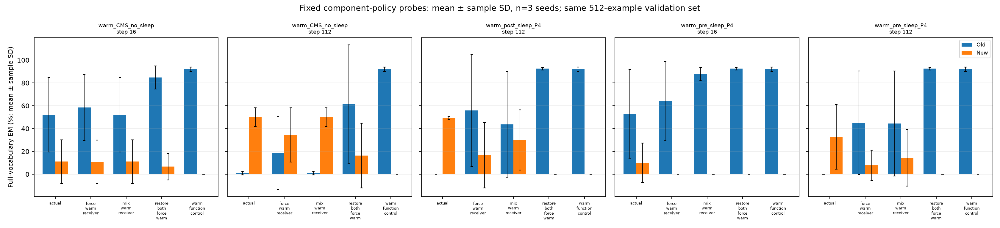
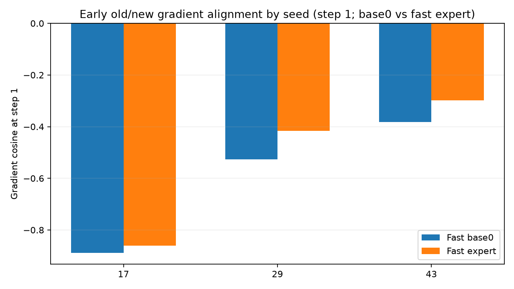

# Recoverable old memories and functional interference: v5 diagnosis

**The frozen old receiver still contains recoverable task behavior, but later base changes and routing can hide it.** This is exploratory evidence on already-used AG News train/validation roles. It is not independent confirmation, a full Sleep/HOPE reproduction, or an established new method advantage. The [v4 negative results](agnews-preupdate-v4.md) remain unchanged.

The completed component experiment observes 135 interventions plus three warm references, without any optimizer updates. Its 15 source checkpoint states cover three seeds and five fixed v4 arm/step cases. Every original receiver0 tensor guard passes. Restoring both bases and the original active topology/routing exactly recovers the warm validation function in all cases: old EM 91.93% ± 1.97 pp, new EM 0 (sample SD over the same three seeds). That recovery sacrifices new adaptation and is a diagnostic intervention, not a deployed result.

The [45-cell review table](../results/agnews-mechanism-v5/v5_component_review.md) retains all nine probes per case. Restoring bases while keeping actual routing, or changing routing without restoring bases, is inconsistent across seeds. At pre-P4 step112, switching only the controlled mixture to old slot0 changes old/new EM from 0/49.22 to 91.80/0 in seed17, from 0/0 to 0/0 in seed29, and from 0/48.83 to 41.41/42.97 in seed43. These heterogeneous responses argue against describing the failure simply as erased receiver weights or a single route setting.

Route audits use only the two answer loss positions from existing model forwards. The actual P4 natural winner is the newest receiver (slot4 at16, slot28 at112), in addition to its explicit 0.5 mixture. A `force` probe sets its gate to one; it changes amplitude and is not equivalent to the original singleton mixture because natural gating includes a null expert. The first component-control attempt incorrectly assumed equivalence and stopped after nine scores. Its [failure and executed source](../results/agnews-mechanism-v5/failures/components/) are retained; the corrected control restores original topology and policy and checks EM exactly and NLL within 1e-5.

The separate first16-step replay on the same fixed data adds 48 ordinary wake updates and 66 diagnostic old/new gradient forward/backward passes. All three final model/controller/execution-policy/RNG states exactly reproduce their v4 no-Sleep checkpoints. On fixed four-example old/new train batches, warm-start base0/base1 gradient cosines are -0.885/-0.871 (seed17), -0.529/-0.586 (29), and -0.428/-0.847 (43). Later cosines can change sign; these are local labeled probes, not universal causal proof. The consistent initial opposition motivates a functional old-teacher constraint rather than merely freezing receiver tensors.

That replay evaluates a fixed 128-article validation subset, first 32/class; component probes above use all512. On the subset, old EM before→after the step16 due base writes changes 50.00→45.31%, 95.31→84.38%, and 46.88→29.69% across the three seeds. Slow-only and all-due base candidate scores on a separate balanced 24-prompt training pool are explicitly counterfactual no-Sleep diagnostics, not a reconstruction of each actual Sleep teacher trajectory. A preliminary counter-closure error stopped before any wake update, after one 128-example score and four gradient passes; its [source and complete metered failure](../results/agnews-mechanism-v5/failures/interference/) remain included.

## Frozen follow-up, running at publication

The [protocol description](../docs/agnews-mechanism-v5-protocol.md) and [exact configuration](../configs/agnews-anchored-comparison-v5.json) define seven arms: old-teacher wake constraint off/on crossed with no Sleep, P16 latest mixture and P16 original-slot mixture, plus a joint gold old-answer CE control. Every seed uses the same 448 new-task primary updates; all 21 endpoints and 126 fixed validation states will be reported, without checkpoint or seed selection. The main comparison is still running at this publication; no final improvement claim is made here. The executable source/config were frozen before its first update; this public narrative is published later, not retrospectively dated preregistration.

The anchor is the immutable qualified warm teacher. Soft KD uses old prefixes and its full distributions under teacher-generated first-token contexts; old gold-answer fields do not enter the KD loss. Existing class metadata still balances the replay reservoir. Gold uses direct old-answer targets. Auxiliary losses add computation before one primary CMS collect, so neither teacher replay nor gold is compute-free or a wholly unlabeled method. Warmmixture arms change wake policy only after Sleep; Sleep itself still trains the new receiver with mixture0.5, a deliberate train-to-wake policy intervention with possible adaptation costs.

Before that main run, a real3B qualification saved at step14 with pending counts[2,14], restored independently twice and crossed a Sleep boundary. All model/controller/policy/RNG hashes agree exactly. This costs 18 wake and 48 Sleep Adam updates, with no performance scoring. All prerequisites and source/config/diagnostic/qualification hashes passed separate automated read-only review. The ordinary CPU suite passed 152 tests with one CPU-only-wheel assertion deselected on the installed CUDA wheel; the explicit anchored-wake suite passed 5 tests under the unchanged 256-update per-process guard.

All diagnostic failures and extra work are retained separately from main-run costs. Wall time is not GPU busy time, energy or FLOPs; the first failed component run did not record wall seconds, so none is invented. Code, plans, aggregate metrics and hashes are published. Private article/token packs, generated sequences, model weights and checkpoints are not uploaded. The new 1,024-article within-train reserve remains unscored, and P2/Phase13 sealed data and the blocked Ubuntu formal experiment were not touched.

## Inspect and recompute the completed diagnosis





[Component table](../results/agnews-mechanism-v5/analysis/component-table.md), [gradient/trajectory table](../results/agnews-mechanism-v5/analysis/grad-table.md), [route telemetry](../results/agnews-mechanism-v5/analysis/route-table.md), and [complete cost ledger](../results/agnews-mechanism-v5/analysis/work-ledger.json) can be recomputed with the standard library; plots additionally require Matplotlib:

```sh
python tools/summarize_agnews_mechanism_v5.py --components results/agnews-mechanism-v5/components/result.json --interference results/agnews-mechanism-v5/interference/diagnostic-result.json --component-failure results/agnews-mechanism-v5/failures/components/failure.json --interference-failure results/agnews-mechanism-v5/failures/interference/failure.json --qualification results/agnews-mechanism-v5/qualification/qualification.json --out-dir outputs/mechanism-v5-reanalysis --plots
```

The [Sleep paper](https://arxiv.org/html/2606.03979v2#S3.S2) motivates fast-to-slow consolidation. The anchored-wake term and fixed original-slot wake mixture here are additional engineering interventions, whose costs and joint old/new outcomes must be assessed separately.

For the preliminary interference failure, the cumulative summary field reported zero gradient passes while the stage meters record four. The cost ledger uses those stage meters and preserves the original discrepancy.
