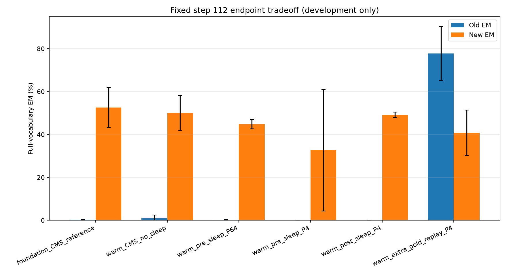
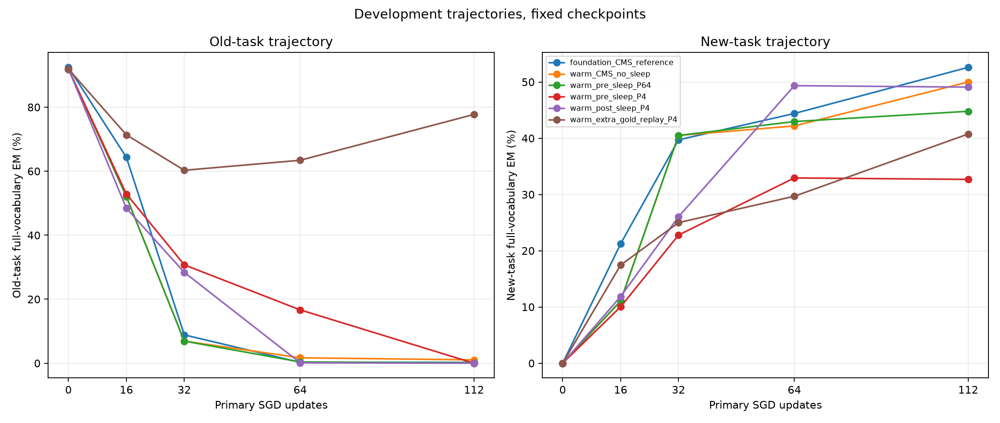

# Competent transfer passes, but frequent self-Sleep still forgets

This is an exploratory, validation-adaptive Llama 3.2-3B development study. All three competent old teachers transfer through a reset/receiver operation at the first common passing budget of 1,536 Adam updates. Subsequent new-task results are reported for every fixed arm, seed and checkpoint below; transfer success alone is not continuing retention or successful new-task acquisition.

At the fixed 112-step endpoint, both P4 teacher-order arms have 0% old EM. Pre-P4 new EM is 32.68 ± 28.30% versus 49.09 ± 1.26% for post-P4 and 50.00 ± 8.12% for matched warm no-Sleep (mean ± sample SD, n=3). Gold replay reaches 77.73 ± 12.59% old and 40.76 ± 10.61% new with additional labels and optimization. This finite-budget study does not establish a sustained retention/adaptation benefit from more frequent self-Sleep or pre-base-update teacher order.

The [protocol description](../docs/agnews-preupdate-v4-protocol.md) explains the source-pinned plan. It was written during phase B, while the executable [configuration](../configs/agnews-boundary-transfer-v4.json), [warm protocol](../results/agnews-preupdate-v4/warm-protocol.json) and [phase-B source lock](../results/agnews-preupdate-v4/phaseB-source-lock.json) retain their actual earlier timestamps. The previous [negative v3 result](agnews-qualified-v3.md) and [failure diagnosis](agnews-sleep-forensics-v3.md) are unchanged.

## Transfer before the task switch

Old validation EM is 92.45% ± 1.63 pp for the immutable teachers and 91.93% ± 1.97 pp after transfer (sample SD, n=3). Old train/validation/class gates and each teacher-relative 5-pp tolerance pass in all seeds; the worst final class drop is 3.125 pp. Earlier stages at 24, 96 and 384 updates fail the common all-seed gate, with nonmonotonic per-seed outcomes. [All stages and actual class drops](../results/agnews-preupdate-v4/warm-stages.md) remain published.

Old validation EM (%) for read-only controls:

| Seed | Competent teacher | Reset without KD | After 1536-update KD | Trained receiver disabled |
|---|---:|---:|---:|---:|
| 17 | 92.97 | 0.00 | 92.19 | 0.00 |
| 29 | 93.75 | 93.75 | 93.75 | 93.75 |
| 43 | 90.62 | 49.61 | 89.84 | 49.61 |

The receiver is functionally necessary for the recovered performance in seeds 17 and 43 under this probe; seed 29's original reset control already preserves its teacher accuracy. This is not proof of unique memory localization. The two independent stage-24 restore branches agree exactly and do not mutate their saved session. Selected snapshots are then restored for all phase-B warm arms, with unchanged source/model/data bindings.

## Fixed new-task endpoints and trajectories

Each seed runs all six arms for the same 112 primary new-task minibatches. The five warm arms share exactly the same starting model, policy and validation metrics. The foundation reference has a different representation and no transfer cost. Full-vocabulary two-token greedy EM is primary. The [90-state trajectory table](../results/agnews-preupdate-v4/trajectory-table.md) and [complete aggregate](../results/agnews-preupdate-v4/development-sealed.json) preserve all class scores, NLL and checkpoint metadata.

| Arm | Old EM | New EM | All EM | Old drop from own start | Old NLL | New NLL | All NLL |
|---|---:|---:|---:|---:|---:|---:|---:|
| foundation_CMS_reference | 0.26% ± 0.23 pp | 52.60% ± 9.26 pp | 26.43% ± 4.52 pp | 92.19% ± 1.70 pp | 3.4019 ± 0.1864 | 0.4932 ± 0.1327 | 1.9475 ± 0.0383 |
| warm_CMS_no_sleep | 1.04% ± 1.48 pp | 50.00% ± 8.12 pp | 25.52% ± 4.39 pp | 90.89% ± 2.15 pp | 4.1317 ± 1.1536 | 0.4679 ± 0.0412 | 2.2998 ± 0.5863 |
| warm_pre_sleep_P64 | 0.13% ± 0.23 pp | 44.79% ± 2.15 pp | 22.46% ± 1.01 pp | 91.80% ± 1.79 pp | 4.4744 ± 0.9231 | 0.4704 ± 0.0233 | 2.4724 ± 0.4550 |
| warm_pre_sleep_P4 | 0.00% ± 0.00 pp | 32.68% ± 28.30 pp | 16.34% ± 14.15 pp | 91.93% ± 1.97 pp | 15.7108 ± 15.9565 | 17.7934 ± 29.5193 | 16.7521 ± 22.7346 |
| warm_post_sleep_P4 | 0.00% ± 0.00 pp | 49.09% ± 1.26 pp | 24.54% ± 0.63 pp | 91.93% ± 1.97 pp | 7.6793 ± 3.0702 | 1.3863 ± 0.5376 | 4.5328 ± 1.7448 |
| warm_extra_gold_replay_P4 | 77.73% ± 12.59 pp | 40.76% ± 10.61 pp | 59.24% ± 11.59 pp | 14.19% ± 14.10 pp | 0.3551 ± 0.1765 | 0.6864 ± 0.1468 | 0.5207 ± 0.1456 |





These are short-budget validation trajectories, not a full final-acquisition benchmark. Per-class scores matter: for example, seed 17 post-P4 ends at 100% for new class 2 and 0% for class 3, giving 50% new EM without balanced new-class learning. No best checkpoint or new decision threshold is selected after seeing these results.

Seed 29 pre-P4 is a severe negative trajectory: endpoint old/new EM and new marker accuracy are all 0, while new answer NLL is 51.8794 nats/token. The values remain finite, so this is a completed capability failure rather than a numerical-guard interruption. It is retained without rerunning or replacing the seed. Some earlier checkpoints show transiently higher old EM under frequent Sleep; none replaces the prespecified endpoint or establishes durable retention.

The [five predefined paired contrasts](../results/agnews-preupdate-v4/paired-table.md) use matched seeds and sample SD without p-values. Pre-P4 versus post-P4 matches event count, prefix pools, optimizer budget and capacity, but changes teacher order. Their first initial students match exactly; later trajectories can diverge. P4 versus P64 bundles timing with 28× more event updates and more receivers. Gold replay has extra labeled exposure and 336 extra SGD steps per run. None is claimed to have equal FLOPs or equal label exposure.

## What was implemented and what this can establish

The generalized transaction supports fast-only boundaries at slow counts 4/8/12 and simultaneous boundaries at 16. It preserves pending slow gradient windows, applies slow proposals only when due, and resets clocks exactly once. New phase-B helpers and targeted CPU tests were added; the frozen v3 core and older scientific outputs remain unchanged. The 28-event arms finish with 29 slow expert slots, within capacity 32. Base weights occupy no expert slot.

The pre-update name refers to the fast base write. The current minibatch has already updated active fast experts before the teacher clone. After phase A, the old snapshot is archived for audit, not repeatedly imposed as the phase-B teacher. An informative old-teacher transfer check therefore does not guarantee that subsequent self-teachers remain competent, nor that frozen receiver tensors protect the model's whole old-task function from changing base/context representations. This experiment does not independently identify the complete cause of any later loss.

The approach is inspired by [Sleep §§3.2–3.3](https://arxiv.org/html/2606.03979v2#S3.S2), but remains a two-level, rank-16 last-MLP engineering variant with fixed random routing, an explicit 0.5 mixture, arbitrary two-token class codes and exact-output LTI reward. It is not the full paper hierarchy, semantic reward setup, long-horizon benchmark or HOPE architecture. No upstream HOPE source is copied.

## Cost, isolation and checks

Shared phase A uses 4,608 main Adam updates plus two restore-probe updates and 1029.609 seconds. Phase B uses 2,016 primary plus 1,008 extra-replay SGD updates, 4,104 Sleep Adam updates and 1510.610 seconds. The actual new study therefore totals 3,024 SGD and 8,714 Adam updates including restore ghosts. A warm method path separately pays 1,536 transfer updates per seed. [Metered forward work](../results/agnews-preupdate-v4/work-ledger.json) and the [execution receipt](../results/agnews-preupdate-v4/execution-receipt.json) distinguish shared preparation, per-arm training, validation and wall time. Wall time is not GPU busy time, energy or FLOPs; older studies and CPU fixtures are separate costs.

Only existing training/validation roles enter the trainers and scorers. The CPU reservation utility reads the already-used v3 prompt pack solely to exclude record IDs and stored prefix hashes, without old labels or model scoring. The [new 1,024-article reservation manifest](../results/agnews-preupdate-v4/confirmation-reservation-manifest.json) records disjoint IDs/prefixes, private prompt/label hashes and **unscored** status. Its prompt and label files are not opened by this study's trainers, analyzer or evaluators. The reserve is within AG News train, not external or guaranteed free of pretraining exposure. P2/Phase13 sealed data and the blocked Ubuntu formal experiment are untouched.

All 108 private checkpoint/session/teacher files have their hashes read back; none is published. Targeted checks comprise 7 boundary, 2 transfer/checkpoint, 1 training-only-pool and 8 offline-analysis CPU tests. The ordinary suite passes 139 tests, with one existing CPU-only-wheel assertion deselected on this CUDA wheel. Separate bounded boundary/observer checks pass 7/1 tests and use 233/64 toy attempts. The ordinary suite uses 253 attempts. The initial combined attempt stopped at the unchanged 256-attempt guard; its [failure ledger](../results/agnews-preupdate-v4/cpu-validation.json) is retained. Heavy fixtures now have documented explicit entry points; no limit was raised. Independent source/metadata/result review and exact staged Git hash checks are recorded in the [validation receipt](../results/agnews-preupdate-v4/validation.json). We publish code, aggregates, hashes and figures; article text, token packs, generated token sequences, model weights, checkpoints and secrets remain private.

Offline reanalysis needs only Python's standard library (add Matplotlib for figures):

```sh
python tools/summarize_agnews_preupdate_v4.py --warm-result results/agnews-preupdate-v4/transfer-result.json --development-seal results/agnews-preupdate-v4/development-sealed.json --out-dir outputs/preupdate-reanalysis --plots
```

Training requires the exact legally held local backbone, private role pack and old foundation snapshots referenced by hashes. These are not bundled; complete asset-free training reproduction is not claimed. The data were already used for development, so no result here is an independent confirmation of a selected method.
