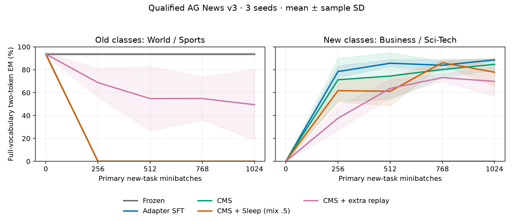

# Qualified AG News v3: fixed-endpoint retention and adaptation

**All three old-task foundations passed the predeclared acquisition gate; all 15 seed/arm runs then completed before the fresh 1024-article holdout was scored. SFT, CMS and CMS+Sleep all ended at 0% old-task EM: this bounded variant showed no retention advantage from Sleep.** CMS+Sleep versus CMS changed mean endpoint old/new/all EM by +0.00/-6.84/-3.42 percentage points. These are three-seed descriptive results, not a significance test or a full Sleep/HOPE reproduction. Every fixed endpoint and failed development gate is retained.

## Diagnose acquisition before measuring forgetting

The [v2 foundations](agnews-retention-v2.md) failed acquisition in all three seeds, so v2 is not a valid forgetting comparison. A paired train/calibration-only diagnostic reused each historical foundation schedule, 512 steps and capacity 8. The low LR pair (.005,.01) reproduced all three v2 adapter fingerprints exactly. Increasing both rates fourfold (.02,.04) helped all seeds, but seed 29 still failed the 80% training gate. The diagnostic does not identify learning rate as the sole cause.

| Seed | Low LR train / calibration % | Higher LR train / calibration % |
|---:|---:|---:|
| 17 | 76.17 / 72.66 | 94.92 / 92.97 |
| 29 | 47.66 / 45.31 | 78.71 / 82.81 |
| 43 | 68.36 / 71.09 | 94.92 / 93.75 |

The [acquisition audit](../results/agnews-qualified-v3/acquisition-audit.json) records bijective code maps, equal 1024/1024 class-target counts per candidate, one shared marker, zero zero-gradient steps, finite positive gradient norms, nonzero parameter changes and consumed CMS windows. CPU tests check the causal loss indices and that prompt inputs contain the shared marker but no class target. Parameter movement establishes execution, not correct task acquisition. The earlier natural-route zero-gradient failure and explicit mixed receiver fix remain documented in [v1](agnews-retention-v1-failure.md) and [v2](agnews-retention-v2.md).

For the new study, the [qualification plan](../docs/agnews-v3-qualification-plan.md) froze fresh roles and a global budget ladder. All seeds had to pass train EM >= 80%, validation EM >= 75% and each target-class validation EM >= 70%, with no seed replacement. Old qualification used the first common 512-step stage. The new-task SFT 512 stage failed (seed 43 validation 74.61%, class 3 61.72%); continued 1024 steps passed all seeds. Failed stage records are in [development evidence](../results/agnews-v3-development/). New-task calibration selected only a common acquisition budget; it did not select an old-retention outcome or method.

| Seed | Old train EM % | Old validation EM % | New SFT train EM % | New SFT validation EM % |
|---:|---:|---:|---:|---:|
| 17 | 96.29 | 92.97 | 91.99 | 83.20 |
| 29 | 93.75 | 93.75 | 90.82 | 83.59 |
| 43 | 95.31 | 90.62 | 91.60 | 82.81 |

The fresh study uses capacity 32 to cover the upper budget ladder, a new hash-selected data split and LR .02/.04. Those changes also alter initialization relative to capacity 8, so its qualification success cannot be attributed to LR alone. Every arm within v3 has the same allocated architecture and exact per-seed foundation/execution/RNG state. Each formal SFT endpoint exactly matched its corresponding fixed new-task calibration adapter fingerprint.

## Frozen comparison and all endpoints

The [protocol](../docs/agnews-qualified-comparison-v3-protocol.md) uses a frozen BF16 Llama 3.2-3B backbone, FP32 rank 16 last-MLP CMS-inspired adapters, two levels and batch 4. SFT updates the same adapter scope every batch; it is not full-model SFT. CMS periods are 4/16. All adaptive arms receive the same 1024 primary new-task batches. CMS+Sleep adds 16 events, each 16 alternating teacher/student GKD updates and 8 partial LTI updates, Adam LR .003, two generated tokens, no Dream and a persistent 0.5 receiver mixture. LTI uses the implementation's binary exact-output proxy plus edit reward and KL; it does not use the paper's semantic reward model. Extra labeled replay uses the same train-only 24-prompt event pool, 12 B4 batches per event, with gold labels and its own advancing CMS clocks.

The following are full-vocabulary, fixed-length two-token EM, mean ± sample SD across seeds 17/29/43. Old/new each contain 512 articles; all contains 1024. Each of the four classes contains 256 articles. The same holdout articles are shared across seeds; they are not 3072 independent examples. Old drop is the per-seed step 0 minus final old EM, not a maximum-over-time metric. All adaptive endpoints are the preselected step 1024.

| Arm | Old EM % | New EM % | All EM % | Old drop pp | Answer NLL |
|---|---:|---:|---:|---:|---:|
| frozen | 93.68 ± 1.30 | 0.00 ± 0.00 | 46.84 ± 0.65 | 0.00 ± 0.00 | 3.262 ± 0.361 |
| sft | 0.00 ± 0.00 | 88.61 ± 0.56 | 44.30 ± 0.28 | 93.68 ± 1.30 | 2.434 ± 0.111 |
| cms | 0.00 ± 0.00 | 84.70 ± 4.99 | 42.35 ± 2.49 | 93.68 ± 1.30 | 2.396 ± 0.167 |
| cms_sleep | 0.00 ± 0.00 | 77.86 ± 12.14 | 38.93 ± 6.07 | 93.68 ± 1.30 | 2.986 ± 0.886 |
| cms_extra_replay | 49.48 ± 30.86 | 69.79 ± 12.99 | 59.64 ± 21.61 | 44.21 ± 31.96 | 0.641 ± 0.336 |



Full per-class scores, marker accuracy, class accuracy conditional on the shared marker, candidate accuracy, answer NLL and all 66 checkpoint scores are in the [evaluation summary](../results/agnews-qualified-v3/evaluation-summary.json). Auxiliary candidate accuracy is never substituted for full-vocabulary EM. NLL is teacher-forced and measured in nats per answer token. Read the old/new tradeoff together; a method retaining old scores while failing new learning is not a successful continual learner.

## Evaluation isolation and source timing

The [isolation manifest](../results/agnews-v3-development/fresh-isolation-manifest.json) uses a new salt, official-train articles and disjoint train/validation/final roles. Each class has 256 training, 128 validation and 256 final articles. It excludes all 2048 historical-role normalized IDs/prefixes and all 7600 old official-test IDs/prefixes. The old official test has already informed development and is not independent confirmation. Normalized exact IDs and truncated prompt hashes are disjoint; near-duplicate news events and pretraining overlap are not ruled out.

The trainer has no holdout input. Prompt and label files are separate; source-level isolation is not an OS access-control claim. Before decoding the holdout, the frozen evaluator checked all 15 completed runs, acquisition gates, budgets and 69 checkpoint hashes (66 scientific checkpoints plus 3 copied foundations). It verified the sealed prompt/label hashes, 1024 unique IDs/prefixes, class balance and zero train/validation overlap. Evaluation was read-only: adapters, execution policy and checkpoint hashes remained unchanged. No training, budget, seed or endpoint was changed after holdout opening.

Local source/config freeze d15c21a preceded formal training. Initial public uploads were rejected by GitHub commit_refs_rules; a normal new-commit push succeeded shortly after formal launch and before holdout access. This is not described as externally preregistered before training. The operational amendment ff3b11a was published before continuation. The historical LR diagnostic ran CRLF source while Git publishes LF; the audit verifies that newline normalization is the only source-byte difference and retains both hashes.

## Operational interruption and costs

The original process/session disappeared after seed 17 Frozen/SFT/CMS completed and Sleep printed step 64. No Python process, exception or exit receipt remained; the cause is unknown. The 12 completed scientific checkpoint files were retained byte-for-byte. The original protocol disallowed retries, so the [explicit operational amendment](../docs/agnews-v3-operational-recovery.md) records this deviation before any holdout scoring. It did not change scientific settings or extend the original 3600-second deadline.

The interrupted Sleep arm restarted from the exact original foundation/policy/RNG because only its step 0 checkpoint existed. Its discarded prefix consumed 64–256 extra supervised updates and 24–96 extra Sleep Adam updates; the precise work is unavailable. The continuation adds full recovery snapshots every 64 steps, binding source/config/protocol/seed/arm, model, controller pending sums, execution policy, RNG and ledger. These recovery files stay private. Completed arms were skipped, and no recorded engineering failure or timeout was retried.

| Arm | Primary SGD / seed | Extra replay SGD / seed | Sleep Adam / seed | Mean FW+2gradFW proxy | Mean arm wall s |
|---|---:|---:|---:|---:|---:|
| cms | 1024 | 0 | 0 | 1103160 | 57.07 |
| cms_extra_replay | 1024 | 192 | 0 | 1310288 | 69.69 |
| cms_sleep | 1024 | 0 | 384 | 1284088 | 154.92 |
| frozen | 0 | 0 | 0 | 0 | 0.16 |
| sft | 1024 | 0 | 0 | 1103160 | 59.32 |

Formal logical adaptation used 12864 supervised minibatches and 1152 Sleep Adam steps. V3 diagnostic/qualification/probe work adds 3072+4608 supervised minibatches, yielding 20544 logical supervised updates in total; actual updates including discarded work are bounded 20608–20800, with 1176–1248 Sleep Adam updates. Earlier failed studies remain in their linked ledgers. The formal seal records 1976.81s since the original start, including interruption and preparation; frozen evaluation took 481.00s. These wall times are not GPU busy time or energy, and recovered arms include extra checkpoint overhead. Forward-input-token proxies omit architecture-dependent cost and serialization, so neither equal FLOPs nor strict wall-time method speed is claimed. Extra replay sees ground-truth labels; Sleep uses generated/distilled targets and a different active-expert scope. This is not a one-factor or equal-label comparison.

The [work ledger](../results/agnews-qualified-v3/work-ledger.json), [seal](../results/agnews-qualified-v3/training-sealed.json), [protocol receipt](../results/agnews-qualified-v3/training-protocol.json), [analysis](../results/agnews-qualified-v3/analysis-summary.json), [per-seed CSV](../results/agnews-qualified-v3/per-seed-endpoints.csv) and [66 score receipts](../results/agnews-qualified-v3/evaluation-receipt-inventory.json) preserve all reported evidence. Models, token packs, article text, mutable checkpoints and secrets are not redistributed.

## Offline reanalysis and limits

```sh
python tools/summarize_agnews_qualified_v3.py --run-dir results/agnews-qualified-v3 --evaluation-dir results/agnews-qualified-v3 --out-dir outputs/agnews-v3-reanalysis --plots
```

Omit `--plots` for a standard-library-only JSON/table/CSV workflow. Plotting requires Matplotlib. The analyzer verifies seal/protocol/evaluation provenance, endpoint hashes, budgets and 1024-example denominators before summarizing. Public CPU checks passed 126 tests with one CPU-wheel build-only assertion deselected in the CUDA-wheel environment; CUDA initialization remained prohibited in those CPU tests. A tiny-Llama non-boundary recovery fixture verifies pending sums, model/policy and CPU RNG continuation. Earlier real-3B controlled-mix fixtures verify CUDA and in-flight Sleep restoration separately.

This is a small class-incremental arbitrary-code task with 96-token article truncation, one fixed World/Sports→Business/Sci-Tech order, three seeds and a partial last-MLP implementation. The holdout is fresh within AG News train, not external or pretraining-independent confirmation. The explicit routing intervention, capacity and target-information differences limit causal attribution. It is not the full [Sleep v2](https://arxiv.org/abs/2606.03979v2) or [Nested Learning v1](https://arxiv.org/abs/2512.24695v1) architecture, and its accuracy cannot be compared directly with upstream WikiText perplexity/copying results. The [pinned HOPE revision](https://github.com/obekt/HOPE-nested-learning/tree/599244e65fedf26f4db9844beb631c3dbca41188) informed diagnostics, not copied code; its MIT badge without an accompanying license was not treated as a license grant.

Model weights came from ModelScope `LLM-Research/Llama-3.2-3B`, pinned weight revision `48d84dd14886f01964f72e7f742a404dd86f9fb6`; auxiliary files are pinned individually. The queried ModelScope AG News mirror returned 404, so the [official dataset](https://huggingface.co/datasets/fancyzhx/ag_news/tree/eb185aade064a813bc0b7f42de02595523103ca4) supplied pinned Parquet bytes. Third-party model/data licenses remain separate from the repository licenses. The public bundle supports aggregate reanalysis; exact training reruns require locally reconstructed licensed assets and private role packs with the recorded metadata/hashes. It is not a turnkey public benchmark release.

A separate [post-v3 exploratory diagnosis](agnews-sleep-forensics-v3.md) exactly replayed the first 64 steps without rescoring the holdout. It finds that old validation performance had largely collapsed before the first Sleep teacher was formed; the original fixed-endpoint results above are unchanged.
