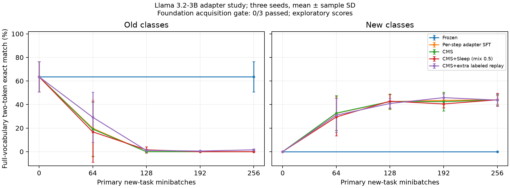

# AG News Llama 3.2-3B v2: completed, acquisition gate failed

**All 15 preregistered runs completed, but 0/3 main foundations met the fixed old-task acquisition gate. This is not a qualified retention demonstration or evidence of a Sleep advantage.** All seeds, checkpoints and failures are reported; no seed, learning rate or endpoint was replaced after test access.

The three-seed study uses a frozen BF16 Llama 3.2-3B backbone, FP32 rank-16 last-MLP CMS-inspired adapters, and two levels with periods 4/16. The SFT control updates the same adapter scope each minibatch; it is not full-model SFT. Old classes are World/Sports and new classes Business/Sci-Tech. Each seed learned one 512-update old foundation, then forked five arms for 256 new-task minibatches; Sleep has four 16-GKD + 8-LTI events, no Dream, and an explicit persistent 0.5 receiver mixture. Extra replay adds 48 labeled minibatches per seed. See the [frozen protocol](../docs/agnews-retention-v2-protocol.md) and [source lock](../results/agnews-retention-v2-preregistration.json).

## Acquisition and endpoint scores

Qualification required old-training two-token EM >=80% and independent train-derived calibration EM >=75%. DEV seed 1907 passed and selected the lowest qualifying LR pair (0.005,0.01); that qualification did not transfer to any main seed. Main calibration was examined only after all training sealed and never filtered seeds.

| Seed | Old train EM % | Old calibration EM % | Fixed gate |
|---:|---:|---:|---|
| 17 | 76.17 | 72.66 | FAIL |
| 29 | 47.66 | 45.31 | FAIL |
| 43 | 68.36 | 71.09 | FAIL |

The following are **exploratory task scores**, mean ± sample SD across seeds 17/29/43. Old/new each contain 256 fixed official-test articles; all contains 512. The same 512 articles are reused across seeds. “Old forgetting” is only a descriptive score difference here because acquisition failed.

| Arm | Old EM % | New EM % | All EM % | Old forgetting pp |
|---|---:|---:|---:|---:|
| Frozen | 63.54 ± 12.89 | 0.00 ± 0.00 | 31.77 ± 6.45 | 0.00 ± 0.00 |
| Per-step adapter SFT | 0.00 ± 0.00 | 44.01 ± 3.63 | 22.01 ± 1.81 | 63.54 ± 12.89 |
| CMS | 0.00 ± 0.00 | 43.88 ± 4.44 | 21.94 ± 2.22 | 63.54 ± 12.89 |
| CMS+Sleep (mix 0.5) | 0.00 ± 0.00 | 44.01 ± 5.54 | 22.01 ± 2.77 | 63.54 ± 12.89 |
| CMS+extra labeled replay | 1.56 ± 0.78 | 43.75 ± 5.08 | 22.66 ± 2.15 | 61.98 ± 13.67 |



Full-vocabulary two-token EM counts the shared marker and class code; NLL and four-code conditional accuracy are also released per class/checkpoint. Answer-marker accuracy was approximately 99.4–100%, so most errors concerned the class code. Sleep showed a strong class skew in this setup: seed 17 Business/Sci-Tech EM 96.09%/3.91%, seed 29 68.75%/9.38%, seed 43 74.22%/11.72%. These scores do not establish acquisition of the new pair either. Always predicting one balanced new class gives 50% on the new subset and 25% on the four-class set, a useful simple reference rather than a statistical test.

## Engineering findings and cost

The [separate v1 run](agnews-retention-v1-failure.md) stopped at its second Sleep event: the receiver was selected at nine body positions but neither answer-loss position, leaving zero receiver gradient. [Real-3B forensics](../results/agnews-receiver-routing-forensics-v1.json) reproduced this and verified a mixed branch's nonzero gradient without changing live state. V2 keeps the zero-gradient guard, makes the 0.5 mixture explicit for training and deployed inference, and checkpoints non-tensor teacher/student/live routing and readout policies. Its numerical effect cannot be attributed to natural routing or to Sleep alone. Default routing remains unchanged; seed 17 foundation and Frozen/SFT/CMS endpoint adapter fingerprints exactly match v1.

The [four-cycle real-3B DEV fixture](../results/agnews-controlled-mix-dev-v2.json) passed wake127→128 and in-flight optimizer/policy recovery, allocation of slots 0–3, frozen/live invariants and positive gradients. All 12 main Sleep events subsequently passed; natural top1 loss-position coverage varied while the explicit mixed branch covered every loss position. Positive gradients establish reachability, not retention benefit.

Main v2 used exactly 4,752 supervised updates and 288 Sleep Adam updates in 317.312 s. The following new-phase wall times exclude each seed's shared foundation and include local checkpoint overhead. The proxy is padded forward-input tokens+2×gradient-forward-input tokens; it is not FLOPs or GPU busy time.

| Adaptive arm | Mean new-phase wall s | Mean FW+2gradFW proxy |
|---|---:|---:|
| Per-step adapter SFT | 13.41 | 270580.0 |
| CMS | 13.23 | 270580.0 |
| CMS+Sleep (mix 0.5) | 33.85 | 315029.3 |
| CMS+extra labeled replay | 15.83 | 321172.0 |

Extra replay used about 1.13–1.14× Sleep's **additional** token proxy. It sees ground-truth labels, cycles the 24-prompt pool twice, and advances CMS clocks; Sleep uses distillation targets and a different active-expert scope. This is not exact compute/label matching or a one-factor mechanism test. The [work ledger](../results/agnews-retention-v2/work-ledger.json) retains all development, failed v1 and forensic work separately.

Training sealed at 2026-11-05 22:28:27 UTC before any official-test decoding. The original read-only evaluator ended unexpectedly after 32 persisted checkpoint scores; the cause and exit traceback were unavailable. A logged completion used the **same frozen scoring function and same 512-article pack**, recomputed every fixed checkpoint, required exact equality and unchanged hashes for those 32 scores, and completed with exit 0. No old score was overwritten, no training resumed, and no test example/seed/endpoint changed. The completion took 250.391 s including initialization (240.281 s inside scoring); the original partial forward cost is bounded explicitly in the ledger instead of being invented.

## Reanalysis and limits

The aggregate [evaluation](../results/agnews-retention-v2/evaluation-summary.json), [training seal](../results/agnews-retention-v2/training-seal.json), [per-seed CSV](../results/agnews-retention-v2/per-seed-endpoints.csv), and [analysis](../results/agnews-retention-v2/analysis.json) contain every seed-arm and checkpoint. Recompute without model weights or raw data:

```sh
python tools/summarize_agnews_retention_v2.py --evaluation results/agnews-retention-v2/evaluation-summary.json --seal results/agnews-retention-v2/training-seal.json --out-dir outputs/agnews-v2-reanalysis --plots
```

Plotting needs Matplotlib; omit `--plots` for standard-library-only tables/JSON. The figure explicitly shows 0/3 acquisition qualification. Post-run presentation edits did not change numerical analysis, CSV or table bytes.

This is a small arbitrary four-code task with article inputs truncated to 96 tokens; AG News may overlap pretraining. It uses one fixed 2+2 class order, three seeds, a last-MLP adapter and partial GKD/LTI with a routing intervention. It neither reproduces the full [Sleep paper](https://arxiv.org/abs/2606.03979v2) nor supports comparisons with upstream WikiText perplexity/copying scores. The next scientific prerequisite is a robustly acquired foundation under a separately frozen protocol and fresh held-out boundary; this report does not add training or tune against the now-open test set. Raw articles/token packs, Llama weights and private mutable checkpoints are not redistributed.
