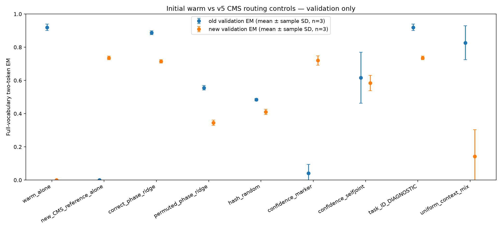
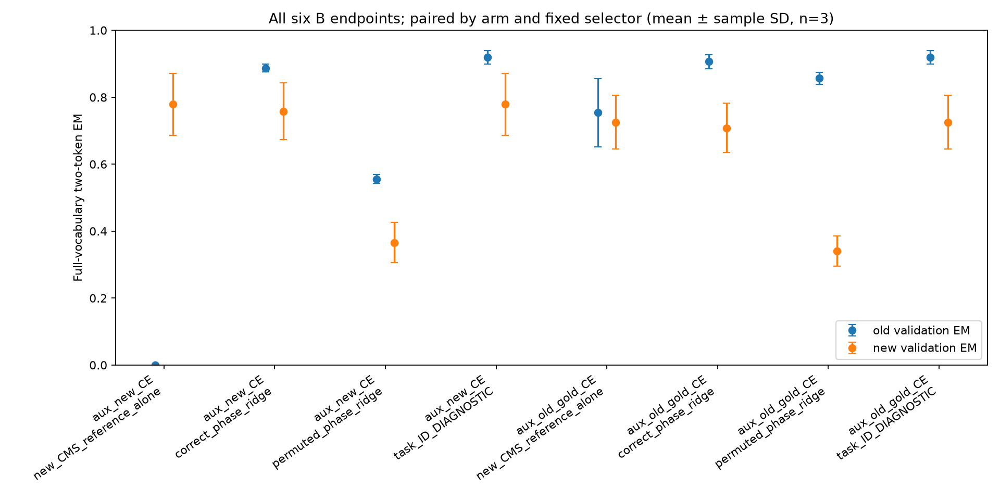

# Routing supervision and matched replay: completed v6 development controls

The v5 routing result uses two ingredients beyond a single current model: a preserved warm function and a classifier trained to distinguish old from new training origins. V6 separates those ingredients from the selector, implements a shared-backbone inference path, and adds two continuation arms with matched forward/backward counts. The results support supervised routing between preserved functions; they do not demonstrate successful Sleep consolidation or task-identity-free continual learning.

All experiments below are exploratory. The same previously used AG News development roles were reused. No reserved confirmation examples, official test examples, P2 data, or Ubuntu formal experiment were used. The complete grid was retained, including failures and collapsed seeds. Seeds 17/29/43 change the codebooks and training trajectories; the article split and frozen backbone are shared. They are not three independent datasets or three independently learned gates.

## Fixed data, metric and gates

Llama-3.2-3B was loaded locally from the ModelScope acquisition recorded in the [v5 report](agnews-anchored-v5.md). The isolated pack contains 1,024 training articles (256/class) and 512 validation articles (128/class). Classes 0/1 are the old task and 2/3 the new task. Each seed assigns a two-token marker/class codebook. Inputs contain the article and a generic answer cue, with no explicit task ID. Selection features are taken at the last prefix token before the answer; teacher-forced answer positions cannot influence them causally.

The primary metric is full-vocabulary two-token greedy exact match (EM). The marker must be the greedy first token and the class code the greedy second token under the known marker. This scoring implementation evaluates the two positions in one causal teacher-forced forward; it is not a claim that arbitrary autoregressive two-token generation is free in one call. Each task must reach train EM >=80%, validation EM >=75%, and >=70% EM in each of its validation classes. The joint gate requires both tasks in the same seed. Averages do not determine gate success. Tables show mean +/- sample SD in percentage points, n=3, without p-values or seed/checkpoint selection.

## A: fixed routing controls

We first paired the saved warm context with each seed's v5 CMS step-448 context. Eight selectors were fixed: warm alone, current context alone, correctly supervised ridge, balanced permuted-supervision ridge, deterministic hash-random, marker confidence, self-joint confidence, and a true-task-ID diagnostic. An additional physical control uniformly mixes the two contexts at the last MLP and readout. It mixes intermediate computation, not final probabilities.

| Fixed selector | Old validation EM % | New validation EM % |
|---|---:|---:|
| `warm_alone` | 91.93 +/- 1.97 | 0.00 +/- 0.00 |
| `new_CMS_reference_alone` | 0.00 +/- 0.00 | 73.57 +/- 1.13 |
| `correct_phase_ridge` | 88.67 +/- 1.17 | 71.48 +/- 1.03 |
| `permuted_phase_ridge` | 55.60 +/- 1.37 | 34.51 +/- 1.63 |
| `hash_random` | 48.44 +/- 0.68 | 41.02 +/- 1.56 |
| `confidence_marker` | 4.04 +/- 5.39 | 72.01 +/- 2.83 |
| `confidence_selfjoint` | 61.59 +/- 15.34 | 58.46 +/- 4.63 |
| `task_ID_DIAGNOSTIC` | 91.93 +/- 1.97 | 73.57 +/- 1.13 |
| `uniform_context_mix` | 82.68 +/- 10.26 | 14.19 +/- 16.07 |

The correct-phase route passes the old-task gate in 3/3 seeds but the joint gate in 0/3: new-task validation and per-class performance remain insufficient.

The correct gate is a frozen float64 ridge probe (lambda=1) on frozen last-MLP prefix features. It uses the 1,024 training-origin bits old/new. That partition is equivalent to the class-derived partition in v5: it is extra supervision even though no four-way answer token enters the ridge objective. The permuted control uses the same number and balance of bits, but a fixed shuffled association. Exactly two CPU fits were performed, once for the study, and reused across all seeds and endpoints. Feature hashes match across seeds. The correct gate reproduces the v5 gate; there is no validation refit, threshold search, salt search, or per-seed selection.

Hash-random uses only a fixed hash of the article token prefix. Confidence selectors use model scores without true answer labels: marker confidence uses log P(marker|prefix); self-joint adds the maximum full-vocabulary second-token log probability conditional on the known marker. It does not condition the second score on a model-generated first token. The present confidence reference computes both contexts; it is not an optimized implementation with a shared prefix and two short decode tails.

The true-task-ID selector reads the old/new identity at scoring time. It is a diagnostic, unavailable to a deployment without that identity; it is not a guaranteed per-example upper bound. Some mistakes can be answered correctly by the other branch. No unlabeled selector tested here matches the correctly supervised gate across both tasks. A single fixed permutation is a control, not a significance test or a sweep over random permutations.

## Shared-backbone implementation and actual costs

The new inference-only helper executes the backbone, original last MLP and original LM head once per scored batch, while evaluating both small memory branches and both LoRA readout updates. Correct/permuted gates read the prefix feature from that same live forward. No future masks, cached answer features, or true validation task IDs enter these two deployed selectors. Hard-route masks and all scored metrics match the two-full-branch reference. Hooks and forward methods are restored on exit; parameter/buffer identity and mutation guards detect a stale context.

Constant-old, constant-new, correct/permuted ridge, hash-random, and uniform-mix controls all retain both contexts and compute both small branches. This deliberately matches the available contexts and branch operations for the selector ablation. A pruned constant-context model would be cheaper. A CPU feature transfer and ridge evaluation remain for learned gates. The operation counts establish one shared backbone per scoring call; this study is not a repeated latency, FLOP, throughput or energy benchmark, and does not implement KV-cached generation.

At the initial step, one full adapter state contains 27,396,800 tensor bytes; two independent copies contain 54,793,600 bytes. Actual same-name tensor aliasing reduces the tested two-context GPU payload to 28,576,459 bytes at the initial and all six continuation endpoints, excluding the shared 3B backbone, activations, allocator and gate. The additional distinct adapter bytes are 1,179,659. A deployable float64 ridge mean/scale/weight payload is 73,728 bytes; storing both study gates takes 147,456 bytes. Much of the adapter allocation is inactive expert capacity, so these figures are not a minimal deployable representation.

The loader still reads two full checkpoint files, including training metadata. The actual qualified warm files range from 27,546,041 to 27,546,169 bytes; the new step-448 files range from 28,340,319 to 28,340,383 bytes. The storage audit uses the v5 step-zero warm copies, whose file hashes differ; the CPU bridge confirms exact model-tensor and inference-policy equality. An additional CPU provenance bridge verifies every model tensor and the inference execution policy exactly equal to the qualified warm files loaded by A, for all three seeds; it does not assert training controller/RNG equality or byte-identical files. Tensor aliasing is not a compact checkpoint export. We did not remove the preserved warm information. A CPU inspection found both warm base matrices nonzero and one active expert in every seed, so simply disabling every new module does not establish equivalence to the warm function. This check does not prove that every archived byte is necessary. [Per-tensor storage audit](../results/agnews-routing-fairness-v6/storage/audit.json).

## B: continuation with matched training calls

Both arms start from each seed's identical v5 CMS step-448 model/controller/policy/RNG state, where old-task EM is already zero. Each runs 576 further primary ticks to step 1,024. Both use the same primary new-task B4 schedule and an auxiliary balanced B4 batch, two sequential CE backward passes with coefficients 1+1, one global clip at 1, and one CMS collection. Periods are 4/16, learning rates .02/.04, capacity 32. There is no Sleep optimizer or teacher forward.

`aux_new_CE` adds four new-task labels; `aux_old_gold_CE` adds four old-task labels. Both therefore present eight labeled examples per tick and make exactly two student forward/backward calls, but the information differs. The old-gold arm reuses existing answers, needs no newly collected annotations, and makes 6,912 old-label example presentations across its three seeds (13,824 answer-token targets). It is supervised old-task relearning from a collapsed start, not uninterrupted retention, self-distillation, or evidence of an unlabeled Sleep effect. Four checkpoints including the inherited start are reported per seed; 512/768/1,024 are newly saved. Endpoints are fixed, not chosen by validation performance.

| Fixed arm | Old validation EM % | New validation EM % | Joint gate |
|---|---:|---:|---:|
| `aux_new_CE` | 0.00 +/- 0.00 | 77.86 +/- 9.25 | 0/3 |
| `aux_old_gold_CE` | 75.39 +/- 10.18 | 72.53 +/- 8.03 | 1/3 |

Both arms use 576 ticks/1,152 student forward-backward calls per seed. There are 3,456 new primary ticks and 6,912 student forward/backward calls in total. Scoring adds 1,920 inference calls. The old-gold result is variable; the mean alone does not establish reliable joint learning.

## Frozen gate at every continuation endpoint

We evaluated both arms and all three seeds with the original two gates, cached warm scores, every fixed posthoc selector, and all six physical controls. There was no endpoint gate refit or method selection. All six current-context endpoint metrics reproduce the B training seal exactly. Hard routing again matches the offline reference in every case.

### Endpoint `aux_new_CE`

| Fixed selector | Old validation EM % | New validation EM % |
|---|---:|---:|
| `warm_alone` | 91.93 +/- 1.97 | 0.00 +/- 0.00 |
| `new_CMS_reference_alone` | 0.00 +/- 0.00 | 77.86 +/- 9.25 |
| `correct_phase_ridge` | 88.67 +/- 1.17 | 75.78 +/- 8.46 |
| `permuted_phase_ridge` | 55.60 +/- 1.37 | 36.59 +/- 6.01 |
| `hash_random` | 48.44 +/- 0.68 | 41.93 +/- 5.53 |
| `confidence_marker` | 0.39 +/- 0.68 | 77.60 +/- 9.02 |
| `confidence_selfjoint` | 50.00 +/- 26.08 | 69.66 +/- 5.19 |
| `task_ID_DIAGNOSTIC` | 91.93 +/- 1.97 | 77.86 +/- 9.25 |
| `uniform_context_mix` | 73.44 +/- 16.24 | 26.04 +/- 23.30 |

The correctly supervised gate passes the joint gate in 2/3 seeds.

### Endpoint `aux_old_gold_CE`

| Fixed selector | Old validation EM % | New validation EM % |
|---|---:|---:|
| `warm_alone` | 91.93 +/- 1.97 | 0.00 +/- 0.00 |
| `new_CMS_reference_alone` | 75.39 +/- 10.18 | 72.53 +/- 8.03 |
| `correct_phase_ridge` | 90.62 +/- 2.07 | 70.83 +/- 7.44 |
| `permuted_phase_ridge` | 85.68 +/- 1.80 | 33.98 +/- 4.50 |
| `hash_random` | 83.33 +/- 3.85 | 39.97 +/- 3.69 |
| `confidence_marker` | 75.39 +/- 10.18 | 72.14 +/- 7.82 |
| `confidence_selfjoint` | 89.06 +/- 1.95 | 54.56 +/- 8.91 |
| `task_ID_DIAGNOSTIC` | 91.93 +/- 1.97 | 72.53 +/- 8.03 |
| `uniform_context_mix` | 91.80 +/- 0.68 | 0.00 +/- 0.00 |

The correctly supervised gate passes the joint gate in 1/3 seeds.

The predeclared endpoint gate ledger has 24 rows: six raw branches and 18 correct/permuted/task-ID routes. The two confidence rules and uniform control are descriptive fixed ablations; their complete train/validation metrics are retained in the summaries.

The archived warm branch keeps old-task scores high when the new-only current branch still answers no old examples. This is selection between two preserved functions. Old-gold replay can improve the single current function, while the warm archive and correct gate can further change its old/new tradeoff. Neither effect shows that a consolidated single Sleep receiver acquired both functions. The gate is trained on a particularly convenient two-group partition of one news dataset; generalization to unknown tasks, more tasks, distribution shift or long streams remains untested.





## Failures, work and validation

The real-3B resume qualification crossed a pending-gradient boundary at steps 450->452, preserving model/controller/policy/RNG exactly in both arms and two independent restores. It incurred 12 primary calls and 24 gradient-bearing forwards/backwards, including the repeated proof branches; it is not free preparation. All 20 new private checkpoints (18 continuation, two qualification) passed file-hash verification and CPU readback.

One qualification config failed before loading a model because required descriptor keys were missing (0 forwards). A pre-execution A plan path error was corrected without a GPU run. The first executed A initial attempt then stopped at strict v5 metric replay: FP32-first NLL averaging differed from canonical Python-float-per-position averaging. It incurred 196 inference forwards and no optimizer update. The R3 implementation restores canonical precision order without relaxing the guard or changing selectors, gates, salts or budgets. The failure, executed source and configuration are preserved. Initial full metrics subsequently replayed v5 exactly. The offline analyzer also required constant-selector and reused-gate-metadata validation corrections exposed by actual artifacts; no GPU result was changed. The first real Git-index reanalysis caught CRLF versus LF CSV bytes; the CSV writer now emits LF explicitly, with a regression assertion. This zero-model-work release correction changes no numeric result.

| Incremental successful phase | Full forward batches | Input-token proxy | Gradient-input-token proxy |
|---|---:|---:|---:|
| A_continuation | 8,064 | 6,230,448 | 0 |
| A_initial | 4,612 | 3,563,584 | 0 |
| B_main | 8,832 | 3,940,440 | 2,476,008 |
| qualification | 24 | 8,836 | 8,836 |
| Preserved failed A initial attempt, separate | 196 | 151,672 | 0 |

Recorded elapsed times are 8.859 s for the successful resume qualification, 1,018.625 s for B main, 328.640 s for A initial and 560.422 s for A endpoint scoring. A elapsed time includes its preflight; B main excludes 4.062 s of CPU preflight/plan work. The failed A attempt took 20.812 s in-driver (24.891 s wrapper wall); the failed qualification preflight took 4.266 s wrapper wall with no model load. These timer scopes differ and are not a measurement of aggregate GPU occupancy.

The successful study totals 21,532 model forward calls, including 6,936 gradient-bearing calls, and 3,468 logical primary calls including qualification. Including the failed A attempt gives 21,728 forward calls. Teacher forwards and Sleep Adam updates are zero. These are batch call counts and input-token proxies, not FLOPs. Model-loading and CPU-preflight timer scopes are recorded separately; wall seconds are not GPU-busy seconds. Historical v5 training, acquisition and frozen-pack preparation are prerequisites and excluded from this incremental ledger.

The complete CPU suite passed 196 tests with one CPU-wheel-specific deselection (8.30 s). After the final mapping and LF-output regression assertions, all nine pure-CPU analyzer tests and the three additional release/source/figure tests passed together (12/12, 0.06 s). The suite used 253/256 counted update attempts (76 optimizer, three functional CMS, 174 controller). The initially wrong fixture directory in those two new tests was corrected and retained as a zero-model-work engineering failure in the supplementary receipt. Both scientific plots were inspected visually. The [validation receipt](../results/agnews-routing-fairness-v6/validation.json) and [CPU readback/provenance supplement](../results/agnews-routing-fairness-v6/validation-extra.json) record the scope.

The source/config locks, aggregate counts, per-class denominators, all endpoint gates, exact shared-reference parity, failure provenance, and recomputed analysis are checked against Git index blobs before publication. No model weights, article text, token packs, row predictions/features, fitted gate arrays, or private checkpoint files are included. Historical core code and v4/v5 raw results remain unchanged.

## Reanalysis and limits

The aggregate analysis requires no model or private data:

```sh
python tools/summarize_agnews_routing_fairness_v6.py \
  --initial results/agnews-routing-fairness-v6/initial \
  --continuation results/agnews-routing-fairness-v6/training \
  --endpoints results/agnews-routing-fairness-v6/continuation \
  --storage-audit results/agnews-routing-fairness-v6/storage/audit.json \
  --qualification results/agnews-routing-fairness-v6/qualification/qualification.json \
  --preflight-failure results/agnews-routing-fairness-v6/failures/resume-config-preflight-1/failure.json \
  --a-initial-failure results/agnews-routing-fairness-v6/failures/initial-metric-replay-r2/account.json \
  --out-dir outputs/v6-reanalysis --plots
python tools/verify_agnews_routing_fairness_v6_release.py
```

The first output directory must be new. GPU reruns require the separately licensed base model, private development pack and warm/v5 checkpoints matching the published hashes; this release alone supports full aggregate reanalysis, not a standalone regeneration of the training history. See the [frozen protocol and configuration locks](../docs/agnews-routing-fairness-v6-protocol.md), [all per-seed gates](../results/agnews-routing-fairness-v6/analysis/endpoint-gates.csv), [complete initial summaries](../results/agnews-routing-fairness-v6/analysis/initial-summary.csv), and [complete endpoint summaries](../results/agnews-routing-fairness-v6/analysis/endpoint-summary.csv).

The next justified scientific question is whether an origin-free selector or a protected/relearned single context can reach the same old/new gate at an explicitly matched storage, label and compute budget. The present fixed controls identify the benefit of useful supervised selection and preserved contexts, while leaving that question open. They are our last-MLP CMS-inspired diagnostic, not a GPT-2 HOPE reproduction or the full Language Models Need Sleep protocol.
