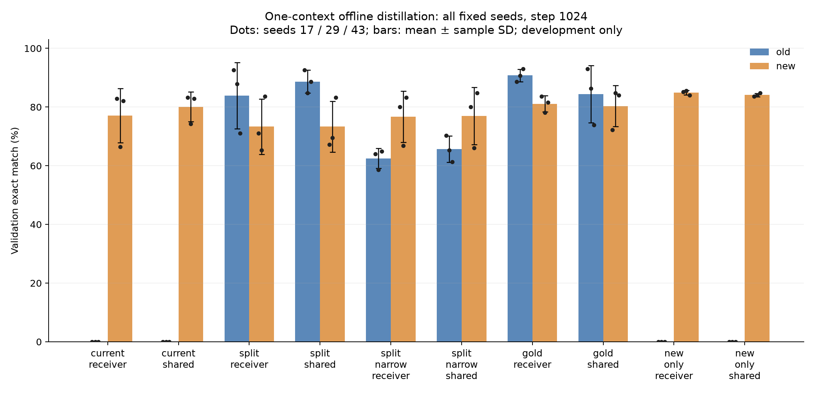
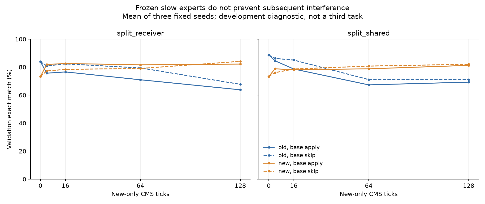

# V7: teacher signal, coverage and interference in one-context consolidation

This development study completed 30 fixed Llama-3.2-3B offline training runs and 12 subsequent wake-stress branches. The combined intervention of a protected old teacher, origin-selected targets and diverse old prompts substantially improves retention. It does not produce a reliable three-seed solution to both tasks. Extra true answer labels provide a useful positive control: `gold_receiver` reaches old/new validation exact match **90.76% / 81.12%**, with 2/3 seeds passing both learning gates. No arm passes both gates in all three seeds.

These are exploratory results on repeatedly used development data. The reserved 1,024-example confirmation set was neither opened nor scored. They are not a reproduction of the original Sleep paper's benchmarks or a confirmation of a general continual-learning benefit.

## Question and relation to earlier results

The [v6 study](agnews-routing-fairness-v6.md) retained separate old/current contexts and optionally learned a phase gate. That carries additional storage and supervision. Here each arm uses the same inference policy with no task-identity gate, and asks whether training one new slow receiver can express old and new behavior together. The already existing old slow slot is still allocated, frozen and potentially routed to: “one context” does **not** mean only one expert exists in the model.

The [Sleep paper](https://arxiv.org/html/2606.03979v2) motivates transferring behavior into a slower receiver before it is lost and separating fast adaptation from slow storage. Its knowledge seeding and on-policy distillation/imitation, receiver routing and class-incremental protocol differ materially from this offline diagnostic. The [Nested Learning author manuscript](https://abehrouz.github.io/files/NL.pdf) motivates updates at different frequencies. This study uses our existing two-level last-MLP rank-16 extension, not the paper's full architecture. The [HOPE repository](https://github.com/obekt/HOPE-nested-learning) motivated retention and implementation checks; no upstream code was copied for v7.

## Frozen setup and interventions

The backbone is the previously acquired ModelScope `LLM-Research/Llama-3.2-3B`, revision `48d84dd14886f01964f72e7f742a404dd86f9fb6`. Model weights, tokenized articles, feature caches, teacher logits and checkpoints are not distributed. AG News development roles remain 1,024 training articles and 512 disjoint validation articles, balanced across four classes. Classes 0/1 are old and 2/3 new. Seeds 17, 29 and 43 use the same articles and backbone with different codebooks/training trajectories; they are not independent dataset replications. See the [frozen protocol](../docs/agnews-single-receiver-v7-protocol.md) and [active r2 configuration](../configs/agnews-single-receiver-v7-r2.json) for hashes.

Each seed starts from its preselected v6 `aux_new_CE` step-1024 checkpoint. Fast memory is reset, new slow slot 1 is activated with the fixed mix fraction 0.5, and old slow slot 0 stays frozen. The warm old teacher passes the predefined old-task gate in every seed (old validation EM 92.19%, 93.75%, 90.62%). The fixed current teacher scores **0% old** in every seed and new EM **83.20%, 67.58%, 83.20%**. Its middle-seed weakness is retained, not selected away. A teacher's score is descriptive, not a mathematical ceiling on the student.

| Family | Target/data intervention | Extra information |
|---|---|---|
| `current` | Current teacher KL on balanced old/new prompts | Prompt class metadata for stratification; no old protected teacher |
| `split` | Warm teacher on old prompts; current teacher on new prompts | Prompt origin selects the teacher; two saved teacher contexts |
| `split_narrow` | Same targets, old pool reduced from 256 to 16 articles per old class | Same old draw mass, fewer distinct old articles/more repetitions |
| `gold` | Cross entropy with true answers on all four classes | Actual old and new answer labels |
| `new_only` | Cross entropy on the two new classes | True new answers; twice the per-update new-example mass |

All families have batch size 8 and 1,024 AdamW updates (lr .003, zero weight decay, clip 1). Balanced families draw two examples per class; `new_only` draws four per new class. Equal update counts therefore do not mean equal new exposure, label information or teacher preparation cost. Each family is crossed with `receiver` (98,304 trainable parameters) and `shared` (also updates the two CMS base A/B pairs; 294,912 trainable parameters). The latter has three times the trainable parameter count. Both allocate the same frozen backbone/head and memory architecture; this is a capacity intervention, not a parameter-matched algorithm comparison.

We evaluate fixed checkpoints 0/64/256/1024, report the final checkpoint without selection, and retain every seed. A task passes only when train EM ≥80%, validation EM ≥75% and each associated validation class EM ≥70%; both tasks must pass for a joint gate. Full-vocabulary two-token greedy EM is the main measure. The known answer marker is appended to score the conditional class position; no gold class token enters the input. Article prefixes are at most 117 tokens, and all v7 execution uses fixed length 118. Thus v7 scores are not numerically identical to historical variable-padding v3–v6 evaluation.

## Offline endpoint results

Means ± sample SD in percentage points, n=3. Gates include train and per-class conditions, so pooled old/new means alone do not establish passage.

| Arm | Old validation EM | New validation EM | Joint gate |
|---|---:|---:|---:|
| current_receiver | 0.00 ± 0.00 | 77.08 ± 9.25 | 0/3 |
| current_shared | 0.00 ± 0.00 | 80.08 ± 5.08 | 0/3 |
| split_receiver | 83.85 ± 11.30 | 73.31 ± 9.38 | 0/3 |
| split_shared | 88.67 ± 3.91 | 73.31 ± 8.65 | 1/3 |
| split_narrow_receiver | 62.50 ± 3.41 | 76.69 ± 8.71 | 0/3 |
| split_narrow_shared | 65.62 ± 4.50 | 76.95 ± 9.76 | 0/3 |
| gold_receiver | 90.76 ± 2.15 | 81.12 ± 2.77 | 2/3 |
| gold_shared | 84.38 ± 9.72 | 80.34 ± 7.00 | 1/3 |
| new_only_receiver | 0.00 ± 0.00 | 84.90 ± 0.81 | 0/3 |
| new_only_shared | 0.00 ± 0.00 | 84.11 ± 0.60 | 0/3 |



Replacing current targets with origin-selected protected old targets raises old EM by 83.85 points in the receiver scope and 88.67 points in shared scope. This estimates the effect of the **whole target-source intervention**, including saved old context and origin metadata, not a benefit from distillation without extra information. Narrowing the old pool lowers old EM in all six matched seed/scope comparisons; the mean reductions are 21.35 and 23.05 points despite the same number of old draws. Diversity/repetition matters in this setup.

The receiver-only gold control can express substantial competence on both tasks. This argues against an absolute inability of this receiver architecture to express the two mappings. It does not isolate teacher error from KL-vs-CE differences or establish that more training would solve distillation. The additional shared bases do not consistently improve joint success, so trainable capacity alone is not an adequate explanation. Full train/validation EM, NLL, per-class results and signed seed contrasts are in the [aggregate analysis](../results/agnews-single-receiver-v7/analysis/endpoint-table.md).

## Subsequent wake stress

The two `split` scopes were preselected for 128 additional new-only CMS ticks, crossed with applying versus consuming/skipping base proposals. Fast experts adapt in both conditions; all slow expert-slot weights remain frozen, while CMS base proposals at both levels are applied or consumed according to the branch. Periods are 4/16, base lr .02 and expert lr .04, with the same new-class schedule and CE computation. Both branches have identical model states for their first three ticks. Numerical gradients can diverge after the first applied base write at tick 4. This continues the new task; it is not a novel third task. Most starting checkpoints already fail the joint gate, so this is a stress diagnostic rather than a qualified continual-retention benchmark.

Validation EM (%) mean ± sample SD over three fixed seeds:

| Offline scope / base proposal | Old EM at 0 → 128 | New EM at 0 → 128 |
|---|---:|---:|
| receiver / apply | 83.85 ± 11.30 → 63.80 ± 11.15 | 73.31 ± 9.38 → 82.16 ± 4.58 |
| receiver / skip | 83.85 ± 11.30 → 67.71 ± 10.84 | 73.31 ± 9.38 → 84.11 ± 1.85 |
| shared / apply | 88.67 ± 3.91 → 69.27 ± 18.68 | 73.31 ± 8.65 → 81.25 ± 4.80 |
| shared / skip | 88.67 ± 3.91 → 71.09 ± 22.03 | 73.31 ± 8.65 → 82.03 ± 1.56 |



Skipping base writes modestly improves mean old EM at the final checkpoint but does not preserve it; the shared-scope seed SD is large (22.03 points in the skip branch). Frozen slow expert slots do not guarantee stable predictions when fast outputs or shared transformations change. Masking fast **expert outputs** in the skip-base branch restores its pre-stress source checkpoint scores exactly (EM; NLL tolerance .001), as checked for every seed and scope. This identifies interference from the adapting fast path under that controlled branch. It does not prove that old knowledge is stored exclusively in a particular slow slot, and does not imply that masking fast outputs is a useful new-task inference policy.

## Read-only mechanism diagnostics

All 30 final models were evaluated with slow output slots disabled in four fixed conditions: none, old slot0, new slot1, and both. We also measured warm-old versus current-new **reference KL** gradients at steps 0/64/256/1024 on the first two training articles per class (one fixed batch of eight). These are common reference objectives, not the actual CE training gradients of the gold controls. The shared initial state was measured once per seed and reused, yielding 93 independent states rather than counting copied step0 rows as extra evidence. There were zero optimizer updates. Weights, execution policy and RNG matched before/after; hooks were removed. The transient `last_routes` diagnostic list may be refreshed by a forward and is not claimed to remain object-identical.

| Arm / disabled slow output | Old validation EM (%) | New validation EM (%) |
|---|---:|---:|
| split_receiver / none | 83.85 | 73.31 |
| split_receiver / old slot0 | 83.85 | 73.31 |
| split_receiver / new slot1 | 7.03 | 22.92 |
| split_shared / none | 88.67 | 73.31 |
| split_shared / old slot0 | 88.67 | 73.31 |
| split_shared / new slot1 | 61.98 | 35.03 |
| gold_receiver / none | 90.76 | 81.12 |
| gold_receiver / new slot1 | 7.03 | 22.92 |

The table gives means over all three seeds; raw per-seed scores, NLL and all ten arms are retained in [probe aggregates](../results/agnews-single-receiver-v7/probe-analysis/aggregate.md). At the two scored semantic positions, receiver-scope models naturally select new slot1 in 100% of audited positions (3,072 positions per arm across three seeds); old slot0's executed coefficient is zero and the mean new coefficient is .9071 under the fixed mix policy. Thus the receiver-only gains do not arise from an old/new task gate choosing the saved old expert at these positions. In `split_shared`, natural old selection is 29.20%, with mean executed old/new coefficients .1412/.7344. Masking old slot0 leaves EM unchanged here too, which does not imply that logits or NLL are unchanged. Masking new slot1 sharply reduces both tasks. The larger shared-scope residual performance is consistent with additional dependence on shared transformations, without uniquely locating stored knowledge.

The final receiver-gradient reference-KL cosine is **-0.0251 ± .673** for `split_receiver` and **-0.1387 ± .929** for `split_shared`; the new reference gradient norms also exceed the old norms in their mean (10.232 vs .315; .292 vs .0069). Slow-base1 reference cosines average -0.3993 ± .331 and -0.2387 ± .280, respectively. The seed dispersion and local batch scope rule out a claim of uniform destructive gradient conflict. Moreover, base groups are only hypothetical probe directions in the frozen receiver scope. These observations support testing target quality/weighting and fast-path isolation, rather than asserting that one universal gradient mechanism explains every failure.

## Numerical correctness, recovery and cost

The frozen last-MLP input/residual cache evaluates only the two semantic positions but scatters them back into padded length 118 before the low-rank tail, preserving the BF16 matrix shapes. Initial short-matrix cache attempts failed the predefined numerical guard (maximum logit difference .0625 versus .05). The guard was not relaxed. The padded implementation passed full-versus-cache forward, loss and gradient checks in both scopes; eight full/cached loss-path update pairs also matched weights, optimizer state, policy and RNG exactly. Every completed main and stress endpoint passed a full-backbone validation check with exact EM and NLL difference ≤.001. A restore bug that froze trainable parameters caused the first resume qualification to fail after two updates; it was fixed and the second qualification passed. These failures and their executed sources are preserved.

The original main process stopped without an exit receipt or global execution-work file; the cause is unknown. Its original progress is preserved: 28 completed arms, seed43 `new_only_receiver` last observed at 704, and the final arm not started. After a separate actual-checkpoint restore qualification, only the incomplete receiver suffix (from saved step256) and the final arm were run. This adds 448 known repeated updates; an additional 0–64 attempted original updates may have occurred after its last persisted progress. The finished 30-arm seal binds both attempts. Do not describe it as an uninterrupted run or infer an original full-cost ledger from the finished seal.

Logical main updates total **30,720**; known observed attempts total **31,168**, plus the unknown original count **0–64**. Successful/failed numerical and restore qualifications add **34 Adam updates** separately (16 loss-path + 2 failed resume + 12 successful resume + 4 recovery proof). Stress main adds **1,536 CMS ticks**, stress qualification **16 proof ticks**, and read-only probes **zero optimizer updates**. The stress qualification's generic plan lists the main 128-tick schedule, but its actual proof runs only eight ticks per write condition and performs no scoring. CPU checks are separately budgeted.

`MatmulWork` counts actual executed `mm/addmm/bmm/mv/dot` shapes, with multiply-add counted as two operations. These are matrix-arithmetic **lower bounds**, excluding normalization, nonlinearities, elementwise operations, softmax, optimizer operations, I/O and hardware energy. Recovery, qualifications, stress and diagnostic ledgers retain their own measured counts. Original arm-local counters are incomplete and overlap global scopes; do not add them to recovery or treat them as a complete original total. The missing preparation ledger has 864 scheduled full-forward calls and the interrupted partial arm has 576 scheduled cached evaluation calls; their FLOPs are not fabricated. No complete end-to-end measured FLOP total or energy claim is available.

The X870E run used an RTX 5090 D (32,607 MiB), Python 3.11.17, Torch 2.8.0+cu128 and Transformers 4.57.1. Teacher creation in v4/v6 is a prior cost, not free. Teacher snapshots, full-vocabulary teacher logits and feature caches add substantial private storage; none are required at final student inference. Both teacher-selection arms use phase/class metadata during training, and the gold arms use answer labels. Inference has one backbone evaluation, the existing two-level low-rank paths and a fixed mix policy; it has no task classifier or second full-model teacher pass. Shared scope has extra trainable/optimizer state during training, not extra inference layers relative to receiver scope. Checkpoint and cache bytes are itemized in the release storage receipt; no weights/data are uploaded.

All 155 new checkpoint files, including failed qualifications, were independently loaded on CPU. 154 matched hashes already bound by receipts; the failed qualification's unbound pending checkpoint is now hash-recorded without pretending it had a prior receipt. No Ubuntu formal jobs, sealed P2/Phase13 data or reserved AG News confirmation data were used.

Full offline CPU regression passed 227 tests with one explicitly deselected CPU-wheel-specific optional-dependency test under the installed CUDA build. The toy update ledger records 253/256 allowed attempts; the eight-tick stress controller check has a separate explicit budget. After the aggregate denominator correction, its two synthetic tests were rerun. The release validator recomputes every published aggregate/table from bundled receipts, treating JSON semantically and normalizing text newlines for portability, while source-bound raw receipt hashes retain their original bytes.

## Reanalysis and limits

The bundled aggregate-only main receipts can be reanalyzed on CPU:

```sh
python tools/summarize_agnews_single_receiver_v7.py \
  --main-dir results/agnews-single-receiver-v7/main-r2 \
  --config configs/agnews-single-receiver-v7-r2.json \
  --qualification results/agnews-single-receiver-v7/resume-qualification-r2/qualification.json \
  --cache-qualification results/agnews-single-receiver-v7/cache-qualification-r3/qualification.json \
  --loss-path-qualification results/agnews-single-receiver-v7/loss-path-qualification-r1/qualification.json \
  --qualification-work results/agnews-single-receiver-v7/resume-qualification-r2/execution-work.json \
  --prior-qualification-failure results/agnews-single-receiver-v7/resume-qualification-r1/qualification-failure.json \
  --prior-failure-work results/agnews-single-receiver-v7/resume-qualification-r1/execution-work.json \
  --recovery-qualification results/agnews-single-receiver-v7/main-r2/recovery-qualification-r1/qualification.json \
  --recovery-qualification-work results/agnews-single-receiver-v7/main-r2/recovery-qualification-r1/execution-work.json \
  --source-root . --out-dir outputs/v7-main-reanalysis
python tools/summarize_agnews_v7_probes.py \
  --stress-dir results/agnews-single-receiver-v7/stress-main-r1 \
  --diagnostics-dir results/agnews-single-receiver-v7/diagnostics-r1 \
  --out-dir outputs/v7-probe-reanalysis
```

Fresh model execution requires legally acquired model/data assets and the exact prior teacher checkpoints whose hashes are recorded; those are not supplied by the aggregate release. Public hashes validate provenance, not public availability. Main and stress drivers refuse output reuse and bind their configuration, data and teacher sources. This release supports aggregate reanalysis and source inspection, not an assets-free replay of historical training.

No formal significance claim is made from n=3 correlated development seeds. Gradient cosines describe one fixed eight-example training batch, output lesions describe conditional path contributions, and neither establishes a universal mechanism. A next distinct experiment could separate teacher hard-label error from soft KL targets and use a stronger **prequalified** new teacher; it must be designed on development data before a new confirmation protocol is frozen. These results are retained as mixed/negative evidence rather than advertised as an unlabeled Sleep solution.
