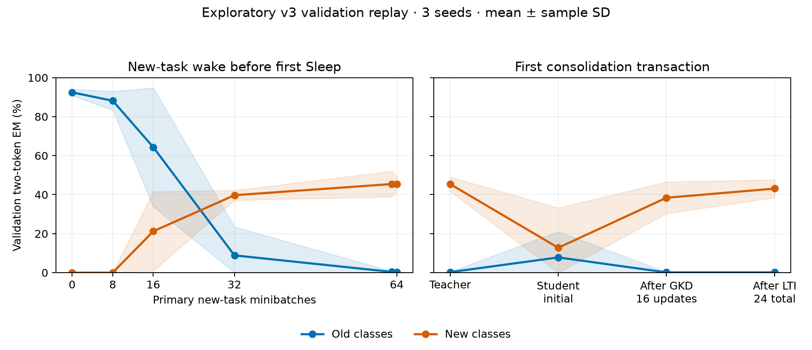

# Why v3 Sleep did not preserve the old task

**The main measured failure happened before the first Sleep event.** On the already-used train-derived validation set, mean old EM fell from 92.45% at the foundation to 0.39% at new-task step 63. The actual first Sleep teacher scored 0.26%. It therefore supplied almost no correct old-task behavior to distill. This is a post-v3 exploratory diagnosis, not a new confirmation, replacement endpoint, or a proof that Sleep caused earlier forgetting.

The [frozen v3 study](agnews-qualified-v3.md) remains unchanged. This diagnosis adds exactly 192 supervised replay updates and 72 Sleep Adam updates, taking 272.297s. It uses seeds 17/29/43, their original foundations, schedules, model weights and method settings. Only the existing validation roles were scored: 128/class, old/new 256 each, all 512. The v3 final holdout was already scored in the earlier formal evaluation. This diagnostic did not read its prompts/labels or rescore it.

## What the existing evidence already established

The [aggregate audit](../results/agnews-sleep-forensics-v3/aggregate-forensics.md) retains all 66 original checkpoint rows and 48 Sleep events. At the original fixed endpoints, old EM is 0 for SFT/CMS/Sleep, while marker accuracy is 100%; class prediction, rather than the shared output marker, fails. Sleep's new-class trajectory is nonmonotonic. All 48 events had positive receiving gradients and executed mixed-receiver coverage 1.0. Natural top1 covered 1283/1920 loss positions, but that is a separate counter: the active 0.5 mixture provided the actual training path. Incomplete natural coverage is not evidence that v3 had the earlier zero-gradient bug.

## Replay the missing first boundary

The [new diagnostic source](../tools/diagnose_agnews_sleep_v3.py) observes the original engine with no-grad hooks. Every seed's post-Sleep 64 adapter state, controller, execution policy and global RNG exactly matches its existing recovery checkpoint. Existing CMS 64 controls also match for seeds 29/43; the original seed 17 CMS 64 file does not exist, so that control is explicitly unavailable. The [plan](../results/agnews-sleep-forensics-v3/diagnostic-plan.json) was written before replay updates, source-pinned and bounded to the stated 192/72 updates; its 900-second elapsed limit is checked cooperatively between operations, not a forced kernel interruption.

There are 54 observed states and 864 fixed-subset literal two-token autoregressive checks. All exactly agree with the frozen scorer's EM. Weights, policy and RNG are unchanged by observations. Post 24-update student metrics exactly match committed metrics in all three seeds. These checks found no clear loss-position, scoring, hidden label-supervision, receiver-gradient or commit-state error. They do not prove the complete implementation correct on every input.

Means ± sample SD across the same three seeds:

| Stage / policy | Old EM % | New EM % |
|---|---:|---:|
| Foundation | 92.45 ± 1.63 | 0.00 ± 0.00 |
| Foundation, fast bank disabled | 47.79 ± 46.90 | 0.00 ± 0.00 |
| Wake step 8 | 88.15 ± 4.82 | 0.00 ± 0.00 |
| Wake step 16 | 64.32 ± 30.51 | 21.22 ± 20.37 |
| Wake step 32 | 8.85 ± 14.66 | 39.71 ± 2.48 |
| Wake step 63 | 0.39 ± 0.39 | 45.44 ± 6.56 |
| Boundary 64, before base commits | 0.39 ± 0.39 | 42.58 ± 6.14 |
| Boundary 64, CMS without reset | 0.26 ± 0.23 | 44.40 ± 8.01 |
| First teacher, slow proposal applied | 0.26 ± 0.23 | 45.44 ± 3.63 |
| Student before distillation | 7.81 ± 13.19 | 12.76 ± 20.43 |
| After 16 GKD updates | 0.13 ± 0.23 | 38.41 ± 8.14 |
| After 24 GKD+LTI updates | 0.13 ± 0.23 | 43.10 ± 4.56 |
| Committed at step 64 | 0.13 ± 0.23 | 43.10 ± 4.56 |



Teacher construction follows the frozen local order: collect the boundary batch, apply the due slow-level 1 proposal in a clone, then clone the teacher. The student additionally receives the prospective fast-level 0 base proposal, resets its fast bank and opens a receiving slow slot. The teacher is pre-sender-base-update; it is not a protected old-task snapshot. The no-reset CMS 64 control makes the pending fast update without the reset/consolidation.

The effects vary by seed. Removing the foundation's fast bank changes old validation EM to 0%,93.75%,49.61% for seeds 17/29/43; this is functional dependence, not proof of exclusive memory localization. Seed43's initial student briefly recovers 23.05% old EM after the combined prospective-update/reset/expansion step, then drops to0 after GKD toward the nearly-forgotten teacher. This is consistent with distilling an incorrect target, but it does not isolate that target from all other training effects. A protected-teacher control has not yet been run.

## Inspect what the teacher actually teaches

Every first event uses 24 train-derived prompts, balanced 6/class: 16 GKD and 8 LTI, with equal teacher-generated/on-policy GKD counts. Old prompts are present; old gold labels are not used in Sleep optimization. Their labels enter only these no-grad diagnostics. Original wake CE uses gold labels, and the extra-replay arm uses them explicitly.

Across 34 sampled old-task contexts whose first generated marker was correct, teacher greedy class correctness is 0/34; mean gold-old-class probability is 0.90%, while new-class codes receive 98.68% probability mass. Two incorrect-marker contexts are reported separately. These contexts are correlated sampled training prompts, not independent test examples. The [complete per-update target audit](../results/agnews-sleep-forensics-v3/diagnostic-result.json) and [stratified summary](../results/agnews-sleep-forensics-v3/analysis.json) retain both groups and all losses.

Positive gradients therefore demonstrate that the receiver can learn the current teacher; they do not imply a correct retention target. For example, old teacher-generated GKD's same-sample objective decreases in 11/12 updates while the teacher's greedy old class is wrong in 12/12. Distillation can succeed locally while copying the wrong class behavior. Other GKD/LTI updates sometimes increase the objective; the 24-update recipe is not shown to converge. A larger distillation budget alone is not established as a remedy for an already-wrong teacher.

## Test fixed routing alternatives without selecting a new method

Five policies were specified before replay: actual persistent mix, natural routing, disabling the slow experts, forcing the oldest slow expert and forcing the latest. They are read-only validation probes of the original final checkpoints. Every policy has 0 old EM in every seed. Their new-task means differ; no policy replaces the original deployed endpoint or is presented as a validated improvement.

| Stage / policy | Old EM % | New EM % |
|---|---:|---:|
| Original 0.5 mixture | 0.00 ± 0.00 | 73.96 ± 8.40 |
| Natural top1 | 0.00 ± 0.00 | 76.82 ± 4.88 |
| Slow experts disabled | 0.00 ± 0.00 | 54.30 ± 26.24 |
| Oldest slow expert forced | 0.00 ± 0.00 | 63.93 ± 16.68 |
| Latest slow expert forced | 0.00 ± 0.00 | 62.50 ± 26.50 |

The actual latest mixed component's mean L2 norm at new-validation loss positions is approximately2.02,0.0000209,14.16 across seeds 17/29/43. Component norms and NLL changes show strongly different functional scales; they do not measure stored semantic knowledge or establish why new-task accuracy differs. Zero old accuracy under these five probes argues against a simple latest-route switch being sufficient; it does not rule out every possible retrieval intervention. The original new-task performance gap has not been fully causally decomposed.

## Compare the mechanism, then choose the next development experiment

[Sleep §§3.2–3.3](https://arxiv.org/html/2606.03979v2#S3.S2) place consolidation before the sender's base update, followed by resetting sender experts and optimizing newly expanded receiver parameters. Its example consolidates for each fast update. The paper also uses a larger memory hierarchy and a semantic reward model; its class-incremental experiments specifically isolate consolidation without Dreaming (§4.1; AppendixB). These differences prevent treating this diagnostic as a paper reproduction; absence of Dream alone is not an explanation for this classification failure.

Our fast/slow base periods are 4/16, but Sleep runs every 64 minibatches. Before its first event, the fast base has already committed at 4,8,...60 (15 times), the slow base at 16/32/48 (3 times), and the fast expert has updated online on new data. The first event additionally applies the 64-step slow proposal before constructing its teacher. This is a material, already-frozen schedule departure; it is not a newly discovered indexing bug and must not be silently changed in v3. The local two-level rank 16 last-MLP extension, fixed random router, persistent 0.5 mixture, two-token output and exact-output LTI reward remain additional partial-implementation choices.

The highest-priority next experiment is **transfer while the teacher still knows the old task**, rather than expanding a late distillation budget. On train/validation only, preserve the qualified old checkpoint as an explicit teacher and attempt boundary consolidation before any new-task update. Freeze a teacher-to-student transfer tolerance, finite budget and no-reset/reset-without-KD/reset-with-KD controls before running. Check whether the receiver can preserve that competent teacher before allowing a destructive reset/commit. A protected checkpoint teacher is a new engineering control, not claimed to be the paper's unchanged self-teacher.

If that transfer works, compare a schedule aligned to fast-base updates with the current delayed schedule, with explicit capacity and cost budgets. Capacity 32 must account for every newly allocated receiver; increasing event frequency cannot silently exhaust or overwrite slots. Only after teacher competence and transfer fidelity pass should we spend on larger receiver ranks, more GKD/LTI steps, route variants or Dream. Route choices and budgets must use development data; a new untouched holdout is required before a subsequent confirmatory claim. No such new-method training or confirmation was performed here.

## Evidence, cost and offline reproduction

The [diagnostic ledger](../results/agnews-sleep-forensics-v3/work-ledger.json) includes all replay and observation forwards. Literal greedy and observer forwards go through the model's metered logits method. Direct low-rank component-norm hooks are extra unmetered adapter work, explicitly excluded from the token proxy. Wall time is not GPU busy time, energy or FLOPs. The GPU work here is 192 SGD+72 Adam; including it gives 20736 logical v3 supervised updates and 1224 logical Adam updates. Including the earlier process-loss bounds yields 20800–20992 SGD and 1248–1320 Adam. Earlier v1/v2 studies remain separately accounted.

```sh
python tools/summarize_agnews_sleep_forensics_v3.py --diagnostic results/agnews-sleep-forensics-v3/diagnostic-result.json --plan results/agnews-sleep-forensics-v3/diagnostic-plan.json --out-dir outputs/sleep-diagnostic-reanalysis --plots
python tools/summarize_agnews_v3_aggregate_forensics.py --out-dir outputs/v3-aggregate-audit
```

Omit `--plots` for standard-library-only tables/JSON. The [validation receipt](../results/agnews-sleep-forensics-v3/validation.json) records exact replay, decoder agreement, no observation mutation and separate-agent review. The CPU fixture compares an uninstrumented versus instrumented tiny-Llama event for model/controller/policy/RNG identity; the real 3B exact-replay checks are separate evidence. Published artifacts are aggregate metrics, source/config hashes and figures, not articles, token packs, model weights, generated token sequences, checkpoints or secrets. The original v3 heldout scores and core source files remain unchanged.
