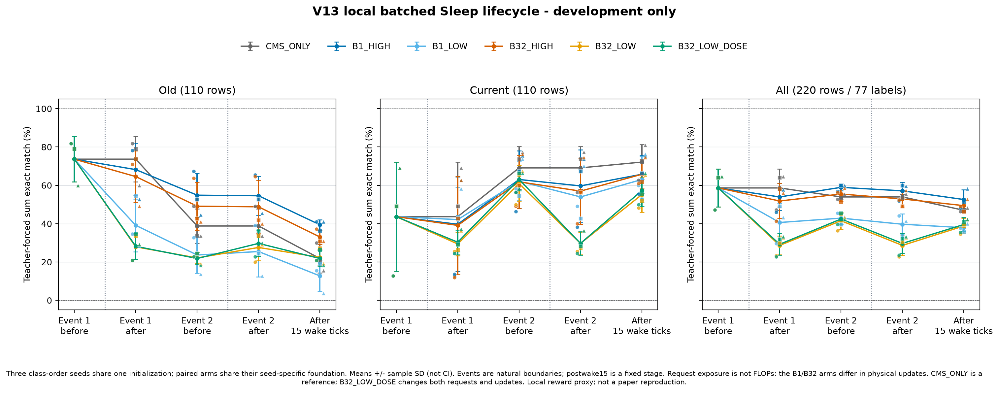
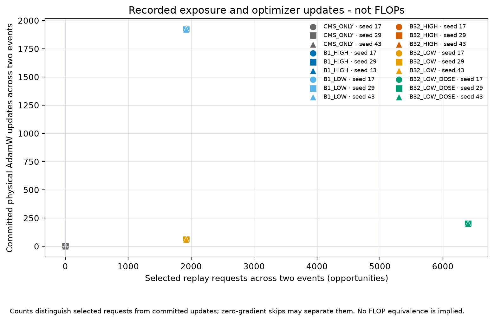

# Banking77 V13: effective batch 32 in a local multi-boundary Sleep pipeline

## Status

The protocol was frozen before inspecting V13 outcomes; this is a development-only comparison, not an externally registered study. All 18 trajectories and their fixed evaluations completed; all arms, seeds and stages are reported below. The study uses the existing pinned Banking77 training/development pack and qualified task-0 foundations. It does not acquire new data or read the official test set. Earlier official-test results from prior work are already known, so V13 development scores are not fresh confirmation.

## Model, data and environment

The existing local model is [ModelScope `LLM-Research/Llama-3.2-3B`](https://modelscope.cn/models/LLM-Research/Llama-3.2-3B), revision `48d84dd14886f01964f72e7f742a404dd86f9fb6`. The backbone is loaded in BF16 on `cuda:0` with eager attention. The paper does not identify this exact 3B checkpoint; using it is a local choice. Additional memory has rank 64, five levels and capacity eight slots per level; sequence length is capped at 128. Sleep generation uses temperature 0.8 and at most 10 new tokens, with KL temperature 1.0.

The reused training/development pack comes from [original `PolyAI/banking77`](https://huggingface.co/datasets/PolyAI/banking77/tree/9d081458ff52e53cf7e848f414e6e9344e4e6696), revision `9d081458ff52e53cf7e848f414e6e9344e4e6696`, and is bound by manifest SHA-256 `ed9f4b047768021cbf16a3fa042db12baf212038f89f33a00099f2e32b7300f3`. It contains 9,229 training and 770 development examples with 77 labels. No new dataset or weights were downloaded for V13. The official test files were not loaded in this study.

Execution used the existing Windows X870E environment and RTX 5090D 32 GB recorded in preflight: Python 3.11.17, PyTorch 2.8.0+cu128, Transformers 4.57.1, Accelerate 1.10.1, NumPy 2.2.6, Tokenizers 0.22.2, Safetensors 0.8.0, PyArrow 20.0.0, ModelScope 1.31.0 and huggingface-hub 0.36.2. GPU memory fraction was capped at 0.8. Hardware FLOPs and peak VRAM were not measured. Initialization seed is 1907008; seeds 17/29/43 control the paired class-order/data-order variants.

## Question and relation to Sleep Table 5

V12 found that batch size and learning rate changed fixed-teacher receiver fit, but did not show that the lower-fit-KL setting improved development classification accuracy. V13 tests whether that optimizer-scale observation carries into the full local on-policy GKD+LTI assembly over two natural level-0 boundaries and subsequent wake updates.

Sleep v2 Appendix B.4 Table 5 lists an effective batch size of 32, learning rate `5e-6`, and 100 Sleep steps, with LoRA rank 64 and alpha 128. Its task scope is unspecified: B.4 is titled “Additional Details,” and neither the table nor nearby text names a dataset or declares an all-experiment recipe. The paper does not specify that every continual-classification Sleep event uses 32 replay requests or 100 optimizer steps. It does not publish the task-specific replay count, batch accumulation rule, number of optimizer updates per boundary, task order, or a conversion from a paper “step” to a request/minibatch in this Banking task. The inspected author/publication sources contain no linked executable recipe for this paper. We therefore test a local, explicit interpretation and do not call it a paper reproduction.

Our model uses nonlinear sparse CMS memory experts, so Table 5's LoRA alpha is not inserted as a scaling multiplier. The local clock unit is one wake optimizer minibatch. The semantic reward is a canonical-label equivalence proxy, not the paper's frozen semantic reward model; LTI retains the local normalized edit proxy and the frozen local KL/reward mixture. GKD uses alternating teacher/student policy sampling. These are transparent implementation choices, not claims about undisclosed paper settings.

| Detail | Primary-source position | V13 treatment and remaining gap |
|---|---|---|
| Effective batch | Appendix B.4, Table 5: 32 in all three columns | New-task wake tensors have 32 requests; Sleep batch 32 uses microbatch 1 with request-mean gradient accumulation. The task-0 foundations remain batch 8. Batch 1 remains an explicit comparison. |
| Replay requests per Sleep update | Section 3.3 defines teacher/student sequence objectives but not a classification request count or accumulation rule | Batch 32 means 32 selected requests before one AdamW update. It is a local operational interpretation, not a disclosed author recipe. |
| LR and steps | Table 5: LR `5e-6`, 100 Sleep steps | Sleep tests `5e-6` versus the existing `1e-3`. The 3,200-request condition has 100 batch-32 update opportunities per event. Wake fast/base rates remain 0.1/0.001 for the shared local controller; they are not aligned to Table 5. |
| Extra memory and LoRA | Appendix B opening: five dimension-64 MLP blocks; Table 5: LoRA rank 64, alpha 128 | Five local memory levels and rank-64 bottlenecks do not establish the same placement, routing or active parameter count. LoRA alpha is not transplanted into the nonlinear expert parameterization. |
| Optimizer, clipping and decay | No task-specific Knowledge-Seeding optimizer recipe was found in the inspected text/table | The pinned local transaction uses AdamW with PyTorch 2.8 defaults (betas 0.9/0.999, epsilon `1e-8`), weight decay 0 and global gradient clipping at 1, once per effective batch. |
| GKD/LTI mixture and reward | Section 3.3, Eqs. 1 and 3-5; mixture coefficients, threshold and semantic reward-model identity are not numerically specified for this task | The inherited local coefficients, `z0=8`, alternating GKD policies, `GKD,GKD,LTI` schedule and canonical-label semantic proxy remain explicit assumptions. Equation 4's raw-distance threshold followed by length-normalized similarity is preserved. |

Sources: [Sleep v2, Section 3.3 and Appendix B/B.4](https://arxiv.org/html/2606.03979v2),
[author publication listing](https://alibehrouz.com/publications/), and the
[primary-source audit](../docs/sleep-paper-v13-primary-source-audit.md).
The implementation details are bound by the
[frozen configuration](../configs/banking_v13_batched_lifecycle_frozen_a.json),
[batch helper](../tools/banking_cil_v13_batching.py) and
[existing transaction](../tools/banking_cil_v10_lifecycle.py).

## Frozen design

The design has six arms across seeds 17, 29, and 43, all starting from the same seed's qualified task-0 foundation. Foundation wake batches were size 8; task-1 wake batch size 32 is applied identically to every arm and does not retroactively change the foundation. The design holds the wake schedule and base/fast learning rates fixed.

| Arm | Sleep batch | Learning rate | Requests per event | Update opportunities per event |
|---|---:|---:|---:|---:|
| `CMS_ONLY` | — | — | 0 | 0 |
| `B1_HIGH` | 1 | `1e-3` | 960 | 960 |
| `B1_LOW` | 1 | `5e-6` | 960 | 960 |
| `B32_HIGH` | 32 | `1e-3` | 960 | 30 |
| `B32_LOW` | 32 | `5e-6` | 960 | 30 |
| `B32_LOW_DOSE` | 32 | `5e-6` | 3,200 | 100 |

Each Sleep event follows the same `GKD, GKD, LTI` method schedule. The primary 2×2 contrasts match prompt/request exposure within event; they do not match actual generated tokens, optimizer updates, or FLOPs. At 960 requests, batch 1 performs 960 update opportunities and batch 32 performs 30. Thus the batch contrast estimates the combined effect of gradient aggregation and fewer updates at fixed request exposure, not a batch-size-only effect. The `B32_LOW_DOSE` condition changes both data exposure and update count relative to `B32_LOW`; it is a dose comparison, not a pure batch contrast.

The deterministic request selector uses a shared 3,200-position schedule per event. Each arm consumes its configured prefix, so matched conditions use the same prompt positions while their generated on-policy targets can differ. The selector uses old/current task and class metadata, an additional data privilege that is recorded rather than described as label-free.

The replay prompts are cached training-query text; the response targets are
generated by the teacher or student. This retains access to an old-query store
and its selection metadata. It should not be described as a wholly synthetic
prompt distribution or as a paper-specified replay sampler: the inspected Sleep
classification recipe does not resolve that operational detail.

`CMS_ONLY` runs the same task-1 wake schedule and batch size but has no Sleep fitting, expansion, or Sleep-generated target work. It is a lower-cost reference, not a compute- or information-matched control. Claims about the batch and learning-rate factorial are based on contrasts among the Sleep arms; CMS differences are contextual and cannot isolate Sleep from extra compute, generated targets, or receiver capacity.

The boundary operation also differs: the inherited CMS controller applies the
accumulated base proposal and keeps the fast expert; the Sleep transaction trains
an expanded receiver and commits the prospective sender update with its
transient experts reset. Consequently, CMS-versus-Sleep is a whole-lifecycle
comparison, not a distillation-only ablation. The Sleep factorial holds this
expansion/reset behavior fixed across its four cells.

The actual inherited wake cursors are 348, 326, and 322. The two level-0 boundaries occur at ticks 352/368, 336/352, and 336/352 for seeds 17/29/43. The runs continue 15 further wake minibatches, ending at ticks 383/367/367 before another level-0 due point. The clock unit is a local minibatch assumption, not a paper-specified request or token interval. An unexpected due level fails closed.

The full grid has 18 trajectories. Planned Sleep request exposure is 42,240 across the grid; the maximum planned Sleep optimizer opportunities are 12,480 before accounting for any exact-zero skip. Wake contributes 726 updates and 23,232 labeled request exposures. These were planned counts; the actual request, generated-token, update, forward/backward and wall-clock counters are reported below. Configured resource ceilings apply per run, with study totals reported as sums across runs. Qualification and engineering attempts are reported separately.

## Measurements and interpretation

At five predeclared stages—before and after each Sleep event and after the 15-step postwake interval—the evaluation uses the same 110 old and 110 current development examples and ranks all 77 labels without a task mask. Primary accuracy is teacher-forced summed log likelihood including EOS. Length-mean scoring, gold-label token NLL, and unconstrained greedy exact match are separate metrics. All seeds and stages are retained; no test-based or development-based arm/checkpoint selection is allowed.

This short two-boundary window does not establish long-horizon retention, full seven-task performance, or native HOPE/Sleep behavior. Three class-order seeds share a pretrained/foundation lineage and are not independent pretrained-model replications. Equal prompt counts do not equalize optimizer work or on-policy targets. V13 is a local development study and should not be compared to the paper's headline classification values as if task partitions, prompts, schedule, reward model, architecture, and metric were identical.

Wake budgets match across arms within each seed. Across seeds, reaching the
same two natural boundaries and 15-step postwake endpoint takes 35, 41, and 45
wake minibatches because qualified foundation clocks differ. The three-seed
spread therefore includes clock/horizon differences as well as class order;
it does not isolate class-order uncertainty alone.

## Parameter and checkpoint storage

A CPU-only shape/storage audit of four saved seed-17/B32_HIGH states found
`2 × 64 × 3072 = 393,216` trainable parameters in each new Sleep receiver
(1,572,864 FP32 bytes). The whole mutable adapter remains preallocated at
17,957,376 parameters: 71,829,504 FP32 parameter bytes, or 72,075,704 tensor
bytes including buffers. This allocation includes inactive slots and a frozen
rank-2 readout adapter; it is not the transient Sleep training scope.

Expert-slot active flags across levels 0–4 were `[1,0,0,0,0]` before event 1,
`[0,1,0,0,0]` after event 1, `[0,2,0,0,0]` after event 2, and `[1,2,0,0,0]`
after the postwake interval. These structural counts do not measure actual
per-token routing or hardware FLOPs. Storage stays preallocated, while sender
reset, receiver activation and renewed fast learning change availability.
All Sleep cells share this parameterization; CMS does not activate the new
receivers. Saved endpoint trainable flags are distinct from the per-event
receiver-only optimizer scope.

Each inspected checkpoint stores both the mutable context and an equal named
context inside the wake snapshot, plus lifecycle, gradient-window and RNG
state. Its roughly 149–151 MB file size is therefore not an adapter-parameter
count or a full 3B-backbone checkpoint. See the
[CPU audit](../results/banking-v13/provenance/parameter-shape-cost-audit.json)
and [audit implementation](../tools/audit_banking_v13_parameter_storage.py).

## Results

All 18 frozen trajectories completed on their first attempt. Values below are mean ± sample SD across the three paired class-order seeds, unless a seed is named. Accuracy is in percent; SD is descriptive, not a confidence interval. The joint column pools 220 queries from 22 seen classes while ranking all 77 candidate labels.

### Primary endpoint: after 15 further wake minibatches

| Arm | Old (110) | Current (110) | Joint (220; 77 labels) |
|---|---|---|---|
| `CMS_ONLY` | 21.82 ± 7.44 | 72.12 ± 9.11 | 46.97 ± 1.05 |
| `B1_HIGH` | 39.39 ± 2.62 | 65.76 ± 10.01 | 52.58 ± 5.11 |
| `B1_LOW` | 12.73 ± 8.08 | 63.03 ± 12.11 | 37.88 ± 2.05 |
| `B32_HIGH` | 33.03 ± 3.67 | 65.76 ± 7.62 | 49.39 ± 3.19 |
| `B32_LOW` | 22.42 ± 4.30 | 55.15 ± 9.11 | 38.79 ± 3.92 |
| `B32_LOW_DOSE` | 21.82 ± 4.17 | 57.27 ± 8.33 | 39.55 ± 3.61 |

The higher-rate Sleep cells retain more old-task accuracy than the CMS reference at this endpoint, with lower current-task accuracy. `B1_HIGH` differs from CMS by +17.58 percentage points on old queries, -6.36 points on current queries, and +5.61 points jointly; `B32_HIGH` differs by +11.21/-6.36/+2.42 points. These are whole-lifecycle reference differences, including extra replay, expansion and sender reset, not isolated distillation effects. They do not establish a cost-matched improvement.

The Table-5-number-inspired batch-32/low-rate settings do not recover the higher-rate results. Raising requests from 960 to 3,200 (30 to 100 updates per event) changes the endpoint by -0.61 old, +2.12 current and +0.76 joint points, while multiplying Sleep request exposure and updates by 3.33. Old accuracy is unchanged for seed 17 and lower for seeds 29/43; current accuracy is higher in all three seeds. Joint accuracy is higher for seeds 17/29 and unchanged for seed 43. The data support a small adaptation change, not an old-knowledge retention gain or a reproduction claim.

### All five fixed stages

The following table retains both immediate boundary changes and subsequent wake drift. CMS has no Sleep operation, so its before/after evaluation objects are identical at each boundary.

| Arm | Stage | Old % | Current % | Joint % |
|---|---|---|---|---|
| `CMS_ONLY` | `event1_before` | 73.64 ± 11.89 | 43.64 ± 28.57 | 58.64 ± 9.84 |
| `CMS_ONLY` | `event1_after` | 73.64 ± 11.89 | 43.64 ± 28.57 | 58.64 ± 9.84 |
| `CMS_ONLY` | `event2_before` | 38.79 ± 8.92 | 69.09 ± 11.17 | 53.94 ± 1.39 |
| `CMS_ONLY` | `event2_after` | 38.79 ± 8.92 | 69.09 ± 11.17 | 53.94 ± 1.39 |
| `CMS_ONLY` | `postwake15` | 21.82 ± 7.44 | 72.12 ± 9.11 | 46.97 ± 1.05 |
| `B1_HIGH` | `event1_before` | 73.64 ± 11.89 | 43.64 ± 28.57 | 58.64 ± 9.84 |
| `B1_HIGH` | `event1_after` | 68.18 ± 13.58 | 39.70 ± 24.69 | 53.94 ± 6.96 |
| `B1_HIGH` | `event2_before` | 54.85 ± 11.51 | 63.03 ± 15.00 | 58.94 ± 1.84 |
| `B1_HIGH` | `event2_after` | 54.55 ± 10.12 | 59.70 ± 18.90 | 57.12 ± 4.60 |
| `B1_HIGH` | `postwake15` | 39.39 ± 2.62 | 65.76 ± 10.01 | 52.58 ± 5.11 |
| `B1_LOW` | `event1_before` | 73.64 ± 11.89 | 43.64 ± 28.57 | 58.64 ± 9.84 |
| `B1_LOW` | `event1_after` | 39.09 ± 13.76 | 42.12 ± 16.87 | 40.61 ± 10.02 |
| `B1_LOW` | `event2_before` | 23.64 ± 9.58 | 62.12 ± 10.14 | 42.88 ± 3.03 |
| `B1_LOW` | `event2_after` | 25.45 ± 13.21 | 53.94 ± 14.27 | 39.70 ± 5.42 |
| `B1_LOW` | `postwake15` | 12.73 ± 8.08 | 63.03 ± 12.11 | 37.88 ± 2.05 |
| `B32_HIGH` | `event1_before` | 73.64 ± 11.89 | 43.64 ± 28.57 | 58.64 ± 9.84 |
| `B32_HIGH` | `event1_after` | 64.55 ± 13.45 | 39.09 ± 25.65 | 51.82 ± 9.12 |
| `B32_HIGH` | `event2_before` | 49.09 ± 12.63 | 61.82 ± 13.73 | 55.45 ± 3.72 |
| `B32_HIGH` | `event2_after` | 48.79 ± 13.68 | 56.97 ± 17.28 | 52.88 ± 4.12 |
| `B32_HIGH` | `postwake15` | 33.03 ± 3.67 | 65.76 ± 7.62 | 49.39 ± 3.19 |
| `B32_LOW` | `event1_before` | 73.64 ± 11.89 | 43.64 ± 28.57 | 58.64 ± 9.84 |
| `B32_LOW` | `event1_after` | 27.88 ± 6.45 | 29.39 ± 6.05 | 28.64 ± 4.92 |
| `B32_LOW` | `event2_before` | 22.12 ± 2.78 | 60.91 ± 9.49 | 41.52 ± 4.55 |
| `B32_LOW` | `event2_after` | 27.58 ± 6.94 | 29.70 ± 5.84 | 28.64 ± 5.24 |
| `B32_LOW` | `postwake15` | 22.42 ± 4.30 | 55.15 ± 9.11 | 38.79 ± 3.92 |
| `B32_LOW_DOSE` | `event1_before` | 73.64 ± 11.89 | 43.64 ± 28.57 | 58.64 ± 9.84 |
| `B32_LOW_DOSE` | `event1_after` | 28.18 ± 6.86 | 30.30 ± 6.45 | 29.24 ± 5.68 |
| `B32_LOW_DOSE` | `event2_before` | 21.82 ± 3.28 | 63.03 ± 5.77 | 42.42 ± 2.96 |
| `B32_LOW_DOSE` | `event2_after` | 29.70 ± 6.82 | 29.70 ± 6.05 | 29.70 ± 5.27 |
| `B32_LOW_DOSE` | `postwake15` | 21.82 ± 4.17 | 57.27 ± 8.33 | 39.55 ± 3.61 |

The low-rate batch-32 cells incur their largest immediate losses at the first event: old accuracy changes from 73.64% before the event to 27.88% (`B32_LOW`) or 28.18% (`B32_LOW_DOSE`) afterward. Their second event also lowers current accuracy from 60.91%/63.03% to 29.70%/29.70%. This local sequence is consistent with insufficient preservation through the expansion/reset transaction at these settings; it does not identify whether fit, routing, the reward proxy or architecture is the cause. The study has no reset-only control or author implementation with which to resolve that mechanism.

At the higher rate, old accuracy still falls during subsequent wake updates: `B1_HIGH` changes from 54.55% immediately after event 2 to 39.39% at the endpoint. Thus a relative retention advantage does not mean forgetting has been eliminated.

### Every seed at the primary endpoint

| Seed | Arm | Old % | Current % | Joint % | Greedy exact % | Gold-token NLL |
|---|---|---|---|---|---|---|
| 17 | `CMS_ONLY` | 30.00 | 62.73 | 46.36 | 18.18 | 1.258 |
| 17 | `B1_HIGH` | 40.91 | 55.45 | 48.18 | 17.27 | 1.379 |
| 17 | `B1_LOW` | 15.45 | 60.00 | 37.73 | 12.73 | 1.809 |
| 17 | `B32_HIGH` | 37.27 | 60.91 | 49.09 | 15.45 | 1.511 |
| 17 | `B32_LOW` | 20.91 | 48.18 | 34.55 | 0.91 | 2.911 |
| 17 | `B32_LOW_DOSE` | 20.91 | 50.00 | 35.45 | 1.36 | 2.808 |
| 29 | `CMS_ONLY` | 20.00 | 72.73 | 46.36 | 25.91 | 1.013 |
| 29 | `B1_HIGH` | 36.36 | 66.36 | 51.36 | 29.55 | 0.926 |
| 29 | `B1_LOW` | 19.09 | 52.73 | 35.91 | 15.91 | 1.732 |
| 29 | `B32_HIGH` | 30.91 | 61.82 | 46.36 | 21.82 | 1.129 |
| 29 | `B32_LOW` | 27.27 | 51.82 | 39.55 | 0.91 | 2.810 |
| 29 | `B32_LOW_DOSE` | 26.36 | 55.45 | 40.91 | 1.36 | 2.712 |
| 43 | `CMS_ONLY` | 15.45 | 80.91 | 48.18 | 23.18 | 1.196 |
| 43 | `B1_HIGH` | 40.91 | 75.45 | 58.18 | 26.36 | 1.023 |
| 43 | `B1_LOW` | 3.64 | 76.36 | 40.00 | 18.64 | 1.940 |
| 43 | `B32_HIGH` | 30.91 | 74.55 | 52.73 | 27.27 | 1.140 |
| 43 | `B32_LOW` | 19.09 | 65.45 | 42.27 | 4.09 | 2.726 |
| 43 | `B32_LOW_DOSE` | 18.18 | 66.36 | 42.27 | 5.00 | 2.643 |

All per-seed/stage secondary readouts are retained in the [900-row aggregate CSV](../results/banking-v13/v13-lifecycle-metrics.csv); it contains aggregate counts and metrics, not dataset rows.

### Predeclared paired primary contrasts

Each entry is left minus right, mean ± sample SD in percentage points at `postwake15`. No significance test or selected winning checkpoint is inferred.

| Left minus right | Old pp | Current pp | Joint pp |
|---|---|---|---|
| `B1_HIGH` − `B1_LOW` | +26.67 ± 10.05 | +2.73 ± 9.62 | +14.70 ± 3.92 |
| `B32_HIGH` − `B32_LOW` | +10.61 ± 6.45 | +10.61 ± 1.89 | +10.61 ± 3.87 |
| `B1_HIGH` − `B32_HIGH` | +6.36 ± 3.28 | +0.00 ± 5.06 | +3.18 ± 3.55 |
| `B1_LOW` − `B32_LOW` | -9.70 ± 5.17 | +7.88 ± 6.05 | -0.91 ± 3.61 |
| `B32_LOW_DOSE` − `B32_LOW` | -0.61 ± 0.52 | +2.12 ± 1.39 | +0.76 ± 0.69 |

The high-versus-low LR difference is positive jointly at each batch size. The high-rate batch-1 versus batch-32 endpoint difference is +3.18 ± 3.55 points jointly, while the low-rate difference is -0.91 ± 3.61 points. These contrasts do not support a uniform batch advantage; the batch contrast also changes physical update count. The [aggregate JSON](../results/banking-v13/v13-lifecycle-aggregate.json) retains all 250 predeclared stage/metric/population contrasts.

### Secondary endpoint readouts

Length-mean accuracy and greedy exact match are percent. NLL averages each example's token-mean gold-label loss across examples; it is not a pooled-token corpus loss or general-corpus perplexity. These readouts are not substituted for the primary metric.

| Arm | Length-mean joint % | Old NLL | Current NLL | Joint NLL | Greedy exact % |
|---|---|---|---|---|---|
| `CMS_ONLY` | 45.91 ± 2.84 | 1.633 ± 0.211 | 0.679 ± 0.236 | 1.156 ± 0.128 | 22.42 ± 3.92 |
| `B1_HIGH` | 51.97 ± 9.14 | 1.384 ± 0.238 | 0.835 ± 0.298 | 1.109 ± 0.239 | 24.39 ± 6.37 |
| `B1_LOW` | 38.33 ± 5.76 | 2.516 ± 0.379 | 1.138 ± 0.171 | 1.827 ± 0.105 | 15.76 ± 2.96 |
| `B32_HIGH` | 47.27 ± 9.58 | 1.591 ± 0.236 | 0.929 ± 0.283 | 1.260 ± 0.217 | 21.52 ± 5.91 |
| `B32_LOW` | 34.39 ± 8.53 | 3.336 ± 0.261 | 2.296 ± 0.262 | 2.816 ± 0.093 | 1.97 ± 1.84 |
| `B32_LOW_DOSE` | 33.18 ± 8.22 | 3.270 ± 0.246 | 2.172 ± 0.255 | 2.721 ± 0.083 | 2.58 ± 2.10 |

The low-rate batch-32 cells also have weak free generation (1.97% and 2.58% joint greedy exact match) and higher gold-label NLL than CMS. Increasing dose does not remove this gap. The higher-rate batch-32 cell has a joint primary reference advantage but a worse joint NLL than CMS (1.260 versus 1.156), illustrating why one ranking metric should not be described as a universal language-model improvement.

The figure uses sample SD and distinct seed markers; the three foundations are seed-specific, with one shared initialization lineage. It depicts 22 evaluated query classes, not full-77-class final performance.

## Actual cost and execution checks

The table sums three runs per arm. Forward tokens/calls and sampled tokens include evaluation and, for `B32_HIGH`, the separately identified restore qualification. Core Sleep requests and AdamW columns exclude that qualification. Wall time includes model loading, state transfer, checkpoint/hash checks and evaluation; it is not optimized throughput or integrated GPU compute time.

| Arm | Sleep requests | Core AdamW | Full forwards | Forward tokens | Sampled tokens | Runner minutes |
|---|---|---|---|---|---|---|
| `CMS_ONLY` | 0 | 0 | 12,082 | 9,589,579 | 0 | 13.99 |
| `B1_HIGH` | 5760 | 5760 | 52,624 | 10,885,625 | 34,795 | 41.75 |
| `B1_LOW` | 5760 | 5760 | 52,998 | 10,883,335 | 35,493 | 41.83 |
| `B32_HIGH` | 5760 | 180 | 54,009 | 10,946,088 | 36,176 | 42.30 |
| `B32_LOW` | 5760 | 180 | 61,903 | 11,296,019 | 43,510 | 47.23 |
| `B32_LOW_DOSE` | 19200 | 600 | 182,578 | 15,235,759 | 150,667 | 128.12 |

Actual study totals: **42,240 core Sleep requests and 12,480 core Sleep AdamW updates**, with no exact-zero batch skips; **726 wake minibatch updates / 23,232 gold wake request exposures**. The one restore qualification adds **32 requests, one AdamW update and 13.469 active seconds**; totals including it are 42,272 Sleep request evaluations and 12,481 AdamW updates. The 26 toy Adam attempts in the CPU acceptance are not scientific GPU updates.

Summed runner wall time is **18913.404 seconds (5.254 hours)**; including launcher preflights it is 19020.264 seconds. UTC elapsed span including inter-run review gaps is 19425.886 seconds, from `2026-11-08T02:30:28.540484+00:00` to `2026-11-08T07:54:14.426540+00:00`. Common task-0 foundation training and earlier development versions are excluded from these continuation totals.

All additive integer work counters reconcile with wake + evaluation + the two core events + qualification extra counted once. Overall totals include 416,194 full-backbone forward calls, 68,836,405 non-padding forward tokens, 69,702,254 executed input tokens including padding, 300,641 sampled output tokens and 42,998 tail backward calls. These counters are operation/accounting measures; hardware FLOPs and integrated GPU utilization were not measured.

The [cost receipt](../results/banking-v13/provenance/terminal-cost-summary.json) retains every run, all work counters and unpartitioned wall overhead. The [byte audit](../results/banking-v13/provenance/postrun-checkpoint-byte-audit.json) verified 90 stage checkpoints plus the one qualification snapshot, totaling 13,646,882,011 bytes, against sidecars and terminal hashes. It did not deserialize checkpoint tensors and is not a new restore test. Execution-time destination readback flags are recorded separately.

The real seed-17 batch-32 qualification compared original and restored requests 32–64, one optimizer update, metrics and full transaction snapshots including optimizer/RNG/protected state. They matched, with global RNG restored afterward. This verifies that local completed-batch continuation; it is not a claim that arbitrary interrupted whole jobs can be resumed. See the [qualification receipt](../results/banking-v13/provenance/restore-qualification.json).

The current numerical/source checks and CPU acceptance passed 41 tests. All six arms start with identical complete `event1_before` runtime objects and context hashes within each seed. No V13 official-test or P2 data were read. The historical offline stage-schema adapter correction, unchanged numerical sources, and later figure-caption wording clarification are retained in the [source/analysis binding](../results/banking-v13/provenance/source-analysis-binding.json). No GPU trajectory was rerun for these reporting corrections. The first relocated public CPU acceptance had 34 passes and seven fixture setup errors, and the link check found the same omitted draft-config file. The original, unchanged draft JSON is now bundled as a historical CPU fixture; it remains explicitly rejected for GPU launch. The failed checks are retained in the source/analysis binding, and acceptance was rerun on the repaired public bundle. No numerical source or test logic changed.

## Reproducibility and source notes

The frozen V13 configuration is `configs/banking_v13_batched_lifecycle_frozen_a.json`. It binds the training manifest, parent release, V10 assets, and V13 helper sources. Public reporting must exclude raw requests, generated text, token trajectories, weights, and checkpoint payloads. The source paper audit is in `docs/sleep-paper-v13-primary-source-audit.md`; the local protocol is in `docs/banking-v13-controlled-protocol.md`.

The local LTI coefficients apply inside an LTI request. GKD-only requests are
also interleaved, so these coefficients do not establish that the complete
request stream implements the paper's Equation-5 coefficient `alpha=0.5`.

In the local LTI scalar, zero semantic/edit reward disables only the
reward-scaled CE term; the KL term remains. A zero-objective skip requires
the combined LTI scalar to be exactly zero and every request in the effective
batch to carry that explicit flag. Zero-valued requests still count in the
request-mean denominator. This optimizer skip rule is a local implementation
choice, not a disclosed paper setting.
