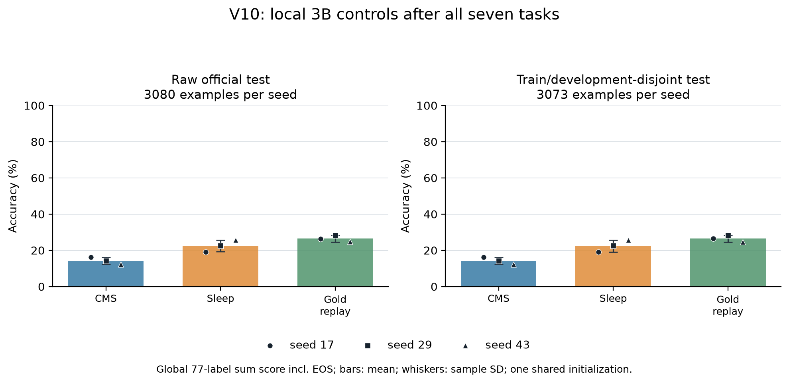

# Banking77 V10: local CMS, Sleep and supervised replay controls

## Official-test results

The official publisher test has **3,080 rows (77 intents × 40)**. Primary scoring uses all rows. The predeclared secondary cohort removes seven exact normalized-text overlaps with train/development (six train, one development), leaving **3,073 rows**; all nine contexts use that same secondary cohort. The metrics are not interchangeable: sum-score and length-mean rank all 77 labels by two different aggregations; greedy exact match is free generation and is highly format-sensitive; gold-label token-mean NLL is per-example mean target-token NLL.

Across the three paired class-order seeds (17, 29, 43), the table gives mean ± sample SD. Seeds share one adapter initialization and therefore do not represent three independent backbone initializations or a confidence interval.
Values were read from official aggregate SHA-256 `3d582ce11bd95b2f0020b69a1508023408410cd0caddfcdc432724443d99823a` and independently scalar-checked against [the independent scalar cross-check](../results/banking-v10-v11/v10-independent-scalar-crosscheck.json) (SHA-256 `2708572510c2d2ec21e28d7eb871cf3bf1f8d33ae3e35e6380f0e643e9823344`).

**Raw official cohort (n=3,080 each):**

| Arm | Sum-score exact accuracy (%) | Length-mean accuracy (%) | Greedy exact accuracy (%) | Gold-label token-mean NLL (nats) | Final old-66 (sum score) (%) | Final current-11 (sum score) (%) |
|---|---:|---:|---:|---:|---:|---:|
| CMS_ONLY | 14.21 ± 1.92 | 13.73 ± 1.01 | 11.15 ± 2.85 | 2.485 ± 0.118 | 3.36 ± 1.64 | 79.32 ± 10.94 |
| SLEEP_ADDITIVE | 22.45 ± 3.23 | 16.31 ± 2.80 | 3.18 ± 1.38 | 2.709 ± 0.119 | 19.85 ± 3.81 | 38.03 ± 4.07 |
| GOLD_ADDITIVE | 26.45 ± 1.80 | 27.23 ± 1.31 | 6.92 ± 0.23 | 2.219 ± 0.015 | 24.27 ± 1.46 | 39.55 ± 6.15 |

**Train/development-disjoint cohort (n=3,073 each):**

| Arm | Sum-score exact accuracy (%) | Length-mean accuracy (%) | Greedy exact accuracy (%) | Gold-label token-mean NLL (nats) | Final old-66 (sum score) (%) | Final current-11 (sum score) (%) |
|---|---:|---:|---:|---:|---:|---:|
| CMS_ONLY | 14.23 ± 1.90 | 13.74 ± 1.03 | 11.14 ± 2.91 | 2.485 ± 0.119 | 3.38 ± 1.64 | 79.28 ± 10.98 |
| SLEEP_ADDITIVE | 22.42 ± 3.25 | 16.35 ± 2.80 | 3.17 ± 1.36 | 2.709 ± 0.119 | 19.81 ± 3.82 | 38.08 ± 3.83 |
| GOLD_ADDITIVE | 26.43 ± 1.82 | 27.18 ± 1.30 | 6.90 ± 0.18 | 2.219 ± 0.016 | 24.26 ± 1.42 | 39.45 ± 6.62 |

Paired mean deltas (left minus right, mean ± sample SD across the three seedwise differences):
On the raw primary cohort, Sleep vs CMS is mixed across readouts: sum-score exact match is +8.24 ± 5.15 percentage points, while greedy exact match is −7.97 ± 1.47 points and gold-token mean NLL is +0.224 ± 0.149 nats (higher/worse). Gold replay raises sum-score by +12.24 ± 1.87 points and lowers NLL by −0.267 ± 0.125 nats versus CMS, but greedy remains 4.23 ± 3.05 points lower. The disjoint-cohort deltas are similar.

**Raw cohort:**

| Paired contrast (left − right) | Sum-score Δ (pp) | Length-mean Δ (pp) | Greedy Δ (pp) | Gold-token NLL Δ (nats) |
|---|---:|---:|---:|---:|
| SLEEP_ADDITIVE − CMS_ONLY | 8.24 ± 5.15 | 2.58 ± 3.77 | -7.97 ± 1.47 | 0.224 ± 0.149 |
| GOLD_ADDITIVE − CMS_ONLY | 12.24 ± 1.87 | 13.50 ± 2.12 | -4.23 ± 3.05 | -0.267 ± 0.125 |
| GOLD_ADDITIVE − SLEEP_ADDITIVE | 4.00 ± 4.35 | 10.92 ± 1.76 | 3.73 ± 1.57 | -0.491 ± 0.134 |

**Disjoint cohort:**

| Paired contrast (left − right) | Sum-score Δ (pp) | Length-mean Δ (pp) | Greedy Δ (pp) | Gold-token NLL Δ (nats) |
|---|---:|---:|---:|---:|
| SLEEP_ADDITIVE − CMS_ONLY | 8.19 ± 5.16 | 2.60 ± 3.78 | -7.97 ± 1.55 | 0.224 ± 0.150 |
| GOLD_ADDITIVE − CMS_ONLY | 12.20 ± 1.81 | 13.44 ± 2.13 | -4.24 ± 3.08 | -0.267 ± 0.126 |
| GOLD_ADDITIVE − SLEEP_ADDITIVE | 4.01 ± 4.45 | 10.84 ± 1.75 | 3.73 ± 1.53 | -0.490 ± 0.134 |

The per-seed values below include the final task-6 partition into the earlier 66 and current 11 intents. These are **final cross-sectional accuracies, not forgetting amounts**: the experiment gates only task 0, so acquisition was not established for every earlier intent at its own task endpoint.

**Raw cohort by seed:**

| Arm | Seed | Sum-score acc (%) | Length-mean acc (%) | Greedy exact acc (%) | Gold-token mean NLL | Final old-66 acc (%) | Final current-11 acc (%) |
|---|---:|---:|---:|---:|---:|---:|---:|
| CMS_ONLY | 17 | 16.10 | 14.25 | 12.76 | 2.348 | 5.11 | 82.05 |
| CMS_ONLY | 29 | 14.25 | 14.38 | 12.82 | 2.553 | 1.86 | 88.64 |
| CMS_ONLY | 43 | 12.27 | 12.56 | 7.86 | 2.555 | 3.11 | 67.27 |
| SLEEP_ADDITIVE | 17 | 19.16 | 13.99 | 3.86 | 2.681 | 16.40 | 35.68 |
| SLEEP_ADDITIVE | 29 | 22.56 | 15.52 | 4.09 | 2.607 | 19.20 | 42.73 |
| SLEEP_ADDITIVE | 43 | 25.62 | 19.42 | 1.59 | 2.840 | 23.94 | 35.68 |
| GOLD_ADDITIVE | 17 | 26.40 | 25.78 | 6.69 | 2.225 | 23.48 | 43.86 |
| GOLD_ADDITIVE | 29 | 28.28 | 27.60 | 6.92 | 2.229 | 25.95 | 42.27 |
| GOLD_ADDITIVE | 43 | 24.68 | 28.31 | 7.14 | 2.202 | 23.37 | 32.50 |

**Train/development-disjoint cohort by seed:**

| Arm | Seed | Sum-score acc (%) | Length-mean acc (%) | Greedy exact acc (%) | Gold-token mean NLL | Final old-66 acc (%) | Final current-11 acc (%) |
|---|---:|---:|---:|---:|---:|---:|---:|
| CMS_ONLY | 17 | 16.11 | 14.25 | 12.76 | 2.348 | 5.13 | 82.00 |
| CMS_ONLY | 29 | 14.29 | 14.42 | 12.89 | 2.554 | 1.86 | 88.64 |
| CMS_ONLY | 43 | 12.30 | 12.56 | 7.78 | 2.555 | 3.15 | 67.20 |
| SLEEP_ADDITIVE | 17 | 19.13 | 14.03 | 3.87 | 2.681 | 16.36 | 35.76 |
| SLEEP_ADDITIVE | 29 | 22.49 | 15.55 | 4.04 | 2.607 | 19.14 | 42.50 |
| SLEEP_ADDITIVE | 43 | 25.64 | 19.46 | 1.59 | 2.840 | 23.92 | 35.99 |
| GOLD_ADDITIVE | 17 | 26.46 | 25.74 | 6.74 | 2.226 | 23.50 | 44.19 |
| GOLD_ADDITIVE | 29 | 28.25 | 27.53 | 6.87 | 2.229 | 25.90 | 42.27 |
| GOLD_ADDITIVE | 43 | 24.60 | 28.28 | 7.09 | 2.201 | 23.39 | 31.89 |

The nine final contexts were scored with zero optimizer updates; all contexts and the frozen backbone passed the immutability checks. Joint evaluator cost was **8,448.562 seconds, 155,329 backbone forwards, and 301,801 tail calls**. This includes all nine contexts and both cohorts where distinct; it is not per-context latency. The run remained below the fixed 600,000-forward and 21,600-second ceilings. The raw and disjoint populations are also not independent samples because the latter is a subset of the former.

## Development endpoints and main continuation cost

These development rows were exposed during preparation and are reported separately from the reserved official test. Each accuracy/NLL cell is the mean and sample SD across three class-order seeds, with 770 examples per seed. Work columns sum the three task-1-to-task-6 continuations; shared foundations and other qualifications are additional costs.

| Arm | Development accuracy | Label-token mean NLL | Wake updates | AdamW updates | Backbone forward calls | Active wall seconds |
|---|---:|---:|---:|---:|---:|---:|
| CMS_ONLY | 13.33% ± 2.08 pp | 2.5069 ± 0.1211 | 5,948 | 0 | 16,431 | 1,238.001 |
| SLEEP_ADDITIVE | 20.09% ± 1.87 pp | 2.7191 ± 0.1230 | 5,948 | 14,820 | 116,316 | 6,139.360 |
| GOLD_ADDITIVE | 25.50% ± 2.48 pp | 2.2202 ± 0.0168 | 5,948 | 14,820 | 31,251 | 2,574.298 |

The Sleep ranking gain on development is accompanied by worse gold-label NLL than CMS, so it is not a uniform improvement across readouts. Forward-call counts are not FLOPs: the three arms also differ in batch shapes, valid positions and tail re-execution. Main valid backbone positions are 12,207,521 / 15,329,358 / 12,703,769, respectively. The observed continuation wall ratio is about 4.96 for Sleep/CMS, including the entry points' scoring and checkpoint work; it is not an isolated kernel or standalone inference comparison.

The wake counter counts minibatches, rather than every individual matrix assignment across memory levels. Physical AdamW counts refer to the added consolidation optimizer; zero AdamW in CMS does not mean zero wake learning.

All three arms preallocate 17,957,376 mutable matrix parameters; the final checkpoint's trainable-matrix count is 1,966,080. At the final endpoint, the corrected logical activated-resident count is 2,621,952 for CMS and 3,801,600 for each additive arm. These state-derived counts exclude the frozen backbone and are not measured GPU residency. Expert-branch matrix-evaluation bounds per token are 393,216 and 1,572,864, respectively; they must not be confused with unique stored parameters or full-model measured FLOPs.

The numerical design is recorded in the [pretest protocol](../docs/banking77-v10-preflight-protocol.md). [Reproduction instructions](../docs/banking-v10-v11-reproduction.md) describe the private assets and explicit CPU components; [the paper comparison](../docs/sleep-paper-alignment-v10-v11.md) separates implemented mechanisms from local assumptions.

## What the comparison measures

This is a last-MLP memory experiment on a frozen Llama-3.2-3B **base** model, not a native HOPE or full Sleep reproduction. Three paired class orders use seeds 17, 29 and 43, with a single common adapter initialization seed 1907008. The variation across those orders is reported with sample standard deviation, not independent-backbone uncertainty or a confidence interval.

There are seven tasks of eleven classes. Each order first learns a shared CMS-only task-0 foundation, which must pass the fixed global-77 candidate-accuracy gate of 0.50 and old-class macro gate of 0.40 on 110 development rows. The three foundations score 84/110, 95/110 and 85/110. Each subsequent task receives two fixed epochs with batch size eight. Periods 16/64/256/1024/held-fixed count minibatches; these are explicit local choices.

Sampling uses temperature 0.8; token KL uses temperature 1.0. The local LTI term is 0.5 KL plus 0.5 reward-weighted CE on the student's sampled continuation. Its teacher rollout supplies the prefix/reward reference, rather than a row-gold or directly forced teacher CE target.

| Arm | Additional operation at a due boundary | Additional information |
|---|---|---|
| CMS_ONLY | Apply the pending base proposal | Current-task gold targets used by wake learning |
| SLEEP_ADDITIVE | Protected teacher, prospective/reset student, 20 GKD + 10 LTI opportunities; only receiver A/B optimized before commit | Earlier training requests and class/task metadata for balanced input selection; sampled targets |
| GOLD_ADDITIVE | Same receiver allocation, sender reset, input requests and opportunities, with supervised CE | Additional old/current gold targets |

Gold is a positive control with extra supervision. Sleep versus CMS compares the entire added package: replay access, expansion/reset, routing and optimization. Neither contrast isolates a reward term or matches complete FLOPs. The V11 development follow-up supplies a narrower loss contrast with those other factors held fixed.

Gold and Sleep share the same additive parameter allocation; both differ from CMS in receiver activation and execution. Gold's extra information relative to Sleep is the known target supervision, rather than a larger parameter allocation.

Wake learning is supervised in every arm. “No gold target” describes the Sleep consolidation objective, not an unlabeled end-to-end experiment. Gold adds 14,820 labeled consolidation update exposures across the three continuations; these reuse the original training annotations rather than representing 14,820 new human annotations or unique examples.

Sleep's balanced request selector also reads the original training class IDs. Avoiding gold-target CE does not remove that label metadata from input selection.

The teacher is constructed before the due sender **base** write, after the fast expert has already received that minibatch's online update. Simultaneously due levels run in ascending order; pending base-gradient windows carry across task boundaries. Additive routing excludes an expanded receiver from the natural pool and adds its full output. It can execute more branches than natural top-one routing. All reserve slots are preallocated, so physical stored matrices and logically active/executed matrices must be counted separately.

The task-0 qualification does not qualify every later boundary teacher. A teacher is protected against mutation during its consolidation event; preceding wake updates can already have changed its task behavior. Resetting or rerouting a sender can also change the model function while protected old matrices remain intact. State-isolation checks therefore do not establish preserved old-task accuracy.

## Data and readouts

The original publisher train CSV has 10,003 rows. Four same-label duplicates are excluded before a deterministic normalized-text-group split: 9,229 training rows and ten development rows per class, 770 in total. There is no normalized train/development overlap. Every packed request fits the reserved input budget, and every canonical label plus EOS fits the ten-token output cap. Model/tokenizer assets, split rules, source files and configuration are hash-pinned.

The primary readout enumerates all 77 labels and sums each label's conditional log probabilities, including EOS. The full label dictionary is extra readout information; there is no task-specific candidate mask. Token-mean ranking and unconstrained greedy exact match are separately reported diagnostics. Their different denominators or format sensitivity are not interchangeable definitions of accuracy. NLL is the mean of each example's label-token mean NLL; its count is examples, not pooled target tokens.

All nine main endpoints are sealed before official test acquisition. The raw 3,080 publisher test rows remain the primary population. A secondary population excludes exact NFKC/casefold/whitespace-normalized overlap with **both** the 9,229 training rows and the 770 development rows already exposed during preparation. Filtering is not applied to the primary result. The same secondary cohort is used by every final context, and overlap counts are reported separately. This does not audit the pretrained model's original corpus.

The official evaluator scores final contexts only. Its `task_breakdown` entries are partitions of each final context by class order, not evaluations of intermediate checkpoints. Foundation qualification uses development rows; this design does not measure a before/after official-test forgetting delta.

## Recovery, failures and costs

The fixed seed-17 transfer probe did not fully preserve its competent teacher. On the same 110 old-task development rows, the teacher scored 84 correct, reset scored 23, and the 30-opportunity Sleep-additive receiver scored 51. The gold-additive receiver scored 54; Sleep fixed mix scored 28 and gold fixed mix 64. The finite 30-opportunity main budget was retained rather than increased to select a better development endpoint. Consequently, source/recovery correctness must not be confused with successful teacher preservation, and one-boundary routing results do not establish a universal routing advantage.

The initial balanced minimum of 32 train plus 10 development rows per class failed on metadata before pack creation or model execution: the smallest raw class contains 35 rows. The natural-count split retains the other unique requests instead of dropping that class or duplicating examples.

Probe A stopped after six updates because scalar tensor hashing was incorrectly implemented. It is not evidence of a restoration mismatch. Probe B compared two snapshot reconstructions and passed exact replay. A separate nine-update qualification then continued the **original** transaction object and compared calls 4-6 with disk restoration: reports, model/Adam, local generator and process RNG states matched exactly. It used 57 full-backbone forwards and 11.188 seconds, with no test/readout access. That additional qualification followed the first two main runs; it changed neither their states nor main arithmetic. Main checkpoints are forensic snapshots; whole-job interrupted/resumed training is not claimed.

Queue A stopped before model/CUDA initialization because a nested output parent was missing. Queue B completed its first valid run, then its parent incorrectly compared a raw-file config hash with a semantic config hash. The valid completed run was retained. Remaining jobs used the unchanged reviewed single-run launcher, original contracts and serial order. The legacy queue mode is retained as provenance; the corrected future queue has separate code-only review and was not used to execute this study.

The Windows default allocator run reported reserved memory above physical VRAM and much longer scoring time in a fixed 110-row development benchmark. That is consistent with paging, which was not independently profiled. The process-local allocator/memory-fraction policy preserved identical metrics in that ordered benchmark and was then applied to all main arms. This is one qualification measurement, not a general hardware speed claim. No driver or system memory settings were changed.

The official evaluator's forward ceiling was raised **before test access** from 80,000 to 600,000, with the same six-hour wall ceiling. The frozen loops have a conservative two-cohort bound of 593,862 calls. Only the resource constant changed; samples, readouts and order remained unchanged. CPU/terminal gates and model/source bindings were reviewed separately from numerical training.

Official-evaluation startup A passed the CPU checkpoint audit, then stopped before model loading and test-row parsing because of an unused import from the wrong helper module. Its launch record confirms CUDA remained uninitialized. The official CSV had already been downloaded and hash-verified. The narrow repair removes the unused import; the model loader already returns the correct immutable-version function. It changes no training or scoring arithmetic. The failed source and launch record are preserved, and the repaired launch uses fresh B contracts and outputs. This auxiliary repair occurred after payload acquisition; it is not described as a wholly pre-acquisition source freeze.

Costs distinguish main training, shared foundations, failed/successful probes, transaction qualification, allocator qualification and joint evaluation. The four allocator probes add 734 recorded backbone forwards and 140.156 seconds of measured scoring; their setup wall time and complete forward-shape histories were not recorded and are not treated as zero. Wall measurements include the work recorded by their individual entry points, including evaluation/checkpoint I/O where inside those scopes; they are not pure GPU busy time. Shared multi-context evaluation cannot be divided by context count and called standalone deployment latency. Partial dense-projection/attention estimates omit mutable-tail re-execution, backward, optimizer, normalization and other work; missing fields remain unknown. Legacy natural-route parameter counts are retained as original metadata and corrected offline for the additive path.

The reference evaluator's greedy diagnostic recomputes the complete prefix at each generated token, without an autoregressive KV cache. Official scoring groups these calls within fixed 32-row chunks and executes each final context. Its joint wall time therefore includes this expensive diagnostic as well as candidate ranking and the separate disjoint-cohort pass when needed. It is not a measurement of classification-only deployment latency or an optimized decoder.

## Interpretation limits

The model revision, prompt segmentation/no-BOS choice, rank-64 five-level memory, schedule, two-epoch budget and reward proxy are local assumptions. The reward uses canonical-label equivalence in place of a learned semantic model. A noncanonical generated answer may be a paraphrase; invalid-format counts do not establish semantic wrongness. Three class orders with one initialization, one corpus and a local architecture do not establish broad efficacy or reproduce manuscript headline scores. No Llama 8B or DBpedia result is claimed.

The [alignment audit](../docs/sleep-paper-alignment-v10-v11.md) also records the manuscript's explicit Table 5 values (Sleep rate 5e-6, effective batch 32, 100 steps, rank 64, alpha 128) and their unresolved mapping to classification's wake/base/receiver operations. Our local rates, batch and event budget differ; V11 holds them fixed for a narrow reward comparison rather than claiming that the table was reproduced.

The V11 reward controls were selected from training/development evidence and frozen separately before official test access. They are reported as development exploration, not new official-test confirmation. Earlier CLINC and AG News negative results remain in the repository.

Banking77 attribution: Casanueva et al., [Efficient Intent Detection with Dual Sentence Encoders](https://aclanthology.org/2020.nlp4convai-1.5/) (2020), [original publisher](https://github.com/PolyAI-LDN/task-specific-datasets/tree/9d081458ff52e53cf7e848f414e6e9344e4e6696/banking_data), [CC BY 4.0](https://github.com/PolyAI-LDN/task-specific-datasets/blob/master/LICENSE). No requests, weights, checkpoint tensors or generated answers are redistributed.
