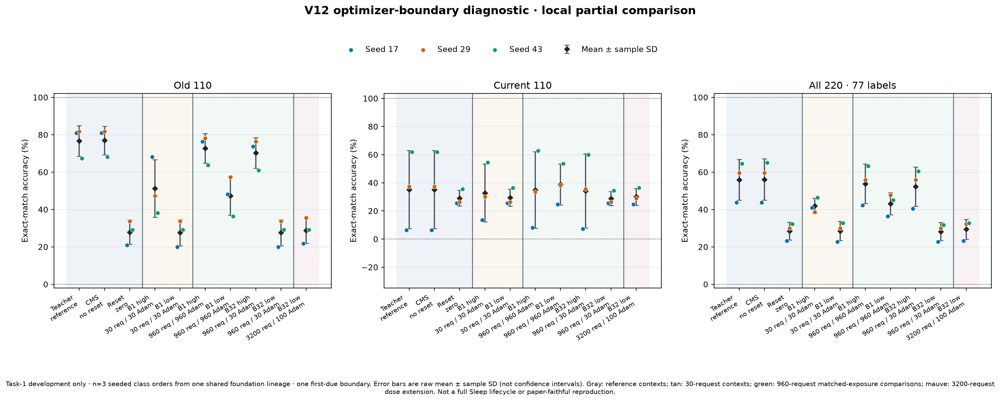
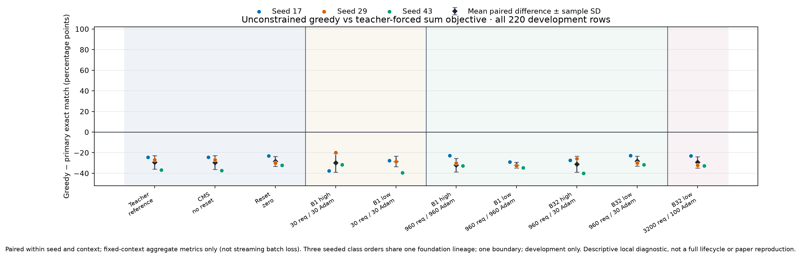

# Banking77 V12: receiver optimization at one boundary

The completed three-seed diagnostic shows that optimizer settings materially
change receiver fit. At 960 identical teacher-request exposures, batch 1 at
1e-3 reaches 53.79% global sum-score development accuracy, versus 43.03% at
5e-6. Batch 32 reaches 52.27% and 28.18% respectively. Neither fitted receiver
beats the no-reset CMS reference (56.06%). This is evidence about this local
receiver and boundary, not evidence that the paper's learning rate is wrong.

All ten predeclared contexts and all three seeds are retained. This experiment
does not establish long-term retention, a full Sleep lifecycle, native HOPE,
or the paper's classification accuracy. No official test was read for V12.
Earlier official test results remain historical, previously viewed evidence.

## Controlled design

The frozen ModelScope Llama-3.2-3B base, Banking77 train/development pack and
qualified task-0 foundations are inherited from V10. Seeds 17, 29 and 43 vary
class order and data/sampling, sharing backbone initialization 1907008. The
first actual level-0 due boundary occurs after 4, 10 and 14 new-task wake
minibatches, preserving pending windows. The teacher is taken before the due
base write, after that minibatch's fast update. No further wake training follows.

Each seed generates 3,200 fixed teacher-policy trajectories once from balanced
old/current training requests. The same prefix, teacher, starting receiver and
routes feed all four arms. Full-vocabulary teacher-to-student KL at T=1 is
averaged over answer tokens within each request and then over requests. Gold
targets are not used for receiver training. The selector uses task/class
metadata and access to earlier requests; these are additional data privileges.
Only receiver A/B are optimized, with one clip and AdamW step per effective
batch. There is no LTI reward or student-policy sampling in V12.

The 2×2 comparison uses effective batch 1/32 and learning rate 1e-3/5e-6 at
960 requests: 960 versus 30 physical updates. Batch-1 checkpoints at 30
requests are update-count comparisons with unequal exposure. The low-rate
batch-32 arm continues from 960 to 3,200 requests (100 total updates), without
rerunning its prefix. These are separately named contrasts, not FLOP matches.
Teacher and CMS/no-reset are reference contexts; reset-zero is the prospective
write plus sender reset and an untrained receiver.

## All development endpoints

Primary accuracy ranks all 77 canonical labels by summed log likelihood,
including EOS, without a task mask. The same 110 old and 110 current
development examples are used for every context within each seed. Values below
are percent mean ± sample SD over three class orders. Greedy is the separately
reported all-220 exact-match mean; supplying the label dictionary and ranking
all candidates is substantial extra inference, not free generation.

| Context | Old 110 | Current 110 | All 220 | Greedy all 220 mean |
|---|---:|---:|---:|---:|
| `TEACHER` | 76.67 ± 8.15 | 35.15 ± 27.79 | 55.91 ± 10.92 | 26.52 |
| `CMS_NO_RESET` | 76.97 ± 7.62 | 35.15 ± 27.79 | 56.06 ± 11.10 | 26.52 |
| `RESET_ZERO` | 27.88 ± 6.45 | 29.09 ± 5.53 | 28.48 ± 4.73 | 0.00 |
| `B1_HIGH_30` | 51.21 ± 15.38 | 32.73 ± 20.59 | 41.97 ± 3.97 | 12.12 |
| `B1_HIGH_960` | 72.73 ± 7.93 | 34.85 ± 27.29 | 53.79 ± 10.61 | 21.82 |
| `B1_LOW_30` | 27.58 ± 6.94 | 29.39 ± 6.05 | 28.48 ± 5.17 | 0.00 |
| `B1_LOW_960` | 47.27 ± 10.48 | 38.79 ± 14.55 | 43.03 ± 5.93 | 10.91 |
| `B32_HIGH_960` | 70.30 ± 8.25 | 34.24 ± 26.38 | 52.27 ± 10.48 | 21.21 |
| `B32_LOW_960` | 27.58 ± 6.94 | 28.79 ± 5.01 | 28.18 ± 4.81 | 0.00 |
| `B32_LOW_3200` | 28.79 ± 6.82 | 30.00 ± 5.96 | 29.39 ± 5.38 | 0.00 |

At 960 requests, raising the learning rate gives +10.76 percentage points for
batch 1 and +24.09 for batch 32 in mean global sum-score accuracy. At 1e-3,
batch 32 minus batch 1 is −1.52 points despite 32 times fewer updates; this
small three-order comparison does not establish equivalence. Extending the
5e-6 batch-32 arm from 960 to 3,200 requests changes accuracy by +1.21 points,
remaining far below CMS. The teacher itself averages only 35.15% on current
classes at this early boundary, so recovery of teacher behavior would not
establish adequate acquisition of new knowledge.

Free generation remains much weaker than label ranking. Even the teacher's
greedy mean is 26.52%; the corresponding high-rate batch-1 endpoint is
21.82%. No endpoint or scoring rule was selected to replace the frozen primary.
Length-mean scoring, token-mean gold NLL, every seed and paired contrasts are
included in [the aggregate package](../results/banking-v12/README.md).

## Fixed-trajectory fit supplement

The separately frozen supplement scores the same first 64 private training
trajectories per seed: 32 old and 32 current, without score/content filtering.
Each complete 3,200-record file is deserialized; only those 64 records enter
the metric. All ten contexts share each frozen-backbone capture. KL is
teacher-to-student, T=1, full vocabulary, answer-token mean within each request
then request mean. These are training-fit values, not held-out generalization.

| Context | Old 32 KL | Current 32 KL | All 64 KL |
|---|---:|---:|---:|
| `TEACHER` | -0.000000 ± 0.000000 | -0.000000 ± 0.000000 | -0.000000 ± 0.000000 |
| `CMS_NO_RESET` | 0.000011 ± 0.000014 | 0.000008 ± 0.000001 | 0.000009 ± 0.000007 |
| `RESET_ZERO` | 4.104997 ± 0.353055 | 3.957379 ± 0.216408 | 4.031188 ± 0.246738 |
| `B1_HIGH_30` | 0.483657 ± 0.079898 | 0.453827 ± 0.061370 | 0.468742 ± 0.064136 |
| `B1_HIGH_960` | 0.090332 ± 0.005657 | 0.100986 ± 0.033412 | 0.095659 ± 0.015630 |
| `B1_LOW_30` | 4.066298 ± 0.358582 | 3.920343 ± 0.213876 | 3.993321 ± 0.249883 |
| `B1_LOW_960` | 0.589032 ± 0.221003 | 0.495827 ± 0.122460 | 0.542429 ± 0.171716 |
| `B32_HIGH_960` | 0.049998 ± 0.006385 | 0.047994 ± 0.005737 | 0.048996 ± 0.005980 |
| `B32_LOW_960` | 4.041250 ± 0.359519 | 3.898659 ± 0.213061 | 3.969954 ± 0.251150 |
| `B32_LOW_3200` | 3.740668 ± 0.385779 | 3.615100 ± 0.208643 | 3.677884 ± 0.271742 |

Values are mean ± sample SD over the three orders. The displayed negative zero
for teacher self-KL is numerical roundoff; maximum absolute per-request
self-KL across the three seeds is 5.624e-8, within the 1e-6 tolerance. Negative
roundoff was recorded, not clipped. The raw aggregate retains scientific
notation, per-role denominators and every seed.

Batch-32/high-rate at 960 requests reaches mean KL 0.048996, versus 3.969954
for batch-32/low-rate and 0.095659 for batch-1/high-rate. The low-rate
batch-32 extension reaches only 3.677884 at 3,200 requests. This supports an
optimization-budget mismatch in this parameterization. It does not establish
an error in the paper's optimizer. The lower training-fit KL of batch-32/high
does not yield higher development accuracy than batch-1/high in this small
comparison; teacher approximation and task accuracy must remain separate.

The published read-only run used 192 backbone forwards and 1,920 tail forwards,
zero backwards/optimizer/wake/generation updates, 31.734 seconds of stored
evaluation activity and 57.375 full process seconds including CPU preflight,
model loading and shutdown. Before/after context hashes, immutable backbone
versions and model adapter hashes match. The shared frozen backbone contains
3,212,749,824 parameter elements (6,425,499,648 bytes); each materialized mutable
context stores 17,957,376 elements (71,829,504 bytes), including inactive slots.
The fitted receiver A/B has 393,216 elements (1,572,864 bytes). Activation moves
between banks while preallocated storage is unchanged. These are storage
counts excluding buffers, not physical FLOP or peak-GPU measurements.

CPU review caught and corrected an alias that would overwrite a fitted
receiver when rebuilding reset-zero; no GPU evaluation used that version.
The first actual fit run then scored all three seeds but failed during final
manifest serialization, before metrics were persisted. Its 192 backbone
forwards, 1,920 tail calls, zero updates, 31.578 active seconds and 57.391 full
process seconds are retained as engineering overhead. One explicitly reviewed
recomputation uses identical fixed inputs and writes each seed aggregate
immediately. No main training was repeated and no in-memory failed-run metrics
are claimed. A CPU-only preflight schema mismatch and a mislabeled archive
were also corrected; the missing original 6d source preimage is not claimed
preserved. See the [fit evidence and history](../results/banking-v12/fixed-fit/fixed-fit-engineering-history-final.json).

## Cost, correctness and preserved failures

Successful core receiver work totals 18,240 request exposures and 6,150 AdamW
updates. Seed 17's additional real-disk restore branch adds 32 requests and one
update. The original uninterrupted and disk-restored transactions continue
requests 32–64 and match full transaction/Adam/RNG state; this qualifies a
transaction snapshot, not whole-job production resume. The original 32–64
batch is counted once in core work, not lost from its separate qualification
record or counted twice.

Across the three successful processes, all phases total
39,018 full-backbone forwards,
72,473 tail forwards, 18,300 tail
backwards, 6,151 AdamW updates and
2037.984 seconds of summed recorded activity
(33.97 minutes). These totals include prefix
wake, shared generation, receiver fitting, qualification and all development
readouts. The corresponding three complete launcher processes total 2086.390 seconds, including preflight and loading. They exclude foundation construction and the separately charged
read-only supplement. Candidate padding and executed/valid tokens are retained
in the phase counters. Main-study peak GPU allocation and physical FLOPs were
not measured; parameter counts must not be presented as FLOPs.

Attempt A failed at a mistaken `MutableContext.eval()` call after four prefix
wake updates, before teacher rollouts or receiver updates. It used 4 backbone
forwards/backwards, 2.86 active seconds and 19.0 launcher seconds including
preflight/loading. B fixes mode/freezing on the actual child modules, leaves
the scientific settings unchanged, uses fresh outputs and preserves A. Earlier
CPU fixture failures and later portability changes are also retained. Focused
development checks are not an exhaustive engineering-cost ledger; missing cost
is unknown, not zero. No scientific arm was automatically retried or discarded.

Source/config/asset identities were checked before CUDA. Actual seed-17
qualification and terminal artifacts were independently reviewed before later
seeds. Each final launcher result equals its complete run receipt, with source
and cost reconciliation. Offline CPU tests preserve the original 256-attempt
guard and prohibit CUDA initialization and network. The final release acceptance
receipt identifies the exact published test bytes and counts.

## Relation to the paper and next hypothesis

[Sleep v2](https://arxiv.org/html/2606.03979v2), Appendix B.4 Table 5 gives
5e-6, effective batch 32, 100 steps, LoRA rank 64 and alpha 128. V12 explicitly
tests the first three values in this local receiver, with both exposure- and
update-count comparisons. Our matrices, additive last-MLP routing, frozen
backbone, teacher-policy KL-only target and one boundary differ from the
paper's expanded sparse-memory architecture and alternating-policy objective.
Its table does not fully specify the classification optimizer mapping. The
long-context frequency ablation does not prove that 512 is a classification
minibatch period. Full differences remain in [the alignment audit](../docs/sleep-paper-alignment-v10-v11.md).

The present evidence supports measuring receiver fit and actual update budgets
before borrowing a numerical optimizer recipe across parameterizations. It does
not isolate long-horizon teacher drift, gradient conflict or old/new retention
after subsequent wake updates. Those require a separately frozen lifecycle
study and independent assessment; V12 development outcomes cannot be recast as
fresh confirmation. There is no new 8B or DBpedia result.

The [execution guide](../docs/banking-v12-reproduction.md) identifies the model,
data provenance and exact recipe. Public artifacts contain only code,
configuration, aggregate statistics, safe receipts and figures. Private weights,
data rows, trajectory token IDs and checkpoint payloads are excluded.
