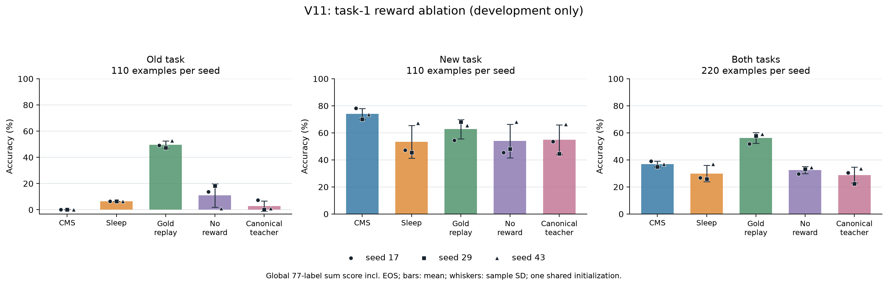

# Banking77 V11: development-only LTI reward ablation

## Final development results

The frozen development evaluator completed all 15 contexts (five arms for seeds 17, 29, and 43). Each seed uses the same 220-row task-0/task-1 cohort: 110 old-task rows and 110 current-task rows, with all 77 labels available to the candidate scorer. The table reports the mean and sample SD across the three seed-level accuracies. `SUM` is the preregistered global-77 sum-log-likelihood ranking accuracy; `length mean` is the global-77 mean-log-likelihood ranking diagnostic; `greedy` is unconstrained exact-label generation. These are development-only descriptions, not a second test confirmation.

| Arm | Old task, 110 | Current task, 110 | Both, 220 | Length mean, all 220 | Greedy, all 220 |
|---|---:|---:|---:|---:|---:|
| CMS_ONLY | 0.00% (0.00) | 73.94% (4.10) | 36.97% (2.05) | 36.36% (2.53) | 27.42% (1.60) |
| SLEEP_ADDITIVE | 6.36% (0.00) | 53.33% (12.11) | 29.85% (6.05) | 30.61% (6.70) | 14.09% (3.28) |
| GOLD_ADDITIVE | 49.70% (2.78) | 62.73% (7.22) | 56.21% (3.87) | 57.27% (9.84) | 26.52% (7.62) |
| LTI_NO_REWARD | 10.91% (8.95) | 53.94% (12.41) | 32.42% (2.58) | 31.67% (8.46) | 13.03% (4.22) |
| LTI_CANONICAL_TEACHER | 2.73% (3.96) | 54.85% (10.96) | 28.79% (5.86) | 31.36% (5.24) | 11.82% (2.53) |

Values in parentheses are sample SD in percentage points. For the primary SUM accuracy, paired differences are mean percentage-point changes across matched seeds, with sample SD in parentheses:

| Paired contrast | Old task, 110 | Current task, 110 | Both, 220 |
|---|---:|---:|---:|
| LTI_NO_REWARD − SLEEP_ADDITIVE | +4.55 (8.95) | +0.61 (2.29) | +2.58 (4.77) |
| LTI_CANONICAL_TEACHER − SLEEP_ADDITIVE | −3.64 (3.96) | +1.52 (4.20) | −1.06 (4.07) |
| LTI_CANONICAL_TEACHER − LTI_NO_REWARD | −8.18 (9.23) | +0.91 (6.36) | −3.64 (6.36) |

On the two all-row secondary metrics, the paired mean differences (percentage points; sample SD) were:

| Paired contrast | Length-mean ranking | Greedy exact match |
|---|---:|---:|
| LTI_NO_REWARD − SLEEP_ADDITIVE | +1.06 (6.37) | −1.06 (0.95) |
| LTI_CANONICAL_TEACHER − SLEEP_ADDITIVE | +0.76 (2.74) | −2.27 (1.36) |
| LTI_CANONICAL_TEACHER − LTI_NO_REWARD | −0.30 (8.34) | −1.21 (2.15) |

The raw evaluator also reports gold-label token-mean NLL: for each of the 220 examples, it first averages negative log-likelihood across the gold label's tokens including EOS, then averages those 220 example-level means. This is not a pooled mean over all label tokens. Lower is better; this is a diagnostic, not the primary selection score.

| Arm | Gold-label token-mean NLL, mean (sample SD) |
|---|---:|
| CMS_ONLY | 1.485 (0.088) |
| SLEEP_ADDITIVE | 2.211 (0.184) |
| GOLD_ADDITIVE | 1.009 (0.172) |
| LTI_NO_REWARD | 2.199 (0.294) |
| LTI_CANONICAL_TEACHER | 2.278 (0.155) |

For the six new-arm contexts, unified-evaluator SUM count, correct count, and accuracy exactly match each training receipt's task-1 candidate summary (220 examples per context). The token-mean NLL values are close but not bit-identical to those earlier per-run receipt values; the largest absolute difference is 0.00054. The table therefore uses one consistently computed set from the final unified evaluator rather than blending receipt and evaluation NLLs.

The qualified task-0 foundations scored 84/110, 95/110, and 85/110 on the fixed old-task development rows for seeds 17, 29, and 43. This is descriptive starting context for the same old group; the final old-task column above is the post-task-1 endpoint. V10's final task-6 official-test `final_old66` subgroup is a separate population and is not a before/after forgetting estimate for this 110-row comparison. No scores for unmeasured new/both-task foundation groups are inferred.

The paired summaries use three fixed seeds and report arithmetic means and sample SDs only: there are no p-values or confidence intervals. The results do not establish a consistent reward benefit. `GOLD_ADDITIVE` is a distinct replay control with additional gold-label supervision, while both V11 arms restart from the same qualified foundation per seed. The canonical-teacher gate has lower old-task and all-row primary means than no-reward in this run, despite a small higher current-task mean. Greedy diagnostics are lower for both new arms than for CMS and Gold; teacher-forced ranking and free generation need not move together.

## Work, checks, and operational history

All six new training runs completed once; the accounting ledger reports no missing run counters and no repeated run. Totals across each three-seed arm were:

| Arm | Active training seconds | Full-backbone forwards | Executed input tokens incl. padding | Physical AdamW updates | Sampled output tokens | Sleep events | Tail calls / backward calls |
|---|---:|---:|---:|---:|---:|---:|---:|
| LTI_NO_REWARD | 971.829 | 19,374 | 2,672,988 | 2,370 | 14,325 | 79 | 21,744 / 3,362 |
| LTI_CANONICAL_TEACHER | 971.156 | 19,312 | 2,673,454 | 2,370 | 14,263 | 79 | 21,682 / 3,362 |

Both arms had 992 wake updates. Their 79 sleep-event request digests and saved event plans match 79/79 across arms; this establishes matching logged request cohorts and opportunities, not identical generated samples or random trajectories after the reward treatments diverge. The combined development evaluation used 5,018 observed model-logit calls, 11,766 tail calls, and 402.953 seconds, with zero optimizer updates. The backbone and all contexts remained unchanged. No raw development examples, predictions, or token IDs were saved by the evaluator.

Operationally, startup A was a hash-alias/preflight failure with no scientific run. In the next attempt, the first completed V11 task-1 training run (including its fixed endpoint scoring) was retained; a terminal-record key mismatch stopped orchestration before the next run. The corrected single-launcher flow continued without repeating the completed run. Later, reference preparation exposed three metadata-interface mismatches: a missing required `source_hashes` argument, the producer's terminal `complete` status, and the producer's `comparison_v10_sleep_task1_checkpoint_sha256` receipt key. These CPU-only validation fixes changed no training recipe, numerical configuration, scoring equations, or training artifact. An initial component-G synthetic fixture still described the obsolete protocol; it was archived and corrected to the actual producer shape. Component-H subsequently passed 71 tests. The separate six-run traces and 79/79 cohort audit were descriptive post-training checks; the recipe was already frozen, and they were not used to retune it.

This remains a one-task development ablation of local reward terms, not a paper-faithful reproduction of HOPE/Sleep or a test-set confirmation. The paper's teacher lifecycle, architecture, and clock mapping are not fully specified for this task setup; the local teacher-forcing drift and reward proxy are implementation assumptions, not paper-prescribed mechanisms. Routing/head behavior and label/reward semantics also remain open fidelity limits. The V10 report's V10 old-subgroup analysis and previous negative results remain separate evidence.

The final aggregate contains 249 long-form metric rows; analysis left its source bytes unchanged. The public bundle contains a path-only projection of the [combined reanalysis](../results/banking-v10-v11/combined-v10-v11-reanalysis.json); `e0b2093b895bdb3a5d3eb908a74fa95b538db94ad83bd4960a3f5b6270ecb56c` is the original source-summary SHA-256, not the public derivative's hash. The [V11 accounting aggregate](../results/banking-v10-v11/v11-accounting-aggregate.json) omits `run_dir`; `62d0d0c2cfc902c37da999a120162e295fc329e82eb8c9ea0181f30db4c3911f` identifies the original source, not the public projection. The [request-cohort audit](../results/banking-v10-v11/v11-request-cohort-balance.json) is the exact artifact (SHA-256 `fbf0ff97f2fadd6043e9166cca4a8843da963304ed4d87aefe4a57897aa2f193`), as is the [development evaluation](../results/banking-v10-v11/v11-development-evaluation.json) (SHA-256 `4b68224a884a435a1262754328af1a39f201c0e71ceab450f6038b611eb7d0d8`). Its frozen 15-context reference SHA-256 is `0fdf1cb21df3e4d7879bfeaa7a517f6b78c82464e5821e673d4ad50ba093166c`; that reference is identified by hash only. The evaluation reports complete status, zero optimizer updates, unchanged contexts/backbone, and no official-test access.

The later three-order training-trace audit contains 4,940 LTI teacher reference samples. Only 369 normalize to a canonical label, and 264 agree with the training label; the latter comparison is diagnostic and never supplies a loss target. Of 3,976 positive-reward observations, 3,641 have a noncanonical teacher reference. The old-input portion has 116 canonical references out of 2,470, compared with 253 out of 2,470 current-input references. This is evidence about the local proxy and generated format, not proof that every noncanonical answer is semantically wrong or that reward is the sole failure mechanism. The CE term reinforces the student's sampled continuation; teacher reference logits supply KL, rather than teacher text serving as CE labels.

All 494 Sleep/Gold event request-cohort digests match within their respective seeds. This matches replay inputs and opportunities, while the Gold arm still receives extra supervision. The all-order audit followed main training and test-payload acquisition; it did not open test rows or alter the V11 recipe. The earlier seed-17 training audit motivated the controls before their configuration freeze. These retrospective training traces are not independent confirmation.

This follows the [V10 main comparison](banking77-controls-v10.md). The [alignment audit](../docs/sleep-paper-alignment-v10-v11.md) and [reproduction instructions](../docs/banking-v10-v11-reproduction.md) distinguish the local objectives and operational gates from a full paper reproduction.

## Motivation and fixed contrast

In the completed seed-17 V10 training trace, 103 of 1,640 sampled LTI teacher answers were canonical under the fixed normalizer, and 79 matched that training row's label. Of 1,294 positive-reward cases, 1,196 had noncanonical teachers. This is a teacher-reference/reward diagnostic: a noncanonical answer may still be semantically correct, and agreement with row labels was not added to the loss.

For LTI, the logged `sample_owner=teacher` names the initial reference rollout. The teacher supplies a sampled prefix and the reward reference; the CE targets are the student's sampled continuation. These teacher-validity statistics therefore do not measure the fraction of noncanonical CE targets. GKD separately uses teacher-distribution KL.

The initially drafted EOS-only reward gate was not executed. All twelve teacher-first-EOS cases already received zero reward, and task 1 had zero such EOS samples among its 280 LTI opportunities. That draft would be a no-op for the inspected task-1 branch. Its sources/reviews were archived before any V11 config or contract was frozen. One earlier memory-helper version in that archive was used only for generic process-memory setup by the separate V10 transaction-replay qualification; no EOS-gate training was run. The replacement uses canonical-teacher eligibility and never checks row gold.

| Arm | LTI objective | Gate information |
|---|---|---|
| V10 SLEEP_ADDITIVE reference | 0.5 KL + 0.5 reward-weighted student-continuation CE | Existing local label-equivalence/edit proxy |
| LTI_NO_REWARD | 0.5 KL | Reward contribution removed; generation and KL retained |
| LTI_CANONICAL_TEACHER | Same as reference only if teacher normalizes to a canonical label; otherwise 0.5 KL | Global 77-label dictionary, already available to the system; no example label |

A wrong canonical teacher label remains eligible. This is not an oracle or a learned semantic reward model. GKD remains unchanged. Equal primary data, generation settings, event schedule, optimizer settings and call opportunities do not guarantee equal sampled lengths, FLOPs or physical Adam counts after trajectories diverge; actual costs are reported.

## Scope and isolation

The two new arms each restart from the same qualified task-0 foundation as their V10 references and learn only task 1 for two fixed epochs. A V10 task-1 checkpoint is a comparison endpoint, never the initialization. There are six new runs: three paired order/data/sampling seeds, with the same common initialization used in V10. No learning-rate or endpoint selection uses this comparison's scores.

The V11 numerical config is frozen from the actual complete V10 seal before official-test acquisition. Launch contracts subsequently bind the completed V10 test metadata as an operational gate; there is no accuracy threshold or metric-based decision in that gate. The new training entry points never read official-test requests. The follow-up is exploratory development evidence, not an additional independent test confirmation.

Startup A stopped after 3.625 seconds in CPU preflight, before loading the base model, initializing CUDA or performing an optimizer update. The frozen preflight producer puts the train JSONL digest under a legacy `training_manifest_sha256` return key; the launch contract correctly pins the complete pack-manifest file instead. The wrapper had compared those different objects. Its narrow repair verifies the manifest file against the contract and the producer's train-file digest against `manifest.files.train.sha256`, then records both under distinct names. The frozen runner's actual training path already writes the correct manifest-file digest in its protocol, checkpoints and receipt, so neither the 25-file training source graph nor the numerical configuration changed. The actual CPU diagnosis did read train/development rows and deserialize the foundation checkpoint for schema checks; it did not load the base model or read official-test rows. The original source and failed attempt are preserved, and fresh B contracts pin the repaired wrapper. This operational repair followed the completed official test and is not described as a pretest source freeze or a successful scientific run.

The unified evaluator uses exactly fifteen task-1 contexts: CMS, V10 Sleep, gold replay, no reward and canonical-teacher gate for each seed. It scores the same 220 development requests within each seed, ten per class for the first two task blocks. Old and current tasks each have 110 requests. All 77 labels remain candidates. Sum-score accuracy is primary; token-mean ranking and unrestricted greedy exact match are separate readouts. The small 44-row V10 task-1 monitors are not substituted for this 220-row evaluation.

Every reference binds the source/model/config/data map, foundation parents, V10 seal and each protocol/receipt/checkpoint. The CPU preflight deserializes trusted context checkpoints before model/CUDA initialization. A process-local memory wrapper queues the same reviewed allocator/fraction policy after that preflight. Evaluation must leave every context and frozen backbone unchanged and perform zero optimizer updates.

## Costs and interpretation

The two new arms share receiver allocation, routing, request access, class metadata, wake schedule, opportunity budget and optimizer settings. They add no row-gold loss target. The class dictionary remains supervision/metadata available to the system. Sampling and optimization trajectories can change in response to the objective, so per-run observed work is required alongside accuracy.

The wake minibatch is eight, whereas each receiver AdamW update uses one selected replay request without gradient accumulation. The two new arms keep this batch-one consolidation policy and the same 30 opportunities per event. The manuscript's effective batch 32, 5e-6 Sleep rate and 100 steps are different settings whose classification-specific mapping is not fully specified. This reward ablation does not test or resolve that optimization gap.

V11 saves final task-1 checkpoints, while V10 saved many forensic checkpoints. Their wall times therefore do not constitute a clean I/O-matched comparison. The two new V11 arms use the same checkpoint policy. Shared fifteen-context evaluation is one observed workload, not fifteen standalone latency measurements. Some evaluator token counters cover candidates only; complete greedy input-position/FLOP totals are not inferred from those partial counters.

An old-task gain coupled to weaker new-task accuracy is a tradeoff, not successful simultaneous retention/adaptation. Conversely, failure of a canonical gate would not establish that a semantic reward model cannot help. This study tests two local reward interventions, not the whole set of differences from the manuscript. Previous negative results and the unexecuted draft remain in the evidence history.
