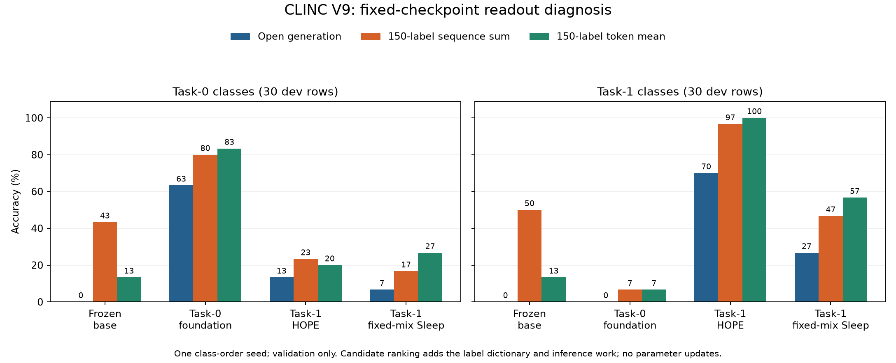

# CLINC V9: readout diagnosis and paper-alignment audit

The development evidence supports two contributors to the low local scores:
open generation imposes a substantial canonical-label format penalty, and
subsequent learning also reduces the probability of already acquired labels.
Changing the readout alone does not remove the local fixed-mix Sleep deficit.
This does not identify one cause of the gap to the paper: the model, architecture,
prompt, task allocation and inference protocol have not been shown equivalent.

This is an exploratory, **one-class-order-seed, 60-row validation diagnosis**.
It neither replaces the [frozen V8 primary results](clinc150-lifecycle-v8-final.md)
nor supplies new confirmation. No official test payload was read in this follow-up.

## What was measured

Seed 17 defines 15 classes in each of tasks 0 and 1. The first two stable-ID rows
per class were selected from the existing normalized train-disjoint development
split: 30 old and 30 new rows. Four fixed contexts were scored: the unaugmented
frozen base, the shared task-0 foundation, and the task-1 terminal HOPE and
fixed-mix Sleep checkpoints. No parameters were updated.

Open greedy generation used the V8 label-normalization rule. Two additional
readouts scored all 150 canonical label sequences, including EOS, using summed
log likelihood or token-mean log likelihood. Neither used a task mask. Candidate
ranking adds the class dictionary and 150-way inference; it is a different
information/compute protocol, not a free improvement to the primary metric.
Both variants were specified and reported; the better one was not selected.

| Context | Open generation, all 60 | Candidate sum, all 60 | Candidate token mean, all 60 | Invalid open outputs |
|---|---:|---:|---:|---:|
| Frozen base | 0/60 | 28/60 | 8/60 | 60/60 |
| Task-0 foundation | 19/60 | 26/60 | 27/60 | 24/60 |
| Task-1 HOPE | 25/60 | 36/60 | 36/60 | 27/60 |
| Task-1 fixed-mix Sleep | 10/60 | 19/60 | 25/60 | 42/60 |

The large sum-versus-mean difference for the frozen base is a warning about
label-length/calibration choices. Candidate gains do not establish that every
previous invalid output was semantically correct: the candidate readout changes
the decision procedure and supplies the complete label set.

## Format penalty is only part of the problem

Each count below is out of 30. NLL is the mean negative log probability per gold
label token, including EOS; lower is better. All rows use identical fixed inputs.

| Context | Old: open / sum / mean | New: open / sum / mean | Old gold NLL | New gold NLL |
|---|---:|---:|---:|---:|
| Task-0 foundation | 19 / 24 / 25 | 0 / 2 / 2 | 0.394 | 3.356 |
| Task-1 HOPE | 4 / 7 / 6 | 21 / 29 / 30 | 2.062 | 0.291 |
| Task-1 fixed-mix Sleep | 2 / 5 / 8 | 8 / 14 / 17 | 3.028 | 1.599 |

The qualified foundation had acquired task 0, but after task 1 even dictionary
ranking drops sharply on those same old examples. The old-label NLL increases
under both arms. This is behavioral forgetting of acquired label responses,
not evidence that all internal semantic representations vanished.

Sleep's new-label NLL is also worse than HOPE's, and its new-class ranking is
weaker under both prespecified ranking variants. Thus format constraints alone
cannot explain away its low current-task performance. This compares the complete
local fixed-mix/replay/distillation intervention, not an isolated Sleep component
or compute-matched causal effect. Old-class rankings are mixed across sum and
mean, so these 30 rows do not establish a robust old-class advantage for either arm.
Sleep still learns some new-label behavior: its task-1 NLL improves from the
foundation's 3.356 to 1.599, although less than HOPE's improvement to 0.291.

## Input and consolidation checks

The tokenizer audit found all 150 CLINC labels round-trip correctly; the longest
label needs six tokens, seven with EOS. Both the eight-token Sleep rollout cap
and the primary longest-label-plus-EOS greedy limit can represent every target.
All 15,000 training and 3,000 development requests fit the reserved 106-token
body budget; no request was truncated. In a stable 100-row development probe,
training and generation prefixes matched in all 100 cases.

The implementation concatenates encoded prompt segments and omits BOS in both
paths. Its token IDs differed from standard joint prompt encoding in all 100
probes although decoded text was identical. That is a model-format assumption,
not a demonstrated train/evaluation mismatch; its performance effect remains
untested. A new prompt/BOS control would require new training/development work.

Existing development evidence also remains relevant, with its limits preserved:

- The corrected single-seed k=10 probe had 63/320 canonical-valid teacher samples
  and 49/320 prompt-gold matches. These are stochastic rollout statistics, not
  teacher greedy accuracy or a statistic of the six full V8 runs. Earlier
  32-sample probes used other versions/budgets and remain separately identified.
- The first reconstructed boundary retained 17/60 correct in teacher/base-only
  states and 0/60 after sender reset plus receiver expansion. Later boundaries
  are repeated, trajectory-dependent points, not independent experiments.
  The joint intervention does not isolate reset from routing or prove causality.
- Natural routing previously failed closed when the fresh receiver was selected
  at none of eight answer positions and had no gradient. The persistent 0.5 mix
  makes it trainable but changes the executing function. It is a local variant.
- Wake uses only each new task's labeled rows; the no-Sleep baseline has no old
  gold replay. The fixed-mix arm adds replay and optimization, with only four
  working-pool prompts per class. Class coverage is not sample diversity.

The most useful next controls are supervised old-text replay with its extra
labels/cost disclosed, and a boundary factorization separating sender reset,
receiver routing and rollout quality. A function-preserving additive receiver
control can test the routing change; it would be another local intervention.
These are proposals, not completed training results. No test-driven retuning or
blind frequency/learning-rate sweep was performed here.

## What can be copied from the papers

[Sleep v2](https://arxiv.org/html/2606.03979v2) describes consolidation without
Dreaming for the classification experiment, names Llama-3B/8B, and specifies
pre-update teacher, prospective/reset student, fresh-parameter-only distillation,
then commit/reset. The audited text does not establish its exact classification
checkpoint, prompt, sample IDs or update schedule. Appendix B.4's reasoning-style
training table is not a documented CLINC recipe; long-context frequency ablations
do not establish classification-optimal periods.

[InCA](https://aclanthology.org/2025.coling-main.487.pdf) uses a different external
learner and label-summary pipeline with Mistral-7B; its reported CLINC result is
not a direct target for this last-MLP Llama-base ablation. Its Banking setup has
seven tasks, not proof of Sleep's task split. Our architecture and fixed mix
remain different. An exact like-for-like numerical attribution to Sleep is not
supported by these missing protocol details.

## Cost, failures and reproducibility

The accepted **attempt d** used 1,439 full-backbone forwards, 4,847 tail calls,
269,538 executed input-token positions and 89.735 seconds from evaluate entry,
including setup; the CLI's initial manifest parse is outside that timer.
Generation accounts for 303 forwards/tails. Candidate scoring accounts for
1,136 forwards and 4,544 tails, sharing each frozen-backbone capture across four
contexts. These are work counters, not measured complete FLOPs. All parameter
fingerprints and backbone versions were unchanged; optimizer updates were zero.

Two earlier attempts loaded the model but failed before scoring on metadata/hash
handoff and cursor-contract bugs. Their zero inference counts follow from the
failure locations; their total setup time is unknown, not zero. Attempt c ran
after a failed source-freeze check because a PowerShell command chain did not
short-circuit. It is quarantined and not accepted; its scores were not inspected
or used for selection. It incurred another 1,439 forwards, 4,847 tails and 90.453
seconds. Known completed-program time is therefore 180.188 seconds, plus unknown
failed-setup and other preparation costs. The accepted launch used a separate
successful freeze action and a fail-closed hash-checking launcher.

The [operational ledger](../results/clinc-v9-readout/operational-costs.json) and
historical buggy source texts preserve these failures. The same four contexts,
60 rows, three readouts and limits were retained throughout. CPU preflight now
validates all three real checkpoint cursors before model setup. The portable
builder was exercised on the actual grid and produced exactly the launched
context rows; eight diagnostic and two builder CPU tests passed before scoring.

The accepted raw result SHA-256 is
`99e70cd071de47c6dc854a12416255d583d70a424fa4961171c4be817f2d8609`;
executed source is `211d3c9d499838fa8372f59f99559abc20f045f5e91cd0baf9c0ed91c2a6e687`.
[Aggregate inputs and offline reanalysis](../results/clinc-v9-readout/README.md)
preserve the original schemas and raw-source hashes. No prompts, dataset rows,
generated answers, model weights or private checkpoint payloads are redistributed.

## Banking77 remains preparation

[The source and matching-controls draft](../docs/banking77-matched-comparison-draft.md)
records non-equivalent ModelScope candidates, the original PolyAI reference,
proposed seven-task matching and all unfrozen choices. Metadata-only tokenization
already found a nine-token Banking label: the old eight-token Sleep cap is
insufficient; ten tokens with EOS are needed. No Banking payload or model result
is claimed. Any Hugging Face acquisition still requires the parent to relay the
name, exact source links and capacity first; the original files total about
1.079 MB and practical cache preparation is budgeted at 25 MB.
