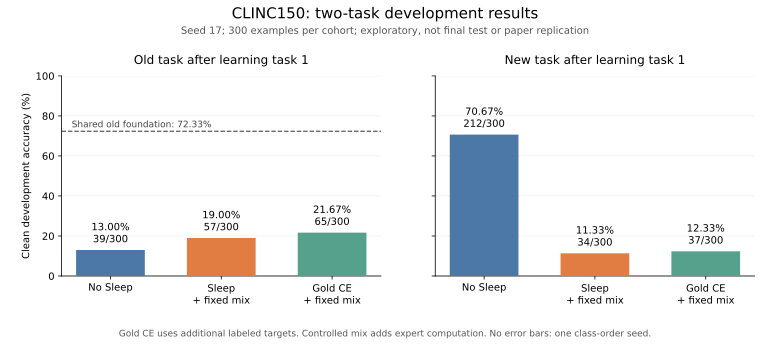

# CLINC150 V8 development: qualified acquisition, unsuccessful transfer

The local 3B model acquired the first 15-class task at **217/300 (72.33%)**.
After learning the next 15 classes, the no-Sleep branch scored **13.00% old /
70.67% new**. The three-update controlled Sleep branch scored **19.00% / 11.33%**;
its paired gold-label control scored **21.67% / 12.33%**. Both transfer branches
severely impaired new acquisition. These observations do not establish an overall
Sleep benefit.

This is one reused development class-order seed, two tasks, and the project's
CMS-inspired last-MLP adapter. It is not the paper's native HOPE architecture, a
full 150-class benchmark result, independent confirmation, or a reproduction of
the paper's accuracy. The official test shard remains unopened at this stage.

Figure: historical three-receiver-update development configuration with the local
edit-reward proxy. Each cohort has 300 clean development examples. The shared old
foundation is a reference for old-task retention; it is not the new-task target.
No uncertainty across seeds can be estimated from this one class-order seed.

## What is compared

All branches fork from the same source-bound, independently rescored old HOPE
checkpoint, including its pending windows and RNG state. Each then receives the
same 1500 new-task rows, in the same order, batch eight, 188 updates. Here
`HOPE` is the historical arm identifier for our local CMS-inspired baseline.
It does not identify a native implementation of the full paper architecture.

| Branch | Old correct | New correct | Seen correct | New wake updates | Receiver AdamW updates |
|---|---:|---:|---:|---:|---:|
| No Sleep (HOPE) | 39/300 | 212/300 | 251/600 | 188 | 0 |
| SLEEP_MIX | 57/300 | 34/300 | 91/600 | 188 | 48 |
| GOLD_CE_MIX | 65/300 | 37/300 | 102/600 | 188 | 48 |

The two controlled branches use the same 48 request IDs and order: 24 old and
24 current, covering all 15 classes in each role. Gold CE reuses labeled training
requests; it adds label-target optimization, not new human annotations. Both
branches have the same allocated capacity and receiver update count. They are
not matched in full-vocabulary target information, generated tokens or FLOPs.

The [protocol](../docs/clinc-cil-v8-protocol.md) records all asset hashes and
assumptions. The backbone is ModelScope's pinned Llama-3.2-3B **base**, with BF16
backbone weights and FP32 mutable matrices. Five rank-64 residual memory blocks
and eight preallocated expert slots per level augment its last MLP. The readout
is frozen. Update periods are local assumptions: 16/64/256/1024 minibatches and
an unclocked terminal level. They are not the paper's 512/2k/8k long-context
ablation translated into a classification schedule.

Each transaction uses the pre-base-update teacher and prospective student, resets
only the sender bank, and trains only a fresh next-level expert. The persistent
0.5 fresh-expert mixture guarantees a path to the receiver and adds an expert
branch in training and inference. It is an explicit engineering intervention.
Simultaneously due levels run fast to slow, reacquiring proposals after commits.
There are 16 events in task 1: 12 from level 0, three from level 1, one from level 2.

## What the diagnostics support

The natural-routing attempt failed at wake tick 64: a finite loss had no
trainable path because the fresh receiver was not selected. An independent replay
reproduced the failure and retained the transaction snapshot. The controlled
mixture fixes execution coverage, not demonstrated retention.

On the frozen controlled run, same-sequence KL decreased in all six reported
Sleep role/owner/objective groups. The gold control's same-sequence CE also
decreased. This establishes local fitting, not generalization or preservation.
Among the 32 teacher-owned samples, only three mapped to a canonical class and
none matched the request's label. Student-owned samples are excluded from that
teacher statistic. Gold CE has no sampling diagnostics: its values are missing,
not zero. The small, trajectory-dependent sample does not measure the teacher's
overall greedy accuracy.

Weak sampled targets and insufficient transfer are therefore testable concerns.
Because Gold CE also fails new acquisition, weak teacher targets alone are not
a sufficient explanation. Paired pre/post checkpoint scoring separates base-only
changes, reset/expansion, and the subsequently optimized receiver. Those
counterfactuals are exploratory reconstructions, not captured training states.

## Corrections and retained failures

The first R1 evaluator associated length-grouped predictions with labels in
original row order. **Every originally reported R1 accuracy is invalid.** Its
old checkpoint was separately rescored with corrected ordering before reuse;
the corrected 72.33% is not a reinterpretation of the old reported 3.33%.

Before the controlled run, an audit also caught a replay selector that repeatedly
visited only the leading classes, and phase checkpoint names that would collide
at simultaneous boundaries. Both were corrected and tested before training.

The frozen proxy edit reward uses `1 - distance/z0`. Paper Equation 4 instead
uses the maximum sequence length as denominator, with a distance-threshold cutoff.
A separately versioned development objective corrects that explicit formula.
Canonical-label equivalence remains a local substitute for the paper's frozen
semantic reward model. Corrected-objective runs must not be pooled with this
historical proxy configuration as if their objectives were identical.

Engineering failures remain local with receipts: read-only Windows fsync
failed before the disk qualifier was repaired; the first controlled qualification
missed a loader helper; the first controlled launcher shadowed the torch module;
and the initial boundary scorer treated its state dataclass as an nn.Module.
The latter two failed before any model forward or optimization. Each correction
uses a fresh output directory and additional targeted checks.

## Cost, access and current boundary

The controlled two-branch run completed 376 wake updates and 96 receiver AdamW
updates, 3690 full-backbone forwards and 604293 valid input tokens in 239.093
process seconds. The separate no-Sleep continuation used 188 wake updates and
1296 forwards. These counts exclude the shared historical foundation's cost,
which is preserved separately and must not be charged three times. Engineering
qualification/replay, failed attempts and subsequent diagnostics are additional
costs. Wall times are observational, not normalized throughput benchmarks.

The operation estimator charges recorded padded shapes, original capture/head
work, independently recomputed tails and the additional controlled branch.
It provides analytical bounds for listed GEMM/attention operations only; omitted
operators are outside those bounds. It is not measured complete hardware FLOPs.

Only pinned train/validation shards were acquired: 389885 bytes. After OOS
exclusion, the pack contains 15000/3000 rows; three normalized overlaps are
removed from clean development. The user-suggested ModelScope resources are
supervised classifiers, not raw datasets, and were not used as teachers or
initializers. InCA's subsample is not silently equated with this full split.
Weights, raw text, token arrays and private checkpoints are not redistributed.

Since the earlier one-seed probes, the corrected transfer-budget comparisons
and zero-optimization boundary diagnostics are complete. The three task-0
foundation seeds have now passed their acquisition gate: seed 17 scored 72.33%,
seed 29 54.67%, and seed 43 58.33% on the fixed clean development subset.
Their six continuations are in progress. No complete six-run continuation grid
or final official-test evaluation is available yet.

The upstream [HOPE repository's pinned update](https://github.com/obekt/HOPE-nested-learning/commit/599244e65fedf26f4db9844beb631c3dbca41188)
adds measured evaluation and withdraws unsupported capability claims. Its
reported forgetting results are useful motivation for explicit acquisition,
retention and baseline checks; they are not directly comparable to these
classification results. GitHub's API does not identify a repository license,
so this work implements ideas independently rather than copying upstream code.

Primary references: [Sleep v2](https://arxiv.org/html/2606.03979v2),
[InCA](https://aclanthology.org/2025.coling-main.487.pdf),
[original CLINC source](https://github.com/clinc/oos-eval).

## Corrected transfer-budget development

A second, corrected-objective development comparison varies the fixed number of receiver transactions per boundary. Both budgets start from the same task-0 HOPE checkpoint and use the same 188 task-1 wake updates, request selector, 16 boundaries and source/data/model assets. The corrected local LTI edit term uses token edit distance with the paper-shaped threshold and max-length normalization; its canonical-label component remains a local proxy, not the paper's learned reward model. The historical k=1 run used another edit proxy and is excluded here.

| Budget | Arm | Old clean | Current clean | Seen clean | Receiver AdamW | Full-backbone FW |
|---|---|---:|---:|---:|---:|---:|
| k=1 | SLEEP_MIX | 34/300 (11.33%) | 21/300 (7.00%) | 55/600 (9.17%) | 48 | 2,312 |
| k=1 | GOLD_CE_MIX | 65/300 (21.67%) | 37/300 (12.33%) | 102/600 (17.00%) | 48 | 1,772 |
| k=10 | SLEEP_MIX | 23/300 (7.67%) | 94/300 (31.33%) | 117/600 (19.50%) | 480 | 4,553 |
| k=10 | GOLD_CE_MIX | 118/300 (39.33%) | 105/300 (35.00%) | 223/600 (37.17%) | 480 | 2,181 |

Figure: exact-match counts and rates on the clean development set for the same-foundation HOPE reference and corrected k=1/k=10 transfer budgets. One class-order seed only. Gold CE reuses known labeled training targets and performs the same number of receiver AdamW updates as Sleep within each budget; target information and forward work differ. This is development evidence, not a multi-seed or final-test result. [SVG](../outputs/clinc-v8-figures/clinc-v8-corrected-transfer-budgets.svg).

The k=10 Sleep teacher emitted valid canonical labels for 63/320 teacher-owned samples (19.69%) and matched the prompt's gold label 49/320 times (15.31%); k=1 was 2/32 valid and 0/32 gold-matching. The Sleep arm used 24 old and 24 current prompts at k=1, and 240 old and 240 current prompts at k=10, covering all 15 classes in each role. Gold CE reused 48/480 known training labels, accounting for 151/1,520 target tokens; these are additional labeled optimization targets, not new annotations. It is not matched to sampled Sleep by information or FLOPs.

The two budgets consumed 4,084 versus 6,734 full-backbone forwards and 472 versus 1,336 optimizer/lifecycle update attempts. The recorded per-arm active-time sums were 434.86s and 573.28s; the k=10 scorer overlapped with other work, so these are not throughput benchmarks. Higher k improved current-task acquisition for Sleep but reduced its old-task score. Gold improved both endpoints with additional labels and updates. The comparison cannot isolate optimizer step count from more sampled sequences, forward work, and gold-target exposure. The separate no-Sleep HOPE reference from the same foundation scored 39/300 old and 212/300 current. All remain one-seed development results.

## Boundary counterfactuals

The fixed-boundary evaluation contains 32 event pairs (16 per arm), each scored on the same 60 clean development rows: 30 old and 30 current examples, without a task-ID mask. It performed 10,347 full-backbone forwards over 1,010,973 forward tokens in 684.094 seconds, with zero optimizer steps, zero wake updates, and no test access. Results are indexed in [the aggregate JSON](../results/clinc-v8-development/controlled-boundary-analysis.json); the evaluator binds the source lock, model assets, manifest, parent checkpoint and source hashes.

| Arm | State | Old correct / 480 | Current correct / 480 | Seen correct / 960 |
|---|---|---:|---:|---:|
| SLEEP_MIX | Teacher pre | 96 (20.00%) | 62 (12.92%) | 158 (16.46%) |
| SLEEP_MIX | Base-only reconstruction | 96 (20.00%) | 61 (12.71%) | 157 (16.35%) |
| SLEEP_MIX | Initial reset + expanded reconstruction | 24 (5.00%) | 15 (3.12%) | 39 (4.06%) |
| SLEEP_MIX | Captured optimized post | 46 (9.58%) | 44 (9.17%) | 90 (9.38%) |
| GOLD_CE_MIX | Teacher pre | 83 (17.29%) | 72 (15.00%) | 155 (16.15%) |
| GOLD_CE_MIX | Base-only reconstruction | 83 (17.29%) | 72 (15.00%) | 155 (16.15%) |
| GOLD_CE_MIX | Initial reset + expanded reconstruction | 39 (8.12%) | 15 (3.12%) | 54 (5.62%) |
| GOLD_CE_MIX | Captured optimized post | 69 (14.37%) | 23 (4.79%) | 92 (9.58%) |

For the first sender-0 event at wake step 4, both arms' teacher-pre state scores 17/60 seen (16/30 old, 1/30 current); reset/expanded and optimized-post states score 0/60. Across pairs, teacher-pre and base-only prediction digests match in 10/16 Sleep pairs and 11/16 Gold pairs, not every pair. These are event-local snapshots and reconstructions, not full training trajectories. Reset/expansion sharply reduces this fixed probe, while the later captured post partly recovers some scores; this does not establish that a stage caused forgetting or that Sleep preserved old knowledge.

The inherited task-0 checkpoint had 188 pending ticks at slow levels 2 and 3 and zero applied base updates at those levels. The adapter also carries fast state and lower-level pending windows. Thus these endpoints do not isolate slow consolidation or quantify how much prior-task behavior any component carries. The replay selector's working set is four prompts per class, while the process retains the full local 15k training rows/cache, so this is not a physically bounded four-example learner.

The three-seed foundations have passed acquisition gates and all six continuations are in progress; the full continuation grid has not completed and the official test remains unopened. These one-seed transfer and boundary results are development evidence, not confirmation or multi-seed estimates.
