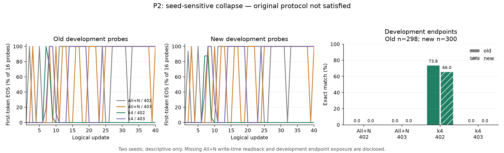

# Ubuntu P2: completed runs, protocol deviation, and seed-sensitive collapse

The four 40-update runs completed, but the independent final review finds
**NOT_ACCEPTED_UNDER_FROZEN_PROTOCOL; DESCRIPTIVE_REPORTING_ONLY**. This report
publishes the development aggregates and the adverse protocol finding under the
user's authorization. It is not a formal acceptance/release receipt, a blinded
confirmation, or a claim of stable benefit from slower old-layer updates.
The original remote terminal remains unchanged.

These are the earlier Ubuntu All+N experiments, separate from the Banking77
Llama experiments in this repository. Each seed (402 and 403) pairs the original
All+N update path with FastNew-SlowOld-k4. Both runs have the same 40-update
budget: eight new-only data updates followed by 32 old/new mixed updates. All+N
uses a single AdamW optimizer for all 261 manifest parameter tensors (252 old,
nine new). k4 updates the new tensors every update; it computes old gradients
every update, averages four raw old gradients, and jointly clips the due old
and current new gradients before their updates. The two seeds select paired
data orders; the model factory RNG is fixed at 401 and M00 is shared. These
are not independent model-initialization seeds. Precise execution identity is bound by the source,
contract and protocol hashes below; the public aggregate alone is not a complete
training-code/data release.

The cached final protocol/source metadata does not identify the exact upstream
pretrained model ID/revision or human-readable old/new dataset names/versions.
Its verified model identity is M00 checkpoint SHA-256
`26bfd21f8765bb6c1ffe546be65af7105848c2296112a26f25dd7ca9f5ead450`;
data and order identities are hash-bound in the private protocol. No model or
dataset identity is guessed from a runtime version or a neighboring experiment.
This unresolved provenance limits external reproduction and comparison.

## Results and readout definitions

Endpoint accuracy is the frozen exact-match readout on development examples:
298 old and 300 new per run. Immediate EOS-empty means EOS is the **only**
generated token, so the visible answer is empty. It differs from eventually
emitting EOS within the 12-token generation cap. Each per-update probe uses 16
old and 16 new examples, for 640 observations per role and 1,280 total
observations over 40 updates in each run.

| Arm | Seed | Old exact match | New exact match | Endpoint immediate EOS-empty, old / new |
|---|---:|---:|---:|---:|
| All+N repeat | 402 | 0/298 (0%) | 0/300 (0%) | 298/298; 300/300 |
| All+N repeat | 403 | 0/298 (0%) | 0/300 (0%) | 298/298; 300/300 |
| FastNew-SlowOld-k4 | 402 | 220/298 (73.83%) | 198/300 (66.00%) | 0/298; 0/300 |
| FastNew-SlowOld-k4 | 403 | 0/298 (0%) | 0/300 (0%) | 298/298; 300/300 |

At seed 402, k4 minus All+N is +73.83 percentage points on old and +66.00 on
new examples. At seed 403, the corresponding differences are both zero and all
endpoint answers are empty. Both seeds must remain visible: two seeds with
this contrast do not establish a stable benefit or identify the cause of
collapse. The fixed development probes are diagnostics, not 40 independent
replicates or fresh confirmation data.



Mean old/new probe first-token EOS rates are 72.50%/72.34% (All+N 402),
62.50%/62.50% (All+N 403), 4.53%/4.53% (k4 402), and 63.28%/64.06% (k4 403).
Sustained full-probe EOS begins at update 33, 40, none, and 24 respectively;
this is a defined trailing diagnostic over these 40 updates, not a claim about
behavior beyond the measured window. The k4/402 endpoint emits EOS within the
cap on 298/298 old and 296/300 new examples, while none is immediately empty.

## Completion, checkpoints, and independent disposition

The recorded work totals 160 logical updates, 4,608 training forwards and 4,608
backwards, 180 physical Adam steps, and 11,399 development forwards (5,120
fixed-probe plus 6,279 endpoint forwards). Summed recorded run time is
46,741.6 seconds, approximately 12.98 hours. No training was repeated for this
report. Systemd exited successfully, cleanup completed, and no worker or
monitor error was recorded.

All 40 checkpoint metadata records passed path, size and metadata-hash checks.
Checkpoints remain under `/mnt/dsm_workspace`; weights and checkpoint payloads
are not published. Post-hoc SHA-256 verification read all 20 All+N payloads,
700,659,302,400 bytes, and matched every frozen receipt and sidecar, with zero
retry. These checks verify the **current persisted bytes**.

The All+N writer hashed source tensor views while writing but did not read back
the destination payload before publishing it. The frozen protocol required that
immediate destination readback. Later matching hashes cannot recreate that
historical step or retroactively make the run protocol-conformant. The k4 writer
has destination readback, per-tensor/whole-stream hashes and finiteness checks
before COMMITTED; its 20 payloads were not rehashed in this follow-up. The final
independent decision therefore rejects original-protocol acceptance while
allowing this explicitly qualified descriptive interpretation.

## Development-data exposure

After all four runs had completed, a metadata inspection accidentally displayed
a truncated prefix of development endpoint records containing row identifiers,
gold labels, predictions and losses. The visible row count is unknown. The
incident was stopped and recorded; no examples are repeated in this release.
The incident record reports no tuning or selection based on the exposed values.
The completed computation was not changed by later exposure, but review is no
longer blind and these development examples must not be reused as unseen
confirmation data. The separate sealed confirmation set was not opened.

An initial local aggregation draft incorrectly defined empty output as zero
generated tokens. Source review showed that the decoder appends EOS before
stopping; the final aggregate uses `generated_tokens == 1 and eos_reached`.
The incorrect draft is preserved privately and is not used for the results here.

## Evidence and reproduction scope

The release contains only a [sanitized aggregate](../results/ubuntu-p2-descriptive/science-aggregate.json),
the [independent final disposition](../results/ubuntu-p2-descriptive/independent-final-disposition.json),
figure inputs and provenance. No per-row labels, text, outputs, token sequences,
model/data files or checkpoint tensors are included. Evidence filenames inside
the disposition identify private execution-workspace records, not bundled files.

Frozen source lock: `80def5fb4ed001b67328ee897796b7c083da9e8bb4b7871c03284b83e5803fd1`.
Contract: `28906555f8cf6255fb1caa46b6e20535e76eb020a4e971ff34782a4e65b8a83f`.
Protocol: `32554d309336fdeac82df03649421fcc4f3e8a9db7c3742a1755cc7e2cc5cd3d`.

Rebuild the figure from the public aggregate, without any private data or model:

```powershell
python tools/plot_ubuntu_p2_descriptive.py --aggregate results/ubuntu-p2-descriptive/science-aggregate.json --output-dir outputs/p2-descriptive-figures
```

The output directory must be fresh. Figure reproduction does not reproduce the
training runs or grant original-protocol acceptance. No further training or
sealed-data access is needed to preserve the conclusion above.
